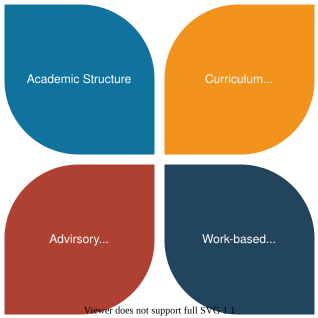

# High School CTE (Grades 11–12) & Community College Scope & Sequence (`CTE/CIS 101–202` · Units `01–21`)

**Program:** High School Career & Technical Education (Grades 11–12) & Community College Dual-Enrollment (**`CTE/CIS 101–202` · AZ CTE CIP `11.0202.00`**)  
**Model:** **2-Year / 900 Instructional Hours / 4 Semesters / 6.0 High School Credits (or 12–16 College CIS Credits)**  
**Instructional Split:** ~49% Classroom Theory & Guided Tracing / ~51% Hands-On Engineering Lab (`~443 hrs Classroom / ~457 hrs Lab`, culminating in hands-on drone build & telemetry fabrication)  
**Certification Target:** **`>= 75%` of all Quiz 1, Quiz 2 & 50-Question Mastery Exam items (`>= 38/50`)** explicitly mapped across **8 industry certifications**: `CIW-JS`, `ITS-JS`, `ITS-HTML-CSS`, `CompTIA-ITF+`, `CompTIA-A+`, `CompTIA-Sec+`, `RHCSA`, and `CCNA`  
**Pedagogical Framework:** Node.js-First Engineering Progression + Revised Bloom's Taxonomy (`L1–L6`) + Trackable SMART Goals ($\ge 5$ Student & $\ge 5$ Teacher per Unit) + Hake's $g$ Pre/Post Verification ([`blooms-taxonomy-framework.md`](./blooms-taxonomy-framework.md))  
**Core Semester Crosswalk:** Compatible 1:1 with the 18-Week (90-Day) Single-Semester Core Fast-Track ([`../roadmap.md`](../roadmap.md))

  

---

## 1. Program Overview & Node-First Philosophy

Traditional secondary and introductory college coding courses trap students inside fragile browser scripts or drag-and-drop sandboxes before teaching real systems engineering. **JavaScript First** flips that sequence by establishing **Node.js** on Day 1 as a full-stack runtime scaling all the way to embedded hardware telemetry:

1. **Runtime Mastery Before DOM Sugar:** Learners master CLI tooling, NVM, ESM vs. CommonJS boundaries (`.mjs`/`.cjs`), data types, binary/fixed-point math, immutability, Linux POSIX permissions, TDD (`node:test`), and `node:http` servers before layering Express, browser DOM, Deno/WASM, Bun SQLite + MongoDB REST, Phaser game engines, local AI pipelines, and physical flight controller telemetry.
2. **One Language Across Systems, Cloud, AI & Hardware:** JavaScript powers CLI auditors, network subnetting & Zero-Trust SIEM analyzers, Deno capability sandboxes + WebAssembly modules, SQLite + MongoDB APIs, Phaser/handheld builds, Local Multimodal AI + 3D CAD `.stl` fabrication, and binary `MSP`/`DShot` Drone Ground Control Systems.
3. **Verifiable Growth & Dual-Level Rigor:** Every unit combines a long-form `@HansOnCoding` Medium-style textbook chapter (`readme.md`) and workstation standard (`setup-guide.md`) with baseline diagnostics (`pre-unit-eval.md`), Red → Green automated `node:test` labs (`0-student_files/` via `npm run grade`), checkboxed Student & Teacher SMART Goals (`- [ ]`), **50-Question Comprehension Mastery Exams** (`quizzes/unit-test-50.*`, `1,050` items across `21` units — **`>= 75%` cert-aligned**), and authentic L5–L6 projects targeting Hake's normalized gain $g \ge 0.55$.

---

## 2. Four-Semester Course Architecture (900 Hours | HS CTE + College CIS)

| Course Code | Semester | Credits | Total Hours | Classroom Hrs | Lab Hrs | Primary Curriculum Units | AZ CTE & Industry Cert Domains |
|---|---|---:|---:|---:|---:|---|---|
| **CTE/CIS 101** | Year 1 — Sem 1 | `1.5 HS` / `3–4 CC` | `225 hrs` | `112 hrs` | `113 hrs` | **Units 01 (incl. `1.4–1.5`), 12, 04, 05, 06** | `2.0–7.0, 11.1–11.2, 11.9–11.12` • `ITS-JS`, `CompTIA ITF+/A+`, `RHCSA`, sUAS Math |
| **CTE/CIS 102** | Year 1 — Sem 2 | `1.5 HS` / `3–4 CC` | `225 hrs` | `112 hrs` | `113 hrs` | **Units 13, 14, 09, 02 (incl. `2.3–2.4`), 03, 10** | `6.4–6.7, 8.0–15.0` • `ITS-HTML-CSS`, `ITS-JS`, `CCNA`, ML Fairness & Computer Vision |
| **CTE/CIS 201** | Year 2 — Sem 3 | `1.5 HS` / `3–4 CC` | `225 hrs` | `112 hrs` | `113 hrs` | **Units 07, 15, 08, 11, 17, 18** | `1.0, 4.0, 8.3, 16.0–18.0` • `CIW-JS`, `CompTIA Sec+`, `RHCSA`, Deno/WASM, Dual-DB REST |
| **CTE/CIS 202** | Year 2 — Sem 4 | `1.5 HS` / `3–4 CC` | `225 hrs` | `107 hrs` | `118 hrs` | **Units 19, 16, 20, 21** | `19.0 + Cumulative` • Phaser/`jsgamelauncher`, SaaS, Local AI + 3D Print, **Hands-On Drone Build (`85h`: Soldering/Wiring/MSP + External FAA Portals)** |
| **TOTAL** | **4 Semesters** | **`6.0 HS`** | **`900 hrs`** | **`443 hrs`** | **`457 hrs`** | **Units 01–21 (`49` Lessons)** | **`1.0–19.0` + `8-Cert >=75%` Quiz Alignment + AI, Security & Hands-On Drone Build** |

> **Scheduling Note:** High school CTE 2.5-hour daily blocks (~180 days/yr) and college 4-credit lab-lecture schedules split roughly ~50% theory/tracing (`Classroom`) and ~50% pair programming, testing, and hardware build execution (`Lab`), shifting slightly toward hardware fabrication (`35h Class / 50h Lab`) in **Unit 21**'s culminating drone build.

---

## 3. Detailed Unit-by-Unit Scope & Sequence (`Units 01–21`)

### Year 1 — Semester 1: `CTE/CIS 101` — Node.js Foundations, Linux/Hardware Safety, Math, AI Pipelines & Core Algorithms (225 Hours)

| Unit | Title & Focus | Class Hrs | Lab Hrs | Total Hrs | CTE & Industry Stds | Key Student Lab / Project Deliverable |
|---|---|---:|---:|---:|---|---|
| **Unit 01** | Reteaching JS, Legal/Ethics, CLI/NVM, Primitives, **Modules (`1.4`)** & **Linux Admin/OS Safety (`1.5`)** | `22` | `23` | `45` | `2.1–2.4`, `3.1–3.6`, `11.1–11.9`, `A+/RHCSA/ITS-JS` | `licenseAudit.js`, `brokenModuleLab.mjs`, `posixAuditLab.mjs` (`1.5`), **Unit 1 Project:** CLI License, PII & OS Hardening Auditor |
| **Unit 12** | Computer Math, Binary/Hex, IEEE-754, Bitwise & **Drone Physics/LiPo/GSD (`12.2`)** | `20` | `20` | `40` | `4.1–4.7`, `CompTIA-ITF+`, sUAS Physics | `computerMathLab.js`, `dronePhysicsLab.mjs` (`12.2`), **Unit 12 Project:** Bitwise Permission & sUAS Flight Preflight Calc |
| **Unit 04** | Variables, Scope, Hoisting, TDZ & Immutability | `20` | `20` | `40` | `3.3, 3.6, 18.2`, `CIW-JS / ITS-JS` | `immutabilityLab.js`, `hoisting.js` analysis, **Unit 4 Project:** Immutable State Store |
| **Unit 05** | Loops, Trace Tables, Matrices, `LinkedList`, `HashTable`, Trees & **AI Data/Vectors/PII (`5.3`)** | `25` | `25` | `50` | `6.1–6.8`, `7.1–7.5`, `CIW-JS`, AI Pipeline | `loopsLab.js`, `matricesTreesLab.js`, `dataPipelineLab.mjs` (`5.3`), **Unit 5 Project:** Matrix Gradebook & AI Pipeline Engine |
| **Unit 06** | Conditionals, Boolean Truth Tables, Functions, Closures & PRNG | `25` | `25` | `50` | `5.1–5.5, 11.10–11.12`, `ITS-JS / CIW-JS` | `booleanLogicLab.js`, `functions.js`, **Unit 6 Project:** Declarative Rules Engine |
| **CTE/CIS 101 Subtotal** | **5 Core Foundation Units (`11` Lessons)** | **`112`** | **`113`** | **`225`** | **`2.0–7.0, 11.0` + `ITF+/A+/RHCSA/ITS-JS`** | **5 Verified Unit Projects + Mid-Year Portfolio Check** |

### Year 1 — Semester 2: `CTE/CIS 102` — Team Workflows, QA, ML Fairness, Subnetting/HTTP & Computer Vision (225 Hours)

| Unit | Title & Focus | Class Hrs | Lab Hrs | Total Hrs | CTE & Industry Stds | Key Student Lab / Project Deliverable |
|---|---|---:|---:|---:|---|---|
| **Unit 13** | Git, PRs, CI/CD, Node Stdlib, `npm` SemVer, ESLint/Babel & Docs | `17` | `18` | `35` | `13.1–13.5, 14.1–14.8`, `RHCSA/ITS-JS` | `changelogLab.js`, `pkgEvaluatorLab.js`, **Unit 13 Project:** OSS Release & Lint Toolkit |
| **Unit 14** | Program Analysis, SDLC, Architecture Trade-offs & ERDs | `15` | `15` | `30` | `10.1–10.10`, `CompTIA-ITF+ / A+` | `systemDesignLab.js`, **Unit 14 Project:** Full-Stack System Design Specification |
| **Unit 09** | Error Taxonomy, Debugger, TDD (`node:test`), Search/Sort, Big-O & **ML Algos/Fairness (`9.3`)** | `22` | `23` | `45` | `6.4–6.7, 12.1–12.8`, `CIW-JS / ITS-JS`, AI Fairness | `debuggingLab.test.js`, `mlMetricsAndFairnessLab.mjs` (`9.3`), **Unit 9 Project:** Algorithm & ML Fairness Test Suite |
| **Unit 02** | Protocols, Cloud, `node:http`, **Express SSR (`2.3`)** & **Subnetting/OSI/Routing (`2.4`)** | `20` | `20` | `40` | `8.1–8.6, 11.3–11.7`, `CCNA 200-301 / A+` | `templateServer.js`, `expressLab.js`, `subnetCalculatorLab.mjs` (`2.4`), **Unit 2 Project:** Multi-Route HTTP & Routing Service |
| **Unit 03** | Client-Side Web, Fetch/AJAX, Browser Storage & Containers | `15` | `15` | `30` | `9.1–9.5`, `CIW-JS / ITS-HTML-CSS / Sec+` | `fetch-exercise.html`, **Unit 3 Project:** Live API Client Dashboard |
| **Unit 10** | UCD, Wireframes, W3C HTML5, ADA/ARIA, SEO, CSS Grid, 2D Canvas & **Computer Vision (`10.3`)** | `23` | `22` | `45` | `15.1–15.11`, `ITS-HTML-CSS / CIW-JS`, AI CV | `a11ySeoLab.js`, `canvasDomLab.html`, `cvKernelAndIouLab.mjs` (`10.3`), **Unit 10 Project:** Accessible Canvas & CV App |
| **CTE/CIS 102 Subtotal** | **6 Applied Web & Engineering Units (`13` Lessons)** | **`112`** | **`113`** | **`225`** | **`6.4–6.7, 8.0–15.0` + `HTML-CSS/JS/CCNA`** | **IT Specialist (`HTML-CSS` & `JS`) + `CCNA`/`CV` Foundations** |

### Year 2 — Semester 3: `CTE/CIS 201` — Async Telemetry, Databases, OOP, Zero Trust Security, Deno/WASM & Dual-DB REST (225 Hours)

| Unit | Title & Focus | Class Hrs | Lab Hrs | Total Hrs | CTE & Industry Stds | Key Student Lab / Project Deliverable |
|---|---|---:|---:|---:|---|---|
| **Unit 07** | Async Concurrency, Event Loop, `AsyncQueue`/`AsyncTree` & **RF Telemetry/CRC-16/RTH (`7.2`)** | `18` | `17` | `35` | `18.1–18.7`, `CIW-JS / CCNA / Drone` | `asyncLab.js`, `telemetryWatchdogLab.mjs` (`7.2`), **Unit 7 Project:** Resilient Async & Telemetry Pipeline |
| **Unit 15** | Storage Architecture, Atomic File I/O, Backups, SQL & MongoDB CRUD Foundations | `22` | `23` | `45` | `16.1–16.6`, `CompTIA A+/ITF+/RHCSA` | `fileStorageLab.js`, `crudEngineLab.js`, **Unit 15 Project:** Dual Inventory CRUD Engine |
| **Unit 08** | OOP Classes, `#private`, Polymorphism, XML/JSON, SOLID, Adapter & GoF Patterns | `22` | `23` | `45` | `17.1–17.13`, `CIW-JS / ITS-JS` | `oopLab.js`, `patterns.js`, `adapterPatternDemo.test.js`, **Unit 8 Project:** Extensible OOP Plugin System |
| **Unit 11** | OWASP, TLS, `scrypt`/`AES-256-GCM` & **Zero Trust, Firewalls, SIEM & STRIDE (`11.2`)** | `20` | `20` | `40` | `1.1–1.7`, `CompTIA Sec+ / CCNA / ADE NetSec` | `cryptoSanitizeLab.js`, `firewallSiemLab.mjs` (`11.2`), **Unit 11 Project:** Security Hardening & SIEM Audit |
| **Unit 17** | **Deno Security Sandbox** (`--allow-*`, `jsr:`, `node --permission`) & **WebAssembly (`.wasm`)** | `14` | `16` | `30` | `1.3–1.4, 4.1–4.7, 11.6–11.8`, `Sec+/RHCSA/CIW-JS` | `permissionPolicyLab.mjs`, `wasmMemoryLab.mjs`, **Unit 17 Project:** Capability & WASM Sandbox Auditor |
| **Unit 18** | **Dual-DB Full REST APIs:** **Bun SQLite** (`Bun.serve`/`bun:sqlite`) & **MongoDB** (`Learn-MongoDB-4.x`) | `16` | `14` | `30` | `8.3, 11.6–11.8, 16.3–16.6`, `CIW-JS/CCNA/Sec+` | `sqliteCrudLab.mjs`, `mongoResponderLab.mjs`, **Unit 18 Project:** Dual-DB REST Service |
| **CTE/CIS 201 Subtotal** | **6 Advanced Systems & Architecture Units (`12` Lessons)** | **`112`** | **`113`** | **`225`** | **`1.0, 4.0, 8.3, 16.0–18.0` + `CIW-JS/Sec+/CCNA`** | **`CIW-JS`, `CompTIA Security+` & `RHCSA` Readiness** |

### Year 2 — Semester 4: `CTE/CIS 202` — Game Engines, SaaS Business, Agentic AI + 3D Print & Hands-On Drone Build Capstone (225 Hours)

| Unit | Title & Focus | Class Hrs | Lab Hrs | Total Hrs | CTE & Industry Stds | Key Student Lab / Project Deliverable |
|---|---|---:|---:|---:|---|---|
| **Unit 19** | **Game Engineering & Part 107 Sim:** Canvas Loop, Gamepad, **Phaser 3**, **`jsgamelauncher`** & **Part 107/METAR/Grids (`19.3`)** | `22` | `23` | `45` | `1.5, 4.3, 9.2, 15.5, 17.3, 19.8`, `CIW-JS/ITS-HTML-CSS` | `gameLoopLab.mjs`, `part107AndMetarLab.mjs` (`19.3`), **Unit 19 Project:** Handheld Game / Part 107 Flight Sim |
| **Unit 16** | Software Business, Agile Delivery, Store Fees, LTV:CAC & Unit Economics | `15` | `15` | `30` | `19.1–19.8`, `CompTIA-ITF+/CIW-JS` | `appLaunchPlanner.js`, Sprint Retrospectives & SaaS Financial Model |
| **Unit 20** | **Local Multimodal AI & 3D Print:** Ollama SSE + **NLP, ReAct HITL & Model Cards (`20.3`)** + **Parametric `.stl` 3D Print** *(feeds Unit 21 drone mounts!)* | `35` | `30` | `65` | `1.0–19.0 Cumulative`, `Sec+/CIW-JS`, Local AI | `ragAndStreamLab.mjs`, `cadPrintLab.mjs`, `nlpAgenticLab.mjs` (`20.3`), **Unit 20 Multimodal AI & 3D Print Mounts** |
| **Unit 21** | **Hands-On Drone Build Project (`Final Semester Centerpiece`):** Soldering (`315–400°C`, XT60, `1000 µF`), Crossed `UART TX↔RX` / `I2C` / `DShot`, Linux `/dev/ttyACM0` (`dialout`), Binary **MSP (`$M<`)** & Pre-Arm GCS (`~75–80%`), + Concise FAA Overview & External FAA Portals (`~20–25%`) | `35` | `50` | `85` | `1.0, 4.0, 8.0, 12.0, 18.0, 19.0` + `CompTIA A+/ITF+/Sec+`, `RHCSA`, `CCNA`, `CIW-JS`, `ITS-JS` + External FAA `TRUST/107` | `solderAndPowerLab.mjs`, `wiringAndMspLab.mjs`, `faaComplianceLab.mjs`, **Unit 21 Project:** Smoke-Safe Quadcopter Stack + Node.js GCS CLI |
| **CTE/CIS 202 Subtotal** | **4 Synthesis, Game, AI & Hands-On Drone Build Units (`13` Lessons)** | **`107`** | **`118`** | **`225`** | **Cumulative `1.0–19.0` + 8-Cert Quiz Readiness + External FAA Portals** | **Live Quadcopter Bench & GCS Defense + Full-Stack Portfolio** |

---

## 4. 8-Certification Assessment Matrix (`>= 75%` Quiz Alignment Across All 21 Units)

Every unit's **Quiz 1 (`quiz-1-concepts.md`)**, **Quiz 2 (`quiz-2-application.md`)**, and **50-Question Mastery Exam (`unit-test-50-answer-key.md`)** guarantees at least **`75%` (`>= 38/50` questions)** directly tagged (`Cert: <TOKEN>`) to testable domains across these **8 certifications** (enforced automatically via `tools/verify.mjs`):

| Token | Official Certification | Core Domains Mapped Across Units `01–21` |
|---|---|---|
| **`CIW-JS`** | **CIW JavaScript Specialist** | Primitives, scope/hoisting, closures, async Promises/Event Loop, OOP/classes, JSON/DOM/AJAX, security hygiene, binary `Buffer` & state machines |
| **`ITS-JS`** | **IT Specialist: JavaScript (`OD 302`)** | Data types, operators, conditionals, loops, arrays/maps, functions, ESM vs CJS modules, `node:test` boundary assertions, error handling |
| **`ITS-HTML-CSS`** | **IT Specialist: HTML and CSS (`OD 301`)** | Semantic HTML5 landmarks, W3C validation, WCAG 2.1/ARIA accessibility, SEO metadata, responsive CSS Grid/Flexbox, Canvas & Web telemetry UI |
| **`CompTIA-ITF+`** | **CompTIA IT Fundamentals+ (`FC0-U61`)** | Binary/hex/units, SDLC & software concepts, relational SQL vs document NoSQL storage, licensing/privacy ethics, security triad, troubleshooting logic |
| **`CompTIA-A+`** | **CompTIA A+ (`220-1101/1102`)** | ESD/PPE safety, PSU/Ohm's law/battery hazards, RAM/SSD/NVMe & 3-2-1 backups, hardware buses (`UART/I2C/USB`), continuity testing, mobile/wireless hardware |
| **`CompTIA-Sec+`** | **CompTIA Security+ (`SY0-701`)** | CIA Triad, `scrypt`/`AES-256-GCM`/TLS, OWASP Top 10, Zero Trust `VLAN/DMZ`, ordered firewall ACLs, `SIEM` anomaly correlation, `STRIDE`, least privilege & DRP |
| **`RHCSA`** | **Red Hat Certified System Administrator (`EX200`)** | POSIX permissions (`rwx`/`chmod`/`umask`), `dialout`/device group access (`/dev/ttyACM0`), processes/systemd/cron, SELinux, SSH hardening, shell/CLI pipelines |
| **`CCNA`** | **Cisco Certified Network Associate (`200-301`)** | OSI vs TCP/IP models, `IPv4 CIDR/VLSM`, routing/switching/STP, IANA ports, DNS/HTTP/REST/MQTT, Wi-Fi/RF spectrum (`2.4/5.8 GHz / 900 MHz`), serial baud framing |

### External FAA Drone Certifications & Curated Portals (`Unit 21` + Units `12.2 / 7.2 / 19.3`)
While Unit 21 prioritizes **hands-on soldering, flight controller wiring, and JavaScript telemetry code (`~75–80%`)**, students and instructors also receive direct external links to earn official FAA credentials:
- **FAA `TRUST` Certificate *(Free Hobby Knowledge Test)*:** <https://www.faa.gov/uas/recreational_flyers/knowledge_test_updates>
- **FAA Part 107 Study Guide (`FAA-G-8082-22`):** <https://www.faa.gov/regulations_policies/handbooks_manuals/aviation>
- **Part 107 Airman Certification Standards (`FAA-S-ACS-10B`):** <https://www.faa.gov/training_testing/testing/acs>
- **FAADroneZone Portal *(Registration & Remote ID)*:** <https://faadronezone.faa.gov/>
- **IACRA Pilot Application Portal:** <https://iacra.faa.gov/>
- **eCFR `14 CFR Part 107` & `Part 89` Legal Text:** <https://www.ecfr.gov/current/title-14/chapter-I/subchapter-F/part-107>
- **B4UFLY & LAANC Airspace / NOAA Aviation Weather:** <https://www.faa.gov/uas/getting_started/b4ufly> · <https://aviationweather.gov/>

---

## 5. High School Dual-Enrollment & Community College CIS Articulation

### Community College Computer Information Systems (`CIS`) Dual-Credit Alignment
Students completing **`CTE/CIS 101–202`** (`Units 01–21`) satisfy foundational High School CTE (Grades 11–12) and introductory Community College CIS competencies (including Maricopa / Estrella Mountain Community College equivalents):
- **`CTE/CIS 101` & `CTE/CIS 102` (Year 1):** Align cleanly with introductory college CIS & web engineering courses (**CIS105** Survey of CIS, **CIS126** Linux Operating Systems, **CIS133DA** Web Development I, **CIS166AA** JavaScript Scripting).
- **`CTE/CIS 201` & `CTE/CIS 202` (Year 2):** Align with intermediate backend/database development, network security, and hardware capstone courses (**CIS119DO / CIS233DA**, **CIS276DB** SQL/NoSQL Databases, Linux/Security+, and Systems/sUAS Capstone Practicum).

### Four-Year Technology & Engineering Articulation
Graduates exporting a verified GitHub portfolio (`Units 01–21`)—including `npm run grade` passing lab/project suites, Model Cards (`20.3`), `.stl` 3D mounts (`20.2`), smoked-tested wiring pinouts + binary MSP GCS (`21`), and `post-unit-eval.md` gain records ($g \ge 0.55$)—demonstrate direct transfer readiness for university **Computer Science**, **Software Engineering**, **Cybersecurity**, **Game Programming**, **Artificial Intelligence**, and **Robotics / Autonomous Systems** degree tracks.

---

## 6. CTSO Competitive Events: FBLA, SkillsUSA & CyberPatriot

| Competitive Event / Pathway | Primary Curriculum Units | Direct Portfolio / Competition Artifact |
|---|---|---|
| **FBLA Coding & Programming / Computer Problem Solving** | **Units 04–09, 12, 14–15, 17** | Node/Deno CLI/UI apps, `node:test` TDD specs, WASM memory tuning, clean architecture README |
| **FBLA Website Coding & Development / UX** | **Units 02 (`2.3` SSR), 03, 10, 15, 18** | Express/Node SSR templates, Bun SQLite & MongoDB REST APIs, WCAG/ARIA accessibility, SEO metadata |
| **FBLA Computer Game & Simulation Programming** | **Units 05, 06, 12, 19** | 4:3 Canvas `dt` loops, seeded PRNG, Phaser 3 scenes, `jsgamelauncher` handhelds & Part 107 sims |
| **FBLA Data Science, AI & Software Entrepreneurship** | **Units 05 (`5.3`), 09 (`9.3`), 10 (`10.3`), 16, 20** | Feature vectors, `4/5ths` fairness audits, CV kernels, ReAct HITL agents, SaaS LTV:CAC & 3D Print Capstone |
| **CyberPatriot & SkillsUSA Cybersecurity / Network Design** | **Units 01 (`1.5`), 02 (`2.1, 2.4`), 11 (`11.1–11.2`), 17** | POSIX/SSH hardening, CIDR/VLSM VLSM plans, Zero Trust `VLAN/DMZ`, ordered firewalls & `SIEM` alerts |
| **SkillsUSA Mobile Robotics / Commercial sUAS / Electronics** | **Units 12 (`12.2`), 07 (`7.2`), 19 (`19.3`), 21 (`21.1–21.3`)** | Props-off XT60/`1000 µF` soldering, DMM continuity/smoke-stopper gates, crossed `UART`/`I2C`, MSP codecs & external FAA checkoffs |

---

## 7. AZ CTE Professional Skills (`1.0–9.0`) & CTE Four-Pillar Integration

Aligned with [`CTE.svg`](./CTE.svg):
1. **Academic Structure:** Explicit Bloom's `L1–L6` progression, Pre/Post Hake's $g$ growth tracking, `>= 5` Student & Teacher SMART Goals per unit, `21 × 50-Q` comprehension exams (`>= 75%` mapped to 8 industry certifications), and dual High School/Community College CIS pacing.
2. **Curriculum & Instruction:** Node-first open-source `@HansOnCoding` textbook (`readme.md` + `setup-guide.md`) + `52` Reveal.js slide decks + `63` Kahoot CSVs + zero-spoiling `0-student_files/` (`62` active `node:test` suites via `npm run grade`).
3. **Advisory Board:** Industry practitioner review of `Unit 14` system specs, `Unit 11`/`17` security audits, `Unit 20` AI Model Cards, and `Unit 21` hands-on drone build + GCS safety sign-offs.
4. **Work-Based Learning (WBL):** Git PR sprints (`Unit 13`), FBLA/SkillsUSA/CyberPatriot events, physical bench team roles (`Soldering Tech / Wiring QA / GCS Lead`), and live Showcase Day demonstrations (`Unit 21`).

---

## 8. 1-Semester (18-Week / 90-Day) Core Fast-Track Pacing Crosswalk

Schools offering **JavaScript First** as a single-semester **90-day × 50-minute** accelerated High School or College semester follow [`../roadmap.md`](../roadmap.md) across **Units `01–16`**, with optional Year 2 / capstone extensions across **Units `17–21`**:

| Quarter & Weeks | Days | Core Unit | 2-Year Sequence Equivalent | Accelerated Focus & Assessment Gate |
|---|---|---|---|---|
| **Q1 · Wks 1–2** | `1–7` | **Unit 01:** Reteaching JS, Legal/Ethics, Types, Modules & Linux Safety | `CTE/CIS 101` Unit 01 | CLI, NVM, MIT/GPL/Privacy, 7 Primitives, ESM vs CJS (`1.4`), POSIX/Safety (`1.5`), Unit 1 Project |
| **Q1 · Wks 2–3** | `8–12` | **Unit 12:** Computer Math, Binary & Drone Physics | `CTE/CIS 101` Unit 12 | Binary/Hex, GEMA, bitwise flags (`4.0`), LiPo 80% DoD, Haversine & GSD (`12.2`) |
| **Q1 · Wks 3–4** | `13–17` | **Unit 04:** Variables, Scope & Immutability | `CTE/CIS 101` Unit 04 | `const`/`let`, TDZ, `===`, `Object.freeze`, `structuredClone` (`3.3, 3.6`) |
| **Q1 · Wks 4–5** | `18–24` | **Unit 05:** Loops, Arrays, Matrices, Trees & AI Data Cleaning | `CTE/CIS 101` Unit 05 | Trace tables, recursion, `Map`, Stack/Queue, 2D grids, vectors, PII & scaling (`5.3`) |
| **Q2 · Wk 6** | `25–29` | **Unit 06:** Conditionals, Boolean Logic & Functions | `CTE/CIS 101` Unit 06 | Truth tables, closures, currying, seeded PRNG (`5.0, 11.10–11.12`) |
| **Q2 · Wk 7** | `30–34` | **Unit 13:** Version Control, Stdlib, `npm`, ESLint & Docs | `CTE/CIS 102` Unit 13 | Git PRs, CI/CD, SemVer, lint/transpile tooling, READMEs (`13.0, 14.0`) |
| **Q2 · Wk 8** | `35–39` | **Unit 14:** Program Analysis, SDLC & Design | `CTE/CIS 102` Unit 14 | SDLC, stack trade-offs, ERD, feasibility (`10.0`) |
| **Q2 · Wk 9** | `40–45` | **Unit 09:** Testing, Debugging, Search/Sort, Big-O & ML Fairness | `CTE/CIS 102` Unit 09 | 4 error types, breakpoints, `node:test`, Binary/Dijkstra, Confusion Matrix & `4/5ths` (`9.3`) |
| **Q3 · Wk 10** | `46–51` | **Unit 02:** Protocols, Cloud, `node:http`, Express SSR & Subnetting | `CTE/CIS 102` Unit 02 | HTTP/TLS, `node:http`, Express SSR (`2.3`), OSI, CIDR/VLSM & 7-Step Triage (`2.4`) |
| **Q3 · Wk 11** | `52–56` | **Unit 03:** Client-Side Web, AJAX/Fetch & Containers | `CTE/CIS 102` Unit 03 | Fetch API, SPA vs SSR, browser storage, Docker/K8s (`9.0`) |
| **Q3 · Wk 12** | `57–61` | **Unit 07:** Async JS, Event Loop & Telemetry Fail-Safes | `CTE/CIS 201` Unit 07 | Microtasks vs Macrotasks, `Promise.allSettled`, `AsyncQueue`, CRC-16/PID/RTH (`7.2`) |
| **Q3 · Wk 13** | `62–67` | **Unit 15:** Storage Architecture, File I/O & Databases | `CTE/CIS 201` Unit 15 | Memory tiers, atomic File I/O, 3-2-1 backups, SQL/MongoDB CRUD (`16.0`) |
| **Q4 · Wks 14–15** | `68–74` | **Unit 10:** UCD, Accessibility, CSS Grid, Canvas & Computer Vision | `CTE/CIS 102` Unit 10 | W3C HTML5, ADA/ARIA, SEO, Canvas, $3\times3$ Sobel kernels, IoU & Edge NPU (`10.3`) |
| **Q4 · Wks 15–16** | `75–80` | **Unit 08:** OOP, XML/JSON, SOLID, Adapter & Patterns | `CTE/CIS 201` Unit 08 | Classes, `#private`, polymorphism, SOLID, Adapter/GoF patterns (`17.0`) |
| **Q4 · Wk 17** | `81–85` | **Unit 11:** Cybersecurity, OWASP, TLS & Zero Trust Firewalls/SIEM | `CTE/CIS 201` Unit 11 | CIA Triad, OpenSSL/TLS, `scrypt`, `AES-256-GCM`, Zero Trust, `VLAN/DMZ`, SIEM (`11.2`) |
| **Q4 · Wk 18** | `86–90` | **Unit 16:** Software Business, Agile & Semester Capstone | `CTE/CIS 202` Units 16/20/21 | Agile sprint, store fees, LTV:CAC, Semester Capstone Defense (`19.0`) |

---

## 9. Cross-Program Technical Standards Matrix (`Software · AI · IT Security · Hands-On Drone`)

| Domain Track & Official Reference | Core Technical Competencies Covered | Mapped Lessons & Labs |
|---|---|---|
| **Software & App Design (`AZ CTE CIP 11.0202.00`, Stds `1.0–19.0`)** | CLI/NVM, ESM/CJS boundaries, Primitives & Immutability, Binary/Hex, Boolean Logic, Loops & Structures, Git/CI, SDLC, `node:test`, HTTP/Express SSR, Fetch/DOM/Canvas/CSS, Async Queues, SQLite + MongoDB REST, OOP/SOLID, Deno/WASM, Phaser 3 & Agile SaaS | **Units 01–20 Core** (`1.1–1.4`, `2.1–2.3`, `3–6`, `7.1`, `8`, `9.1–9.2`, `10.1–10.2`, `11.1`, `12.1`, `13–19.2`, `20.1–20.2`) |
| **Applied Artificial Intelligence (`11.0102.00`)** | AI vs ML vs DL, Ethics & Governance (`NIST/EU AI Act/Model Cards`), CPU/GPU/TPU/NPU hardware, CSV/JSON cleaning, PII masking, Cosine vectors, OLS/Logistic/`k`-Means, Confusion Matrices & `4/5ths` Fairness, Sobel `3×3` & `IoU`, `TF-IDF`/NER/RAG, ReAct HITL Loops & 3D CAD | [**5.3**](../05-DataStructures-and-Loops/03-Data-Cleaning-Vectors-and-Feature-Engineering/readme.md) • [**9.3**](../09-Debugging-TDD-Algorithms/03-Machine-Learning-Algorithms-Eval-and-Fairness/readme.md) • [**10.3**](../10-HTML-CSS-DOM/03-Computer-Vision-Pixels-Convolutions-and-IoU/readme.md) • [**20.1**](../20-Local-AI-Multimodal-and-3D-Capstone/01-Local-LLM-Architecture-and-Streaming/readme.md) • [**20.2**](../20-Local-AI-Multimodal-and-3D-Capstone/02-Multimodal-Voice-Vision-and-3D-Print-Capstone/readme.md) • [**20.3**](../20-Local-AI-Multimodal-and-3D-Capstone/03-NLP-Pipelines-Agentic-AI-and-Responsible-Governance/readme.md) |
| **Hands-On Drone Hardware, Flight Telemetry & External FAA (`49.0199.00` + `Part 107/89`)** | Props-off safety, Soldering (`315–400°C`, XT60, `1000 µF` cap), Continuity & Smoke Stoppers, Crossed `UART TX↔RX`, `I2C`, `DShot`, Linux `/dev/ttyACM0`, Binary `MSP ($M<)`, Pre-Arm GCS State Machine, LiPo `80% DoD`, `TWR`, Haversine/`GSD`, `CRC-16`/PID/RTH + Concise FAA Regs & External FAA Portals | [**12.2**](../12-Computer-Math-and-Binary/02-Drone-Flight-Physics-LiPo-and-Geodesic-Math/readme.md) • [**7.2**](../07-Async-JS/02-Telemetry-FailSafe-and-Sensor-Streams/readme.md) • [**19.3**](../19-Game-Dev-Phaser-and-JSGameLauncher/03-Drone-Mission-Sim-Part107-and-METAR/readme.md) • [**21.1–21.3 (Capstone Build)**](../21-Hands-On-Drone-Build-Soldering-Wiring-and-Flight-Code/readme.md) |
| **IT & Network Security ([`ADE Network Security 1.0–11.0`](https://www.azed.gov/sites/default/files/2024/08/NetworkSecurityIF.pdf) + `Sec+/RHCSA/CCNA`)** | ESD/OSHA/EPA disposal, Linux POSIX `rwx`/sticky/`dialout`, `cron`/`systemd`/SELinux/OpenSSH, OSI vs TCP/IP, `IPv4 CIDR/VLSM`, IANA Ports, STP, 7-Step Triage, `STRIDE`, `VLAN/DMZ`, Ordered ACLs, `SIEM` correlation, `DRP` (`RPO/RTO`) & Deno Capability Sandboxes | [**1.5**](../01-Reteaching-JavaScript/05-Linux-Admin-Hardware-and-OS-Safety/readme.md) • [**2.1**](../02-HTTP/01-Internet-Protocols-and-Cloud/readme.md) • [**2.4**](../02-HTTP/04-Subnetting-OSI-Topologies-and-Routing/readme.md) • [**11.1**](../11-Internet-Server-Security/readme.md) • [**11.2**](../11-Internet-Server-Security/02-Zero-Trust-Firewalls-SIEM-and-STRIDE/readme.md) • [**17.1**](../17-Deno-Security-and-WebAssembly/01-Deno-Secure-Runtime/readme.md) |
