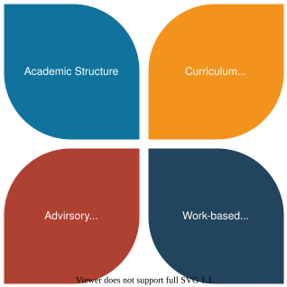

# West-MEC Coding (CIP 11.0202.00) — Node-First Scope & Sequence (Units 01–20)

**Program:** West-MEC Coding / Software and App Design (**AZ CTE CIP `11.0202.00`**)  
**Model:** **2-Year / 900 Instructional Hours / 4 Semesters / 6.0 High School Credits** (`CO101`, `CO102`, `CO201`, `CO202`)  
**Instructional Split:** ~50% Classroom Theory & Guided Tracing / ~50% Hands-On Engineering Lab (`~450 hrs Classroom / ~450 hrs Lab`)  
**Pedagogical Framework:** Node.js-First Engineering Progression + Revised Bloom's Taxonomy (`L1`–`L6`) + Trackable SMART Goals ($\ge 5$ Student & $\ge 5$ Teacher per Unit) + Hake's $g$ Pre/Post Verification ([`blooms-taxonomy-framework.md`](./blooms-taxonomy-framework.md))  
**Core Semester Crosswalk:** Compatible 1:1 with the 18-Week (90-Day) Core Fast-Track ([`../roadmap.md`](../roadmap.md))

  

---

## 1. Program Overview & Node-First Philosophy

Traditional high school coding tracks start learners inside fragile browser scripts or drag-and-drop GUIs before teaching computational rigor. **JavaScript First** flips that sequence by establishing **Node.js** on Day 1 as a real systems runtime:

1. **Runtime Mastery Before DOM Sugar:** Students learn CLI navigation, NVM, ESM vs. CommonJS module boundaries (`.mjs`/`.cjs`), data types, binary/fixed-point math, immutability, TDD (`node:test`), and `node:http` request/response engineering before adding Express, browser DOM, Deno/WASM, Bun, MongoDB, Phaser, or local AI pipelines.
2. **One Language Across the Entire Modern Stack:** JavaScript/ECMAScript powers CLI tooling, HTTP/SSR servers, async queues, SQLite + MongoDB REST APIs, Deno capability sandboxes + WebAssembly binaries, Phaser/handheld games, and full-stack Local Multimodal AI + Parametric 3D CAD applications.
3. **Verifiable Growth & Dual-Audience Rigor:** Every unit pairs baseline diagnostics (`pre-unit-eval.md`), blank student labs (`0-student_files/`), trackable Student & Teacher SMART Goals (`- [ ]`), and L5–L6 projects with Bloom's-aligned teacher keys (`eval-answer-key.md`) targeting Hake's normalized gain $g \ge 0.55$.

---

## 2. Four-Semester Course Architecture (900 Hours | 6.0 HS Credits)

| Course Code | Semester | Credits | Total Hours | Classroom Hours (~50%) | Lab Hours (~50%) | Primary Curriculum Units | AZ CTE Standards (`1.0–19.0`) & Focus |
|---|---|---:|---:|---:|---:|---|---|
| **CO101** | Year 1 — Sem 1 | `1.5` | `225 hrs` | `112 hrs` | `113 hrs` | **Units 01 (incl. `1.4`), 12, 04, 05, 06** | `2.0, 3.0, 4.0, 5.0, 6.1–6.3, 6.5, 6.8, 7.0, 11.1–11.2, 11.9–11.12` |
| **CO102** | Year 1 — Sem 2 | `1.5` | `225 hrs` | `112 hrs` | `113 hrs` | **Units 13, 14, 09, 02 (incl. `2.3`), 03, 10** | `6.4, 6.6–6.7, 8.0, 9.0, 10.0, 11.3–11.8, 12.0, 13.0, 14.0, 15.0` |
| **CO201** | Year 2 — Sem 3 | `1.5` | `225 hrs` | `112 hrs` | `113 hrs` | **Units 07, 15, 08, 11, 17, 18** | `1.0, 4.0, 8.3, 11.6–11.8, 16.0, 17.0, 18.0` (Async, DBs, OOP, TLS/AES, **Deno & WASM**, **Bun SQLite & MongoDB REST**) |
| **CO202** | Year 2 — Sem 4 | `1.5` | `225 hrs` | `113 hrs` | `112 hrs` | **Units 19, 16, 20** | `19.0` + **Phaser 3 & `jsgamelauncher`**, SaaS Economics, Cert Prep, WBL & **Local Multimodal AI + 3D CAD Capstone (`1.0–19.0`)** |
| **TOTAL** | **4 Semesters** | **`6.0`** | **`900 hrs`** | **`449 hrs (49.9%)`** | **`451 hrs (50.1%)`** | **Units 01–20 (36 Lessons)** | **Full 1.0–19.0 Technical + Prof. Skills 1.0–9.0** |

> **Scheduling Note:** Under West-MEC's standard 2.5-hour daily block schedule (~180 instructional days per year = 450 hrs/year), ~75 minutes/day are dedicated to direct instruction, live tracing, code critiques, and assessments (`Classroom`), and ~75 minutes/day to independent/pair programming, debugging, Git workflows, and project builds (`Lab`).

---

## 3. Detailed Unit-by-Unit Scope & Sequence (`Units 01–20`)

### Year 1 — Semester 1: `CO101` — Node.js Foundations, Module Standards, Computer Math & Core Algorithms (225 Hours)

| Unit | Title & Focus | Classroom Hrs | Lab Hrs | Total Hrs | AZ CTE Technical Standards | Key Student Lab / Project Deliverable |
|---|---|---:|---:|---:|---|---|
| **Unit 01** | Reteaching JS, Legal/Ethical IT, CLI/NVM, Primitives & **Module Standards (`1.4` `.mjs`/`.cjs`)** | `22` | `23` | `45` | `2.1–2.4`, `3.1–3.2, 3.4–3.6`, `11.1–11.2, 11.6–11.9` | `licenseAudit.js`, `brokenModuleLab.mjs` (`1.4`), **Unit 1 Project:** CLI Package License & PII Auditor |
| **Unit 12** | Computer Math, Binary/Hex, IEEE-754 & Bitwise Masks | `20` | `20` | `40` | `4.1–4.7` | `computerMathLab.js`, `pythagoreanDemo.js`, **Unit 12 Project:** Bitwise Permission Calculator |
| **Unit 04** | Variables, Scope, Hoisting, TDZ & Immutability | `20` | `20` | `40` | `3.3, 3.6`, `18.2` | `immutabilityLab.js`, `hoisting.js` analysis, **Unit 4 Project:** Immutable State Store |
| **Unit 05** | Loops, Trace Tables, Recursion, Arrays, Matrices, `LinkedList`, `HashTable`, `BitSet` & Trees | `25` | `25` | `50` | `6.1–6.3, 6.5, 6.8`, `7.1–7.5` | `loopsLab.js`, `classicStructuresLab.js`, `matricesTreesLab.js`, **Unit 5 Project:** Matrix Gradebook Engine |
| **Unit 06** | Conditionals, Boolean Truth Tables, Functions, Closures & PRNG | `25` | `25` | `50` | `5.1–5.5`, `11.10–11.12` | `booleanLogicLab.js`, `functions.js`, **Unit 6 Project:** Declarative Rules Engine |
| **CO101 Subtotal** | **5 Core Foundation Units** | **`112`** | **`113`** | **`225`** | **`2.0–7.0, 11.0, 18.2`** | **5 Verified Unit Projects + Mid-Year Portfolio Check** |

### Year 1 — Semester 2: `CO102` — Engineering Workflows, QA, HTTP/Express SSR & Accessible UI (225 Hours)

| Unit | Title & Focus | Classroom Hrs | Lab Hrs | Total Hrs | AZ CTE Technical Standards | Key Student Lab / Project Deliverable |
|---|---|---:|---:|---:|---|---|
| **Unit 13** | Git, PRs, CI/CD, Node Stdlib, `npm` SemVer, ESLint/Babel & Docs | `17` | `18` | `35` | `13.1–13.5`, `14.1–14.8` | `changelogLab.js`, `pkgEvaluatorLab.js`, **Unit 13 Project:** OSS Release & Lint Toolkit |
| **Unit 14** | Program Analysis, SDLC, Architecture Trade-offs & ERDs | `15` | `15` | `30` | `10.1–10.10` | `systemDesignLab.js`, **Unit 14 Project:** Full-Stack System Design Specification |
| **Unit 09** | Error Taxonomy, Live Debugger, TDD (`node:test`), Search/Sort, Big-O, Dijkstra/Huffman | `22` | `23` | `45` | `6.4, 6.6–6.7`, `12.1–12.8`, `11.14` | `debuggingLab.test.js`, `sortSearchLab.test.js`, **Unit 9 Project:** Algorithm & Graph Test Suite |
| **Unit 02** | Protocols, Cloud (`SaaS/PaaS/IaaS/FaaS`), `node:http` & **Express + Modular SSR (`2.3`)** | `20` | `20` | `40` | `8.1–8.6`, `11.3–11.7`, `18.3` | `protocolLab.js`, `templateServer.js`, `expressLab.js` (`2.3`), **Unit 2 Project:** Multi-Route HTTP/SSR Service |
| **Unit 03** | Client-Side Web, Fetch/AJAX, Browser Storage & Containers | `15` | `15` | `30` | `9.1–9.5` | `fetch-exercise.html`, **Unit 3 Project:** Live API Client Dashboard |
| **Unit 10** | UCD, Wireframes, W3C HTML5, ADA/ARIA, SEO, CSS Grid, 2D Canvas & DOM | `23` | `22` | `45` | `15.1–15.11` | `a11ySeoLab.js`, `canvasDomLab.html`, **Unit 10 Project:** Accessible Interactive Canvas App |
| **CO102 Subtotal** | **6 Applied Web & Engineering Units** | **`112`** | **`113`** | **`225`** | **`6.4–6.7, 8.0–15.0`** | **IT Specialist OD 301 (HTML/CSS) & OD 302 (JS) Readiness** |

### Year 2 — Semester 3: `CO201` — Concurrency, Databases, OOP, Security, Deno/WASM & Dual-DB REST (225 Hours)

| Unit | Title & Focus | Classroom Hrs | Lab Hrs | Total Hrs | AZ CTE Technical Standards | Key Student Lab / Project Deliverable |
|---|---|---:|---:|---:|---|---|
| **Unit 07** | Async Concurrency, Event Loop, `Promise.allSettled`, `AsyncQueue`/`AsyncTree` & Severity | `18` | `17` | `35` | `18.1–18.7`, `16.3` | `asyncLab.js`, `asyncQueueAndTreeDemo.test.js`, **Unit 7 Project:** Resilient Async Pipeline |
| **Unit 15** | Storage Architecture, Atomic File I/O, Backups, SQL & MongoDB CRUD Foundations | `22` | `23` | `45` | `16.1–16.6` | `fileStorageLab.js`, `crudEngineLab.js`, **Unit 15 Project:** Dual Inventory CRUD Engine |
| **Unit 08** | OOP Classes, `#private`, Polymorphism, XML/JSON, SOLID, Adapter & GoF Patterns | `22` | `23` | `45` | `17.1–17.13` | `oopLab.js`, `patterns.js`, `adapterPatternDemo.test.js`, **Unit 8 Project:** Extensible OOP Plugin System |
| **Unit 11** | OWASP Top 10, CIA Triad, TLS/HTTPS Certs, `scrypt` & AES-256-GCM | `20` | `20` | `40` | `1.1–1.7` | `cryptoSanitizeLab.js`, `secureServer.js`, **Unit 11 Project:** Security Hardening Audit |
| **Unit 17** | **Deno Security Sandbox** (`--allow-*`, `jsr:`, `node --permission`) & **WebAssembly (`.wasm`)** | `14` | `16` | `30` | `1.3–1.4, 4.1–4.7, 11.6–11.8, 13.1` | `permissionPolicyLab.mjs`, `wasmMemoryLab.mjs`, **Unit 17 Project:** Capability & WASM Sandbox Auditor |
| **Unit 18** | **Dual-DB Full REST APIs:** **Bun SQLite** (`Bun.serve`/`bun:sqlite`) & **MongoDB** (`Learn-MongoDB-4.x`) | `16` | `14` | `30` | `8.3, 11.6–11.8, 16.3–16.6, 17.1–17.13` | `sqliteCrudLab.mjs`, `mongoResponderLab.mjs` (`JSend`/`JSON:API`/`HAL+JSON`, `$lookup`), **Unit 18 Project:** Dual-DB REST Service |
| **CO201 Subtotal** | **6 Advanced Systems & Architecture Units** | **`112`** | **`113`** | **`225`** | **`1.0, 4.0, 8.3, 16.0–18.0`** | **IT Specialist OD 306 (HTML5) & CIW JavaScript Specialist Readiness** |

### Year 2 — Semester 4: `CO202` — Game Engines, SaaS Business, Local Multimodal AI & 3D CAD Capstone (225 Hours)

| Unit | Title & Focus | Classroom Hrs | Lab Hrs | Total Hrs | AZ CTE Technical Standards | Key Student Lab / Project Deliverable |
|---|---|---:|---:|---:|---|---|
| **Unit 19** | **Game Engineering:** 4:3 Canvas Loop, Web Audio, Gamepad API, **Phaser 3** & **`jsgamelauncher`** | `35` | `35` | `70` | `1.5, 4.3, 9.2, 11.7, 15.5, 17.3, 19.8` | `gameLoopLab.mjs`, `.jsg` / `npx rungame`, `vm.SourceTextModule`, **Unit 19 Project:** Handheld Arcade Game |
| **Unit 16** | Software Business, Agile Delivery, Store Fees, LTV:CAC & Unit Economics | `23` | `22` | `45` | `19.1–19.8` | `appLaunchPlanner.js`, Sprint Retrospectives & SaaS Financial Model |
| **Unit 20** | **Final AI Capstone:** Full-Stack Local Multimodal AI (**Voice/Text Core**, **Image/Video Bonus**, **Parametric 3D CAD `.stl`/`.obj` & 3D Print Double Bonus**) + Cert Prep & WBL | `55` | `55` | `110` | **`1.0–19.0` Cumulative** (`1.5, 2.3–2.4, 4.1–4.3, 8–9, 15–19`) | `ragAndStreamLab.mjs`, `voiceVisionLab.mjs`, `cadPrintLab.mjs` + **Unit 20 Multimodal AI & 3D Print Showcase** |
| **CO202 Subtotal** | **3 Synthesis, Game, Business & AI Capstone Units** | **`113`** | **`112`** | **`225`** | **`19.0 + Cumulative 1.0–19.0`** | **Local AI + 3D Print Capstone + Industry Credentials + Portfolio Defense** |

---

## 4. Industry Credentials Alignment

| Credential | Issuing Body | Target Course / Timing | Curriculum Units Mapped | Technical Exam Domains Covered |
|---|---|---|---|---|
| **IT Specialist: HTML and CSS (`OD 301`)** | Certiport / Pearson VUE | End of **CO102** (Year 1, Sem 2) | **Units 02 (`2.2–2.3`), 10 (`10.1–10.2`)** | Semantic HTML5 (`15.3–15.4`), Accessibility/ARIA (`15.6`), Responsive CSS Grid/Flexbox (`15.7–15.8`), Box Model |
| **IT Specialist: JavaScript (`OD 302`)** | Certiport / Pearson VUE | End of **CO102** / Early **CO201** | **Units 01 (`1.1–1.4`), 04, 05, 06, 09, 10, 12** | Operators, Scope/Hoisting, Control Flow, Functions/Closures, Module Exports, Arrays/Objects, DOM & Error Handling |
| **IT Specialist: HTML5 Application Development (`OD 306`)** | Certiport / Pearson VUE | **CO201–CO202** (Year 2) | **Units 03, 07, 10, 15, 19** | Application Lifecycle, 2D Canvas & SVG (`15.9`), Web Storage (`9.4`), Async Fetch, Touch/Gamepad UI |
| **CIW JavaScript Specialist** | Certification Partners (CIW) | **CO201–CO202** (Year 2) | **Units 01–12, 15, 17, 18** | Core JS Syntax, OOP & Prototypes, Asynchronous Requests/AJAX, Security Hygiene, WASM/REST Debugging |

---

## 5. Dual Enrollment & University Articulation Notes

### Maricopa Community Colleges / Estrella Mountain Community College (EMCC) Dual Enrollment
Students enrolled in West-MEC Coding (`CO101`–`CO202`) align with foundational Maricopa County Community College District (**MCCCD / EMCC**) Computer Information Systems (**CIS**) competencies:
- **`CO101`–`CO102` Alignment:** Maps cleanly to introductory programming, HTML/CSS web authoring, and client-side JavaScript scripting sequences (e.g., **CIS105** Survey of Computer Information Systems, **CIS133DA** Internet/Web Development Level I, and **CIS166AA** Introduction to JavaScripting).
- **`CO201`–`CO202` Alignment:** Maps to intermediate web scripting, database CRUD fundamentals (SQL + MongoDB in Units `15` & `18`), and software engineering design principles (e.g., **CIS119DO / CIS233DA** Web Development Level II, **CIS276DB** SQL/NoSQL Database concepts, and Capstone practicum).
- *Administrative Action:* Instructors and West-MEC counselors verify current **EMCC/MCCCD Dual Enrollment** course numbers, instructor credentialing, and placement prerequisites each spring prior to fall registration.

### University of Advancing Technology (UAT) Articulation
- **Pathway Alignment:** West-MEC Coding completers who maintain a verified GitHub portfolio (`Units 01–20`), pass the `post-unit-eval.md` mastery gates ($g \ge 0.55$), complete their trackable SMART Goal logs, and defend their **Unit 16 / Unit 19 / Unit 20 Capstone** before industry advisors satisfy articulated introductory competencies for UAT's **Advancing Computer Science**, **Software Engineering**, **Game Programming** (`Unit 19`), and **Artificial Intelligence** (`Unit 20`) tracks.
- *Transfer Evidence:* Students export their `0-student_files/` unit projects, `node --test` suites, `.stl` 3D CAD artifacts (`Unit 20`), and Capstone Technical Spec (`Unit 14`) to satisfy prior-learning / articulation portfolio review.

---

## 6. CTSO Integration: FBLA (Future Business Leaders of America)

Every unit project naturally feeds directly into **FBLA High School Competitive Events** so competition prep happens inside scheduled lab hours rather than as extra homework:

| FBLA Competitive Event | Primary Curriculum Units | Direct Artifact / Skill Transfer |
|---|---|---|
| **Coding & Programming** | **Units 04–09, 12, 14–15, 17** | Node/Deno CLI/UI problem solving, TDD (`node:test`), WASM benchmarking, clean README & UX walkthrough |
| **Website Coding & Development / Website Design** | **Units 02 (`2.3` SSR), 03, 10, 15, 18** | Express/Node SSR templates, Bun SQLite & MongoDB REST backends, WCAG/ARIA accessibility (`15.6`), SEO metadata |
| **Computer Game & Simulation Programming** | **Units 05, 06, 12, 19** | 4:3 Canvas delta-time loops, seeded PRNG (`6.2`), Phaser 3 physics & `jsgamelauncher` handheld bundles (`Unit 19`) |
| **Mobile Application Development / UX Design** | **Units 10, 14, 18, 20** | Wireframes, UCD heuristics, content-negotiated REST payloads (`JSON:API`), accessible voice/multimodal AI interfaces |
| **Cybersecurity / Network Design** | **Units 02 (`2.1`), 11, 17** | CIA Triad, TLS/HTTPS cert architecture, `scrypt` + `AES-256-GCM`, Deno `--allow-*` capability sandboxes |
| **Business Plan / Entrepreneurship** | **Units 16 (`19.1–19.8`), 20** | Agile MVP roadmap, App Store fee math, SaaS burn rate, LTV:CAC & Local AI / 3D Print Capstone Demo Day |

---

## 7. AZ CTE Professional Skills (`1.0–9.0`) & CTE Four-Pillar Integration

Aligned with [`CTE.svg`](./CTE.svg):
1. **Academic Structure:** Explicit Bloom's `L1–L6` progression, Pre/Post Hake's $g$ proof, `>= 5` trackable Student & Teacher SMART Goals per unit, and 1:1 ADE `11.0202.00` indicator mapping.
2. **Curriculum & Instruction:** Node-first open-source textbook + Reveal.js slides + zero-spoiling `0-student_files/`.
3. **Advisory Board:** Industry review of `Unit 14` system specs, `Unit 11`/`17` security audits, and `Unit 20` Local AI & 3D Print Capstone Demo Day rubrics.
4. **Work-Based Learning (WBL):** Git PR workflows (`Unit 13`), live client projects, FBLA competitions, and internship/capstone sprints (`Unit 20`).

---

## 8. 1-Semester (18-Week / 90-Day) Core Fast-Track Pacing Crosswalk

Schools running **JavaScript First** as a single-semester **90-day × 50-minute (75-hour)** accelerated CTE or dual-credit course follow [`../roadmap.md`](../roadmap.md) across **Units `01–16`**:

| Quarter & Weeks | Days | Core Fast-Track Unit | West-MEC 2-Year Equivalent | Accelerated Focus & Assessment Gate |
|---|---|---|---|---|
| **Q1 · Wks 1–2** | `1–7` | **Unit 01:** Reteaching JS, Legal/Ethics, Primitives & Module Standards | `CO101` Unit 01 | CLI, NVM, MIT/GPL/Privacy (`2.0`), 7 Primitives (`3.0`), ESM vs. CJS (`1.4`), Unit 1 Project |
| **Q1 · Wks 2–3** | `8–12` | **Unit 12:** Computer Math, Binary & Bitwise | `CO101` Unit 12 | Binary/Hex, GEMA, integer cents, IEEE-754, bitwise flags (`4.0`) |
| **Q1 · Wks 3–4** | `13–17` | **Unit 04:** Variables, Scope & Immutability | `CO101` Unit 04 | `const`/`let`, TDZ, `===`, `Object.freeze`, `structuredClone` (`3.3, 3.6`) |
| **Q1 · Wks 4–5** | `18–24` | **Unit 05:** Loops, Arrays, Matrices, Structures & Trees | `CO101` Unit 05 | Trace tables, recursion, `Map`, Stack/Queue/LinkedList, 2D grids (`6.0, 7.0`) |
| **Q2 · Wk 6** | `25–29` | **Unit 06:** Conditionals, Boolean Logic & Functions | `CO101` Unit 06 | Truth tables, closures, currying, seeded PRNG (`5.0, 11.10–11.12`) |
| **Q2 · Wk 7** | `30–34` | **Unit 13:** Version Control, Stdlib, `npm`, ESLint & Docs | `CO102` Unit 13 | Git PRs, CI/CD, SemVer, lint/transpile tooling, READMEs (`13.0, 14.0`) |
| **Q2 · Wk 8** | `35–39` | **Unit 14:** Program Analysis, SDLC & Design | `CO102` Unit 14 | SDLC, stack trade-offs, ERD, feasibility (`10.0`) |
| **Q2 · Wk 9** | `40–45` | **Unit 09:** Testing, Debugging, Search/Sort & Big-O | `CO102` Unit 09 | 4 error types, breakpoints, `node:test`, Binary/Merge/Dijkstra/Big-O (`12.0, 6.4–6.7`) |
| **Q3 · Wk 10** | `46–51` | **Unit 02:** Protocols, Cloud, `node:http`, Express & SSR | `CO102` Unit 02 | HTTP/TLS/IoT, Cloud models, `node:http` + Express SSR/static middleware (`8.0, 11.3–11.7`) |
| **Q3 · Wk 11** | `52–56` | **Unit 03:** Client-Side Web, AJAX/Fetch & Containers | `CO102` Unit 03 | Fetch API, SPA vs SSR, browser storage, Docker/K8s (`9.0`) |
| **Q3 · Wk 12** | `57–61` | **Unit 07:** Async JS, Event Loop & Resilience | `CO201` Unit 07 | Microtasks vs Macrotasks, `Promise.allSettled`, `AsyncQueue`, severity (`18.0`) |
| **Q3 · Wk 13** | `62–67` | **Unit 15:** Storage Architecture, File I/O & Databases | `CO201` Unit 15 | Memory tiers, atomic File I/O, 3-2-1 backups, SQL/MongoDB CRUD (`16.0`) |
| **Q4 · Wks 14–15** | `68–74` | **Unit 10:** UCD, Accessibility, CSS Grid, Canvas & DOM | `CO102` Unit 10 | W3C HTML5, ADA/ARIA, SEO, responsive Grid, 2D Canvas (`15.0`) |
| **Q4 · Wks 15–16** | `75–80` | **Unit 08:** OOP, XML/JSON, SOLID, Adapter & Patterns | `CO201` Unit 08 | Classes, `#private`, polymorphism, SOLID, Adapter/GoF patterns (`17.0`) |
| **Q4 · Wk 17** | `81–85` | **Unit 11:** Cybersecurity, OWASP, TLS & `AES-256-GCM` | `CO201` Unit 11 | CIA Triad, OpenSSL/TLS, `scrypt`, `AES-256-GCM`, XSS/SQLi/traversal (`1.0`) |
| **Q4 · Wk 18** | `86–90` | **Unit 16:** Software Business, Agile & Semester Capstone | `CO202` Units 16/20 | Agile sprint, store fees, LTV:CAC, Semester Capstone Defense (`19.0`) |

> **Fast-Track Extension Option:** Schools running the full 2-Year (900-Hr) West-MEC sequence, honors Year 2 cohorts, or after-school FBLA/coding clubs continue seamlessly through **Units 17–20** (`Deno Security Sandbox & WebAssembly`, `Bun SQLite & MongoDB REST APIs`, `Phaser 3 & JSGameLauncher`, and `Local Multimodal AI + 3D CAD/STL Print Capstone`).
