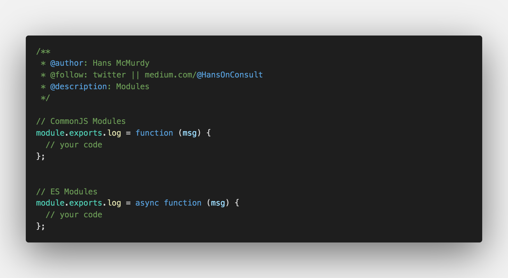

# Lesson 1.4: Module Standards (`.mjs`, `.cjs`, `package.json`) & Import Error Diagnostics (`Std 11.2, 11.7, 13.1, 18.2`)

## Student Learning Objectives (Bloom's Taxonomy & SMART)
- **`[L1 Remember]`** Recall file extensions (`.mjs`, `.cjs`, `.js`), `package.json` `"type"` settings (`"module"` vs. `"commonjs"`), and core module syntax (`import`/`export` vs. `require`/`module.exports`) (`11.7`).
- **`[L2 Understand]`** Contrast **ESM static live bindings** vs. **CommonJS dynamic value copies**, `import.meta.url` vs. `__dirname`/`__filename`, and browser `<script type="module">` execution rules (`11.2, 13.1`).
- **`[L3 Apply]`** Configure `"type": "module"` projects, write explicit relative ESM imports, and bridge `.cjs` <-> `.mjs` modules safely using `createRequire(import.meta.url)` and dynamic `import()` (`11.7, 13.1`).
- **`[L4 Analyze]`** Diagnose all **6 real Node.js module misconfiguration errors** (`Cannot use import statement outside a module`, `require is not defined in ES module scope`, `ERR_MODULE_NOT_FOUND`, `ERR_UNKNOWN_FILE_EXTENSION`, named-vs-default `SyntaxError`, and `ERR_REQUIRE_ASYNC_MODULE`) (`18.2`).
- **`[L5 Evaluate]`** Select and justify module format conventions for libraries, Node CLI tools, and browser `<script type="module">` bundles (`11.2, 11.7`).

### Lesson 1.4 SMART Objectives Checklist
- [ ] **S/M/A/R/T Goal 1:** Identify whether a Node.js file runs as ESM or CommonJS from `.mjs`/`.cjs` extensions and `"type"` in `package.json` with 100% accuracy on Lesson 1.4 exit checks by end of Period 1 (`[L1–L2]`).
- [ ] **S/M/A/R/T Goal 2:** Repair all 4 intentional module-resolution bugs inside [`0-student_files/01-module-standards/brokenModuleLab.mjs`](../../0-student_files/01-module-standards/brokenModuleLab.mjs) so `node brokenModuleLab.mjs` exits `0` within one 50-minute lab session (`[L3–L4]`).
- [ ] **S/M/A/R/T Goal 3:** Derive file paths safely in ESM using `import.meta.url` + `fileURLToPath` and bridge a `.cjs` helper cleanly without leaving unhandled `ReferenceError` or `ERR_REQUIRE_ASYNC_MODULE` crashes (`[L3–L4]`).

---

## 1. Why JavaScript Has Two Module Standards (`Std 11.2, 13.1`)

Early browser JavaScript loaded scripts globally via `<script src="...">`, polluting `window`. As server-side Node.js scaled in 2009 and browser apps matured in 2015, JavaScript standardized two primary module formats:

| Feature | CommonJS (**CJS**) | ECMAScript Modules (**ESM**) |
|---|---|---|
| **Standardized** | Node.js / ServerJS convention (2009) | Official ECMAScript standard (**ES2015 / ES6+**) |
| **Syntax** | `const x = require('./mod')` / `module.exports = ...` | `import { x } from './mod.mjs'` / `export const x = ...` |
| **Forced Extension** | **`.cjs`** (always CommonJS) | **`.mjs`** (always ESM) |
| **`package.json` `"type"`** | `"type": "commonjs"` (classic Node default for `.js`) | `"type": "module"` (makes `.js` execute as ESM) |
| **Resolution & Binding** | **Dynamic & synchronous** at runtime; destructuring copies values at `require()` time | **Static** parse/link phase (hoisted); imports are read-only **live bindings** |
| **Tree-Shaking** | Hard for bundlers (dynamic `require()` paths) | Easy static dead-code elimination (`import`/`export` are top-level static) |
| **Top-Level `await`** | Not supported | Supported natively in ESM |
| **Path Globals** | `__dirname`, `__filename`, `require`, `module` injected automatically | **Not defined!** Derive via `import.meta.url` (or `import.meta.dirname` in Node 20.11+) |

> **Node 24 Note:** Modern Node.js (`v22.12+` / `v24`) can auto-detect ESM syntax in `.js` files *only when `"type"` is omitted*, and can `require()` synchronous ESM graphs. However, explicit `"type": "module"` (or `.mjs`/`.cjs`) removes guesswork, and calling `require()` on an ESM module with top-level `await` still throws `ERR_REQUIRE_ASYNC_MODULE`!

---

## 2. Static Live Bindings vs. Dynamic Value Copies

In **CommonJS**, exporting a primitive and mutating it inside the module does **not** update a destructured copy in the consumer:
```js
// counter.cjs
let count = 0;
module.exports = { count, increment() { count += 1; } };
// consumer.cjs: const { count, increment } = require('./counter.cjs');
// increment(); -> `count` stays 0 (snapshot value copy!)
```

In **ESM**, exported bindings remain **live** (and read-only from the importer's side):
```js
// counter.mjs
export let count = 0;
export function increment() { count += 1; }
// consumer.mjs: import { count, increment } from './counter.mjs';
// increment(); -> `count` updates live to 1!
```

---

## 3. Spot the Misconception in the Original Draft Diagram!

Examine the archived 2020 draft screenshot below (now archived at [`./imgs/modules.png`](./imgs/modules.png)):



> **`[L4 Analyze]` Debugging Challenge:** Look closely at the bottom block labeled `// ES Modules` inside `imgs/modules.png`. It wrote `module.exports.log = async function (msg) { ... }`! Why is that a classic ESM misconception? Because `module.exports` belongs exclusively to **CommonJS**—in **ES Modules**, that function must be written with `export async function log(msg) { ... }` (or `export default async function (msg) { ... }`).

Also remember that a single `.mjs` module can expose **both** an `export default` and a named `export const`:
```js
export default function formatDefault(x) { return String(x); }
export const namedConstant = 'ESM';
// Callers must match: import formatDefault, { namedConstant } from './export.mjs';
```

---

## 4. `import.meta.url` vs. `__dirname` / `__filename` (`Std 11.7`)

In CommonJS, Node wraps each file with `__dirname` and `__filename`. In ESM, accessing `__dirname` throws:
`ReferenceError: __dirname is not defined in ES module scope`.

Portable ESM replacement (works across Node 18, 20, 22, 24):
```js
import path from 'node:path';
import { fileURLToPath } from 'node:url';

const __filename = fileURLToPath(import.meta.url);
const __dirname = path.dirname(__filename);
// Note: Node 20.11+/24 also provides import.meta.dirname and import.meta.filename!
```

---

## 5. Browser `<script type="module">` Behavior (`Std 11.2, 13.1`)

When loading ES modules in an HTML page:
```html
<script type="module" src="./app.mjs"></script>
```
1. **Strict Mode Automatic:** ESM always runs in `'use strict'` mode (undeclared variables throw `ReferenceError`).
2. **Deferred by Default:** `<script type="module">` downloads in parallel and executes after HTML parsing finishes (like `defer`), preserving document order.
3. **Isolated Module Scope:** Top-level `const`/`function` declarations stay private to the module unless explicitly `export`ed—zero accidental `window` global pollution.
4. **Explicit Relative URLs & CORS:** Browsers require explicit paths (`./utils.js`, `/js/app.mjs`, or `https://...`) and enforce **CORS** (`file://` URLs are blocked by browsers; serve via `http://localhost`!).
5. **No Node Built-ins or `require()`:** Browsers cannot `require()` or import `node:fs`.

---

## 6. Six Real Node.js Module Errors & How to Fix Them (`Std 18.2`)

| # | Exact Error Message / Code | Root Cause | Clean Fix |
|---|---|---|---|
| 1 | `SyntaxError: Cannot use import statement outside a module` | Using ESM `import` inside a `.cjs` file or a `.js` file under `"type": "commonjs"` | Rename to `.mjs` or set `"type": "module"` in `package.json` |
| 2 | `ReferenceError: require is not defined in ES module scope` | Calling CommonJS `require()` inside `.mjs` or `"type": "module"` `.js` | Replace with `import` or use `createRequire(import.meta.url)` |
| 3 | `Error [ERR_MODULE_NOT_FOUND]` | Relative ESM import omits file extension (`'./greeter'` instead of `'./greeter.mjs'`) | Always include full relative extension (`'./greeter.mjs'`) |
| 4 | `TypeError [ERR_UNKNOWN_FILE_EXTENSION]` | Importing an unsupported extension (e.g., `./config.data`) as an ES module | Rename to `.mjs`/`.js`, read via `node:fs`, or use JSON import attributes |
| 5 | `SyntaxError: The requested module '...' does not provide an export named '...'` | Importing `{ fn }` from a module that only uses `export default function fn()` | Match `import fn` (default) with `export default`, or add named `export` |
| 6 | `Error [ERR_REQUIRE_ASYNC_MODULE]` (plus `__dirname` `ReferenceError`) | Calling `require()` on an ESM module that uses top-level `await` | In CJS use `await import('./asyncMod.mjs')`; in ESM use `createRequire(import.meta.url)` & `fileURLToPath(import.meta.url)` |

Run the live automated verification suite that triggers and fixes all 6 errors in isolated temp directories:
```bash
node 01-Reteaching-JavaScript/04-Module-Standards-ESM-vs-CJS/code/moduleErrorsDemo.mjs
node --test 01-Reteaching-JavaScript/04-Module-Standards-ESM-vs-CJS/code/moduleErrorsDemo.test.mjs
```

---

## Lesson Resources
- **Slides:** [`slides/slides.md`](./slides/slides.md)
- **Teacher Demo & Tests:** [`code/moduleErrorsDemo.mjs`](./code/moduleErrorsDemo.mjs) | [`code/moduleErrorsDemo.test.mjs`](./code/moduleErrorsDemo.test.mjs)
- **Student Starter Lab:** [`../../0-student_files/01-module-standards/`](../../0-student_files/01-module-standards/)
