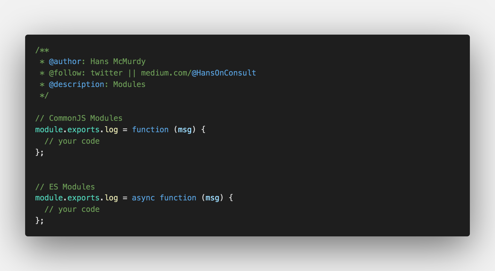

# Lesson 1.4: Module Standards & Import Diagnostics
**AZ CTE Standards `11.2, 11.7, 13.1, 18.2`**

*Mastering ESM (`import`/`export`) vs. CommonJS (`require`/`module.exports`) Across Node.js & Browsers*

---

### `[L1 Remember]` Two JavaScript Module Worlds

| Rule | CommonJS (**CJS**) | ES Modules (**ESM**) |
|---|---|---|
| **Syntax** | `require()` / `module.exports` | `import` / `export` |
| **Explicit File Ext** | **`.cjs`** | **`.mjs`** |
| **`package.json`** | `"type": "commonjs"` | `"type": "module"` |
| **Top-level `await`** | No | Yes |
| **Directory Global** | `__dirname` | `import.meta.url` |

---

### `[L2 Understand]` Static Live Bindings vs. Value Copies

- **ESM (`import`):** Statically parsed at link time (tree-shakeable!). Imported bindings are **live, read-only views** into the exporting module.
- **CommonJS (`require()`):** Synchronous runtime execution. Destructuring `const { count } = require('./c.cjs')` copies a **snapshot value**.

> **Predict Before Running:** If `counter.mjs` runs `count += 1`, what does an ESM importer read for `count`? What about CJS?

---

### `[L4 Analyze]` Spot the Bug in the 2020 Draft Diagram!



> Look at the bottom block under `// ES Modules` — why would `module.exports.log` crash in a `.mjs` file?

---

### `[L3 Apply]` `import.meta.url` & Browser `<script type="module">`

```javascript
import path from 'node:path';
import { fileURLToPath } from 'node:url';

const __filename = fileURLToPath(import.meta.url);
const __dirname = path.dirname(__filename);
```

- **Browser `<script type="module">`:** Strict mode automatically, deferred execution, isolated module scope, CORS required (no `file://`), and NO Node `require()`.

---

### `[L4 Analyze]` 6 Real Node.js Module Errors

1. `SyntaxError: Cannot use import statement outside a module` -> Use `.mjs` or `"type": "module"`
2. `ReferenceError: require is not defined in ES module scope` -> Use `import` or `createRequire(import.meta.url)`
3. `Error [ERR_MODULE_NOT_FOUND]` -> Add explicit `.mjs` / `.js` extension!
4. `TypeError [ERR_UNKNOWN_FILE_EXTENSION]` -> Use `.mjs`/`.js` or `fs.readFile`
5. `SyntaxError: ... does not provide an export named '...'` -> Match `export default` vs. named `export`
6. `ERR_REQUIRE_ASYNC_MODULE` -> Use `await import('./asyncMod.mjs')` from CommonJS!

---

### `[L3 Apply -> L5 Evaluate]` Live Bug-Hunt Lab

1. Run instructor demo:
   `node --test 01-Reteaching-JavaScript/04-Module-Standards-ESM-vs-CJS/code/moduleErrorsDemo.test.mjs`
2. Fix all 4 real module bugs inside:
   `0-student_files/01-module-standards/brokenModuleLab.mjs`
3. Complete the **Post-Lesson 1.4 Exit Ticket**!
