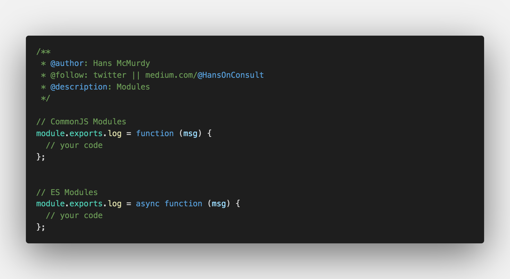

# Chapter 1: Reteaching JavaScript — Origins, Ethics, Node 24, Modules & Linux Safety

*By Hans McMurdy (`@HansOnCoding`) · High School CTE (Grades 11–12) & Community College CIS (`Stds 2.0, 3.0, 11.0, 13.1, 18.2`) + CTE IT Security (`11.1999.00` / CompTIA A+ / RHCSA)*

> **Chapter Navigation:** [Unit 1 Guide](./unit-guide.md) · [Setup & Standards Guide](./setup-guide.md) · [50-Question Mastery Exam](./quizzes/unit-test-50.md) · [Unit 1 Project](./projects/unit-project.md) · Run `npm run grade -- --unit 01`

Let's dispel a myth right away before you write a single semicolon.

JavaScript is **not** "Java Lite." It was never supposed to run inside a Java Virtual Machine, and it has about as much in common with Java as a *car* has with a *carpet*. Even seasoned engineers occasionally repeat that marketing folklore—or assume that dropping a snippet from a blog without a `LICENSE` file is "free," or blame Node.js when a forgotten `.mjs` extension crashes their terminal at 11:45 PM.

Here is the truth: JavaScript is the **only programming language baked natively into every web browser on Earth**, and thanks to **Node.js**, it runs cleanly on Linux servers, CLI tools, robotics controllers, and cloud edge workers. Before we spin up HTTP routers or state stores, we are going to rewire how you think about the ecosystem from the ground up: the real history, the legal guardrails that keep you out of court, your Node 24 LTS terminal toolchain, how JavaScript actually stores primitives vs. objects in memory, why `.mjs` vs. `.cjs` breaks so many teams, and the physical + Linux host safety rules every real engineer lives by.

<p align="center">
  
</p>

---

## 1. Let's Bust the Origin Myth: From 10 Days in 1995 to Node 24 (`Std 2.0`)

In May 1995, Brendan Eich built **Mocha** (quickly renamed **LiveScript**) inside Netscape Navigator in roughly ten days so web pages could respond to clicks without reloading the entire screen. Three months later, Netscape partnered with Sun Microsystems and slapped on the name **JavaScript** purely to ride Java's marketing wave.

Microsoft fired back with **JScript** in Internet Explorer, kicking off the first browser wars. To stop the web from fracturing, Netscape submitted the language to **ECMA International** in 1997, producing **ECMAScript (`ECMA-262`)**:

| Era / Milestone | What Changed | Why It Still Matters Today |
|---|---|---|
| **1995: LiveScript → JavaScript** | Browser scripting debuts at Netscape | Marketing rename—unrelated to Java's class-based JVM |
| **1997–1999: ES1 → ES3** | `ECMA-262` standardizes syntax, `try/catch`, regex | Guaranteed baseline across competing browsers |
| **2005–2008: AJAX & Abandoned ES4** | Asynchronous requests surge; ambitious **ES4** stalls | Proved we couldn't "break the web" with incompatible syntax |
| **2009: ES5, CommonJS & Node.js** | **Ryan Dahl** pairs Chrome **V8** + **`libuv`**; ServerJS becomes **CommonJS** | Moved JS out of browsers into servers via `require()` & `npm` |
| **2015: ES6 (ES2015)** | `let`/`const`, classes, Promises, arrow fns, **ES Modules (`import`/`export`)** | Delivered almost everything ES4 wanted without breaking legacy sites |
| **2012–Present: TypeScript, Deno & Node 24 LTS** | Static typing (`TypeScript`), web-standard **Deno**, modern **Node 24 LTS** | Native `fetch()`, `node:test`, `structuredClone()`, and ESM out of the box |

> **Try this in Node right now:** Open your terminal and run `node -p "process.versions.v8"` to inspect the exact Google **V8 JIT engine** powering your Node 24 runtime—no browser required!

👉 Full reading: [Lesson 1.1: History, Legal & Ethics](./01-History-of-JS/readme.md) · [Slides](./01-History-of-JS/slides/slides.md) · [Worksheet](./01-History-of-JS/student-lesson.md)

---

## 2. The Legal Trap Nobody Warns Beginners About (`Std 2.1–2.4`)

Here is a rule that trips up both first-week students and senior consultants: **publicly visible code on GitHub is NOT public domain.** Under copyright law, original source code is automatically protected the second it hits disk.

- **No `LICENSE` file = All Rights Reserved.** You can read it; you cannot legally copy it into your commercial product.
- **DMCA (Digital Millennium Copyright Act):** Governs takedown notices for pirated/unlicensed code and prohibits bypassing DRM controls.
- **Permissive vs. Copyleft Open Source:**
  - **Permissive (`MIT`, `ISC`, `BSD-3-Clause`, `Apache-2.0`):** Use, modify, and ship inside closed-source commercial apps as long as you keep the copyright and license notice (`Apache-2.0` also adds an explicit patent grant).
  - **Copyleft (`GPL-3.0`, `AGPL-3.0`):** "Share-alike." Distribute a binary (or serve users over a network under `AGPL`) and you must publish your derivative source under the same copyleft license.
  - **Proprietary EULAs:** Closed-source commercial software forbidding redistribution or reverse engineering.

And licensing is only half the compliance test. Every line of telemetry or student data you log must obey **privacy law**:

| Regulation | Protects | Engineering Non-Negotiable |
|---|---|---|
| **COPPA** | U.S. children under age **13** | Verifiable **parental consent** before collecting emails, persistent tracking cookies, or behavior telemetry |
| **FERPA** | U.S. student educational records | Protect grades, rosters, transcripts, and student PII from unauthorized third-party disclosure |
| **GDPR** | EU residents | Explicit opt-in, data minimization, **Right to Erasure**, and 72-hour breach reporting |
| **HIPAA** | U.S. healthcare records (PHI) | Encryption at rest/in transit, strict access controls, and immutable audit trails |
| **PCI DSS** | Credit/debit cardholder data | Never store raw CVV codes; tokenize payments via certified processors |

Ethical engineering also means rejecting deceptive **dark patterns** in cookie banners, honoring Global Privacy Control (`GPC`) opt-out signals, and auditing AI-generated code for hallucinated npm packages or leaked proprietary snippets. See [`licenseComplianceDemo.js`](./01-History-of-JS/code/licenseComplianceDemo.js) and your lab in [`0-student_files/01-legal-ethics/`](../0-student_files/01-legal-ethics/).

---

## 3. Terminal Mastery, NVM, Node 24 LTS & ANSI CLI Craft (`Std 11.1–11.9`)

Why do professional JS courses start in a black terminal window instead of clicking Play in an IDE? Because servers, CI pipelines, Docker containers, and production cloud hosts don't have a GUI desktop.

<p align="center">
  
</p>

Learn these six Unix commands until your fingers type them automatically: `pwd` (print working directory), `ls` (list files), `cd` (change directory), `mkdir` (create folder), `touch` (create file), and `rm` (delete—and pause twice before `rm -rf`, because there is no Recycle Bin!).

### Why We Never Install Node from a One-Off Static Installer
Install **NVM** (Node Version Manager) so you can run **Node 24 LTS** on modern apps and flip to Node 18 for legacy client repos in two seconds:

```bash
nvm install --lts     # Install active LTS (Node 24.x)
nvm use --lts         # Switch active shell to LTS
node -v && npm -v     # Confirm runtime and bundled npm CLI
```

<p align="center">
  
</p>

### How Node Executes Code: AOT vs. Bytecode VM vs. V8 JIT (`Std 11.6`)
- **Ahead-of-Time Compiled (`C`, `C++`, `Rust`):** Compiles straight to CPU machine instructions per OS before shipping.
- **Bytecode + VM (`Java`, `C#`):** Compiles to intermediate bytecode inside JVM/CLR.
- **Interpreted / JIT (`JavaScript` via Chrome V8):** Parses source immediately and **Just-In-Time (JIT)** compiles hot loops straight into native machine code—giving us instant edit-run feedback across Linux, macOS, and Windows.

When building CLI tools in Node (`Std 11.3–11.9`), use descriptive **`camelCase`** variable names (`studentScore`, `sanitizeCliInput`), strip ASCII control characters from untrusted `process.argv[2]` inputs, configure repeatable `"scripts"` in `package.json` (`npm init -y`, `npm install`, `npm audit fix`), and **always end ANSI escape colors with `\x1b[0m`** so red errors don't bleed across the user's terminal!

👉 Deep dives: [Terminal & NVM Guide](./02-Terminal-NVM/00-terminal-basics-and-installing-nvm-node-js.md) · [Node, NPM & NVM Overview](./02-Terminal-NVM/01-node-overview.md) · [Slide Deck](./02-Terminal-NVM/slides/node-npm-overview.md) · [Demo](./02-Terminal-NVM/code/cliFormatterDemo.js) · [Student Lab](../0-student_files/01-terminal-and-node/)

---

## 4. The 7 Primitives, `typeof null` & Stack vs. Heap (`Std 3.1–3.6`)

Ask a room full of developers to name JavaScript's primitive types and half of them forget two. Modern JavaScript has **exactly 7 primitive types**—immutable single values conceptually stored on the fixed-size **Stack** frame:

1. `string` (`"CTE-CIS"`)
2. `number` (IEEE-754 double-precision float: `42`, `3.14`, `NaN`)
3. `boolean` (`true` / `false`)
4. `undefined` (declared, not yet assigned)
5. `null` (intentional absence of value)
6. `symbol` (`Symbol('uniqueKey')`)
7. `bigint` (`9007199254740993n` for integers past `Number.MAX_SAFE_INTEGER`)

Everything else—plain `{}` objects, `[]` arrays, `function(){}`, `Map`, `Set`—is an **Object** allocated dynamically on the **Heap**, while your variable holds a memory reference pointer on the Stack.

### The Classic 1995 Quirk That Still Bites People
> **Try this in Node right now:** Run `node -e "console.log(typeof null, typeof [1,2], Array.isArray([1,2]))"`.

You will see: `object object true`. Why? In JavaScript's original 1995 C implementation, values carried a 3-bit type tag, `000` meant object, and the `NULL` pointer was all-zeros (`0x00`). That legacy bug was frozen forever so old sites wouldn't break. Never write `typeof x !== "object"` to detect primitives—check explicitly:

```js
const isPrimitive = (val) =>
  val === null || (typeof val !== 'object' && typeof val !== 'function');
```

Also guard strings cleanly (`typeof s === 'string'`, `.trim()`, `.slice(0, max)`) and watch out for **$O(n^2)$ memory churn** (`Std 3.5`): because strings are immutable, appending `out += row` inside a 100,000-row loop allocates thousands of throwaway copies. Push chunks into an array and call `.join('\n')` once for linear **$O(n)$** performance!

<p align="center">
  
</p>

👉 Deep dives: [Lesson 1.3 Primitives & Memory](./03-logging-datatypes/readme.md) · [Broken `LOGprimitive` Demo](./03-logging-datatypes/code/testPrimitives.js) · [Student Lab](../0-student_files/02-logging-datatypes/)

---

## 5. Module Standards: `.mjs`, `.cjs`, `package.json` & All 6 Import Errors (`Std 11.7, 13.1, 18.2`)

If there is one error screen guaranteed to ruin a beginner's flow, it's `SyntaxError: Cannot use import statement outside a module`. JavaScript has **two module systems** because Node.js shipped **CommonJS** in 2009—six full years before **ES Modules (ESM)** landed in ES2015:

| Rule | CommonJS (**CJS**) | ES Modules (**ESM**) |
|---|---|---|
| **Syntax** | `require('./x')` / `module.exports` | `import { x } from './x.mjs'` / `export` |
| **Unambiguous Extension** | **`.cjs`** | **`.mjs`** |
| **`package.json` `"type"`** | `"commonjs"` (classic Node default for `.js`) | `"type": "module"` (all `.js` act as ESM) |
| **Binding Semantics** | Dynamic runtime value copy | Static parse-time **live read-only bindings** + tree-shaking |
| **Top-Level `await`** | Not allowed | Natively supported |
| **Path Globals** | `__dirname`, `__filename` built in | **Missing!** Use `fileURLToPath(import.meta.url)` (or `import.meta.dirname` in Node 24) |

<p align="center">
  
</p>

In browser HTML, `<script type="module" src="./app.mjs"></script>` automatically activates `'use strict'`, defers execution until HTML parsing completes, isolates top-level bindings off `window`, and requires CORS (meaning `http://localhost`, not `file://`).

### The 6 Real Node.js Module Errors (And Exact Fixes)
1. **`SyntaxError: Cannot use import statement outside a module`:** ESM `import` inside `.cjs` or `"type": "commonjs"` `.js` → rename to `.mjs` or set `"type": "module"` in `package.json`.
2. **`ReferenceError: require is not defined in ES module scope`:** Calling `require()` inside `.mjs` → switch to `import`, or bridge with `createRequire(import.meta.url)` from `'node:module'`.
3. **`Error [ERR_MODULE_NOT_FOUND]`:** Omitting the extension in a relative ESM import (`'./tax'`) → write the explicit file extension (`'./tax.mjs'`).
4. **`TypeError [ERR_UNKNOWN_FILE_EXTENSION]`:** Importing an unknown file like `./data.conf` as ESM → read with `node:fs` or use `.mjs`/JSON import attributes.
5. **`SyntaxError: The requested module '...' does not provide an export named '...'`:** Using `{ fn }` for an `export default function fn()` → drop the braces (`import fn from '...'`) or add a named `export`.
6. **`Error [ERR_REQUIRE_ASYNC_MODULE]` (plus `__dirname` `ReferenceError`):** Calling `require()` on an ESM file containing top-level `await` → load asynchronously via `await import('./mod.mjs')` and replace `__dirname` with `path.dirname(fileURLToPath(import.meta.url))`.

👉 Deep dives: [Lesson 1.4 Module Standards](./04-Module-Standards-ESM-vs-CJS/readme.md) · [6-Error Verification Runner](./04-Module-Standards-ESM-vs-CJS/code/moduleErrorsDemo.mjs) · [Student Bug-Hunt Lab](../0-student_files/01-module-standards/)

---

## 6. Linux Admin, Hardware & OS Safety (`CTE IT Security (11.1999.00) / CompTIA A+ / RHCSA | ADE 2.1–2.6, 8.6–8.8, 10.2`)

JavaScript doesn't float in thin air—it runs on silicon inside a Linux kernel. Before you touch server hardware or deploy a production daemon, you must protect the machine, the OS, and yourself:

- **Hardware & RAID:** **CPU** (ALU/Control Unit/cache), volatile **RAM** (clears on power loss), **Motherboard** (UEFI Secure Boot). Know your RAID tradeoffs: **RAID 0** (striped speed, zero fault tolerance), **RAID 1** (mirror, 50% capacity, survives 1 disk), **RAID 5** (distributed parity across $\ge 3$ disks, $N-1$ capacity), **RAID 10** (mirrored stripes across $\ge 4$ disks, high speed + redundancy).
- **PSU +25% Headroom & Wake-on-LAN:** Sum continuous component watts and multiply by **`1.25`** (e.g., `400 W × 1.25 = 500 W → 550 W` PSU) for 80-Plus efficiency and spike safety. **WoL** sends `6` bytes of `0xFF` + `16×` the NIC MAC over UDP `7`/`9`—restrict it to management VLANs.
- **ESD / OSHA / EPA Safety:** Static discharges below `3,500 V` are invisible to humans yet destroy `3.3 V` CMOS gates—clip a **`1 MΩ` ESD wrist strap** to a grounded mat. Unplug AC and hold power 5 seconds before opening a chassis; **never open sealed PSUs or CRTs**. Never toss **swollen Li-ion batteries** in municipal trash (thermal runaway fire hazard)—isolate in sand/fire-safe containment for an **EPA hazardous battery recycler**, and send boards to **R2 / e-Stewards** e-waste recyclers.
- **Linux 3 Layers & Bash Pipes:** **Kernel** (`vmlinuz` ring-0 drivers/syscalls) → **Shell** (`bash` pipes `|`, `>`, `>>`, `2>`, `2>&1`) → **Utilities & Daemons** (`grep`, `chmod`, `systemd`, `node`). Grant admin privileges via `usermod -aG wheel` + `sudo`, never daily interactive `root` logins.
- **POSIX `rwx` + Special Mode Bits:** Kernel evaluates **Owner → Group → Others** strictly in order without fallthrough (so `0040` blocks the owner even if the owner is in the group!). Leading octal digits add **`4xxx` (`setuid` `s`/`S`)**, **`2xxx` (`setgid` `s`/`S`, team dir group inheritance)**, and **`1xxx` (`sticky bit` `t`/`T` on `/tmp` `1777` so only owners/`root` can delete)**.
- **Automation, Logs & Hardening:** Validate 5-field `crontab` (`min hour dom month dow`, e.g., `15 2 * * 1-5`), keep UTC synchronized with **NTP (`chronyd`)** so `journalctl` SSH brute-force forensics stay accurate, enforce **SELinux `Enforcing`** + **`firewalld`**, and harden `/etc/ssh/sshd_config` (`PermitRootLogin no`, `PasswordAuthentication no`, `PubkeyAuthentication yes`, `PermitEmptyPasswords no`, `MaxAuthTries 3` with Ed25519 keys).

👉 Deep dives: [Lesson 1.5 Linux & Hardware Safety](./05-Linux-Admin-Hardware-and-OS-Safety/readme.md) · [Reference Suite](./05-Linux-Admin-Hardware-and-OS-Safety/code/linuxAdminAndSafetyDemo.mjs) · [Student Lab](../0-student_files/01-linux-admin-safety/)

> **Try this in Node right now:** Run the automated host-safety reference tests from your terminal to watch POSIX octal permission math, PSU headroom calculations, and `sshd_config` audits execute live:
> ```bash
> node --test 01-Reteaching-JavaScript/05-Linux-Admin-Hardware-and-OS-Safety/code/linuxAdminAndSafetyDemo.test.mjs
> ```

---

## 7. Putting It All Together: Stack vs. Heap, Compliance & CLI Verification

Before shipping your Unit 1 capstone ([`unit-project.md`](./projects/unit-project.md)), verify that you never fall into the **Stack vs. Heap reference aliasing trap** or let broken CLI sanitization leak raw PII:

```js
// Stack copy (independent primitive)
let a = 10;
let b = a;
b = 99;
console.log(a, b); // 10 99

// Heap reference (two labels pointing to ONE array!)
const teamA = ['MIT', 'ISC'];
const teamB = teamA;
teamB.push('GPL-3.0');
console.log(teamA); // ['MIT', 'ISC', 'GPL-3.0'] — surprise mutation!
```

And whenever you inspect `package.json` manifests or student records in [`0-student_files/projects/unit-01-license-cli-auditor/`](../0-student_files/projects/unit-01-license-cli-auditor/), apply all three Week 1–3 habits together:
1. Validate license strings explicitly (`MIT`/`ISC`/`BSD-3-Clause`/`Apache-2.0` vs. `GPL-3.0` vs. `UNLICENSED`).
2. Mask sensitive emails/keys (`sanitizeRecord`) and escape terminal control sequences (`\x1b[0m` reset).
3. Keep ES modules explicit (`.mjs` / `"type": "module"`) and bridge `.cjs` assets cleanly with `createRequire(import.meta.url)`.

### Quick Unit 1 Error Triage Cheatsheet

| Symptom in Terminal | Likely Root Cause | Exact Fix |
|---|---|---|
| `Cannot use import statement outside a module` | ESM `import` run inside CommonJS `.js` | Rename to `.mjs` or set `"type": "module"` in `package.json` |
| `ERR_MODULE_NOT_FOUND` on `./helper` | Relative ESM import omitted file extension | Add explicit `.mjs` / `.cjs` extension (`./helper.mjs`) |
| `typeof payload === "object"` returns `true` for `null` | Legacy 1995 `0x00` object tag quirk | Check `payload === null` before `typeof payload === 'object'` |
| Red/bold ANSI terminal color never turns off | Printed `\x1b[31m` without reset code | Always close styled output with `\x1b[0m` |
| User in group blocked from `0040` file | Kernel checks Owner bits first without fallthrough | Adjust owner permissions (`chmod u+r file` or `0640`) |

<p align="center">
  
</p>

---

## Chapter 1 Verification & Next Steps

1. Follow [`setup-guide.md`](./setup-guide.md) to verify Node 24 LTS, NVM, Git, VS Code, and ESM configuration.
2. Complete all 5 student labs and the [Unit 1 Capstone Project](./projects/unit-project.md) in [`../0-student_files/projects/unit-01-license-cli-auditor/`](../0-student_files/projects/unit-01-license-cli-auditor/).
3. Turn all 6 `node:test` suites **RED → GREEN** with:
   ```bash
   npm run grade -- --unit 01
   ```
4. Prove mastery on [`evaluations/pre-unit-eval.md`](./evaluations/pre-unit-eval.md), [`evaluations/post-unit-eval.md`](./evaluations/post-unit-eval.md), [`quizzes/quiz-1-concepts.md`](./quizzes/quiz-1-concepts.md), [`quizzes/quiz-2-application.md`](./quizzes/quiz-2-application.md), and the comprehensive 50-item [`quizzes/unit-test-50.md`](./quizzes/unit-test-50.md).
