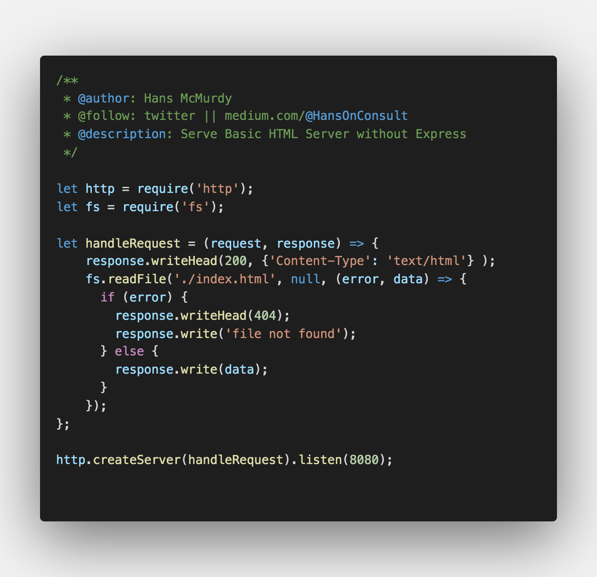
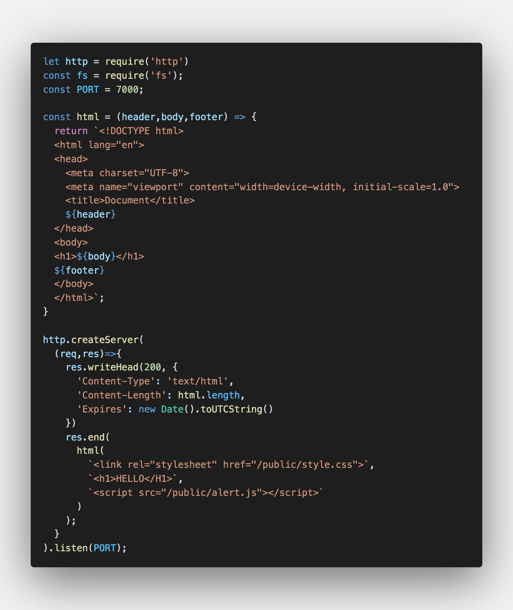

# Lesson 2.2: HTTP Request/Response Lifecycle & Node.js HTTP Server (`Std 11.3–11.7`)

## Student Learning Objectives (Bloom's Taxonomy)
- **`[L1 Remember]`** Recall HTTP methods (`GET`, `POST`, `PUT`, `PATCH`, `DELETE`) and status code families (`2xx`, `3xx`, `4xx`, `5xx`) (`11.4`).
- **`[L2 Understand]`** Explain how MIME headers (`Content-Type`, `Content-Length`) instruct browsers/clients to decode response byte streams accurately (`11.5`).
- **`[L3 Apply]`** Engineer a multi-route Node HTTP server (`node:http`) composing HTML template strings and JSON endpoints (`11.6`, `11.7`).
- **`[L4 Analyze]`** Debug missing headers, method mismatches (`405`), missing routes (`404`), and UTF-8 `Buffer.byteLength` truncation bugs (`18.3`).
- **`[L5 Evaluate]`** Critique raw Node HTTP routing vs. framework abstractions (`Express`) and decide when explicit low-level control improves observability and dependency footprint.

---

## 1. Anatomy of HTTP Messages (`Std 11.3–11.5`)

- **Client Request:** Method + URL Path (`GET /api/health`) + Headers (`Host`, `Accept`, `User-Agent`) + Optional Body (`POST`/`PUT`).
- **Server Response:** Status Code (`200`, `201`, `404`, `405`, `500`) + Response Headers (`Content-Type`, `Content-Length`, `Cache-Control`) + Payload Body.
- **Byte-Accurate Content-Length:** JavaScript `.length` counts UTF-16 code units, NOT UTF-8 bytes! Always pass `Buffer.byteLength(body)` so emojis/accents never get clipped mid-transfer.

  
  

---

## 2. Routing Methods & Template Composition (`Std 11.6, 11.7`)

Inspect BOTH `req.method` and `req.url` cleanly inside `http.createServer((req, res) => { ... })`, export `createAppServer()` separately from `.listen()`, and close sockets properly during automated testing!

## Lesson Resources
- **Interactive Slides:** [`../03-http.md`](../03-http.md)
- **Teacher Demos:** [`code/httpRouterDemo.js`](./code/httpRouterDemo.js) & [`../code/simpleHTTP.js`](../code/simpleHTTP.js)
- **Student Starter:** [`../../0-student_files/03-http-server/templateServer.js`](../../0-student_files/03-http-server/templateServer.js)
