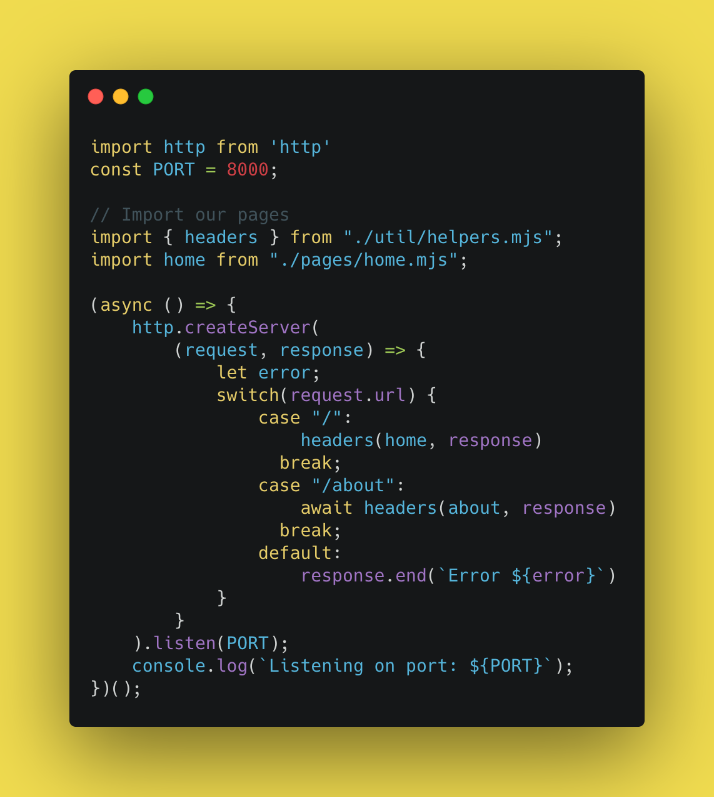
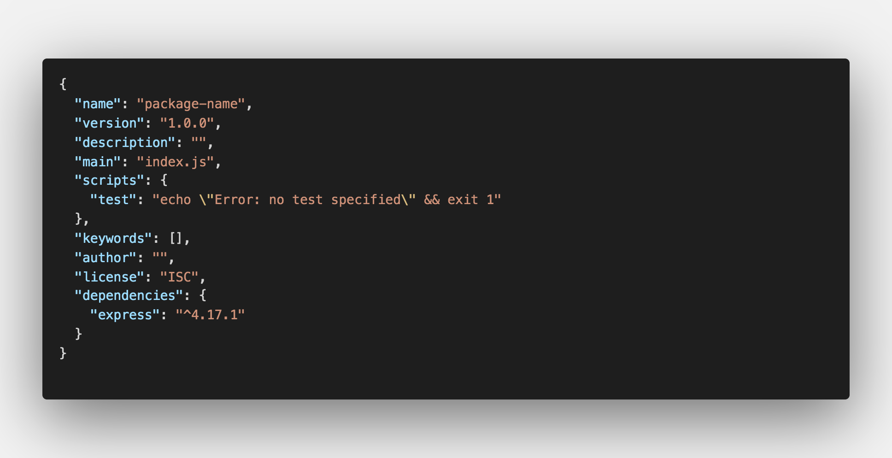
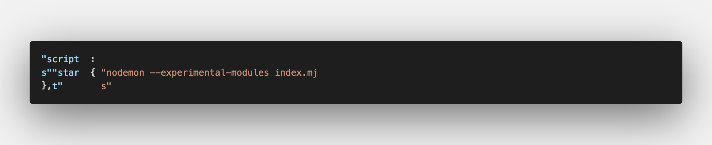
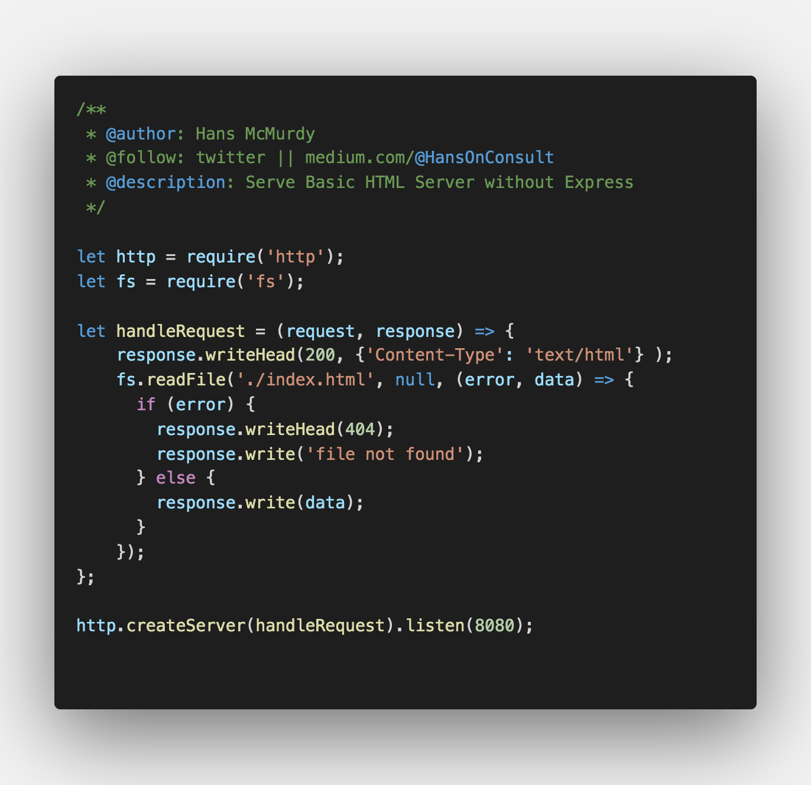
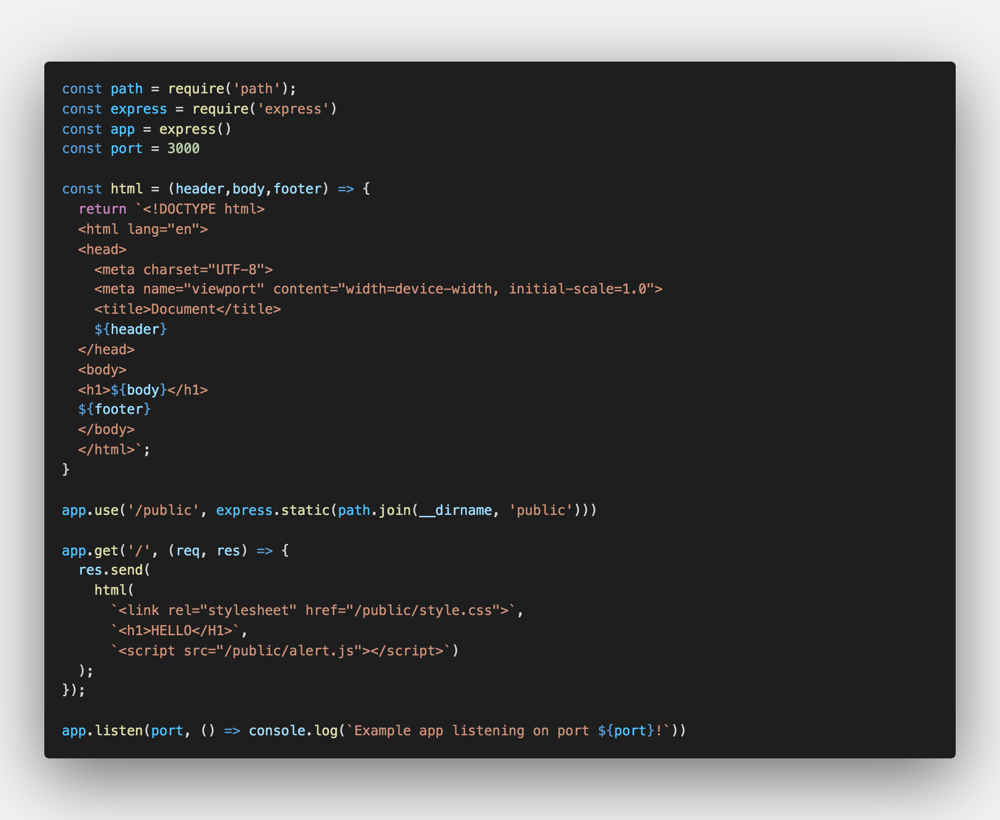

# Lesson 2.3: Express.js, Static Middleware & Modular SSR (`Std 8.3, 11.4–11.7`)

## Student Learning Objectives (Bloom's Taxonomy)
- **`[L1 Remember]`** Recall `package.json` ESM configuration (`"type": "module"`, `"scripts"`), Express core methods (`app.use`, `app.get`, `app.post`, `express.static`), and the 4 modular SSR layers (`routes`, `components`, `layout`, `pages`) (`11.6`, `11.7`).
- **`[L2 Understand]`** Explain how middleware chains `(req, res, next)` separate static asset delivery, JSON body parsing, and route handlers compared to monolithic `if/else` `node:http` callbacks (`8.3`, `11.5`).
- **`[L3 Apply]`** Compose modular ES-module SSR pages (`routes.mjs` → `components/nav.mjs` → `layout/template.mjs` → `pages/*.mjs`) and configure `express.static()` safely with `path.join()` (`11.6`, `11.7`).
- **`[L4 Analyze]`** Diagnose template XSS injection vulnerabilities, unguarded static directory traversal (`../`), and `package.json` dependency/script misconfigurations (`1.5`, `15.6`).
- **`[L5 Evaluate]`**–**`[L6 Create]`** Judge when Express middleware accelerates development versus when zero-dependency `node:http` SSR wins on cold-start speed and minimal CVE footprint (`8.3`, `11.12`).

---

## 1. Refactoring Monolithic Servers into Modular SSR (`Std 11.6–11.7`)

Inline HTML strings inside a single `http.createServer` callback quickly turn unmaintainable as a site grows beyond two pages. Refactoring separates responsibilities cleanly into pure ES modules:

| Module Layer | Responsibility | Example Export |
|---|---|---|
| **Route Manifest (`routes.mjs`)** | Single source of truth for navigation links and URLs | `export const SITE_ROUTES = [{ name: 'Home', url: '/' }, ...]` |
| **UI Components (`components/*.mjs`)** | Pure reusable HTML fragments receiving data arguments | `export const renderNav = (routes, activeUrl) => ...` |
| **Page Layout (`layout/template.mjs`)** | Shared HTML5 shell (`<head>`, header, `<main>`, footer) | `export const renderLayout = ({ title, navHtml, bodyHtml }) => ...` |
| **Page Builders (`pages/*.mjs`)** | Fetch/transform domain records and pass into layout + components | `export const renderCatalogPage = (routes, items) => ...` |

<p align="center">
  
</p>

<p align="center">
  
</p>

> **Security Rule (`Std 15.6`):** JavaScript template literals do **not** auto-escape HTML! Always run untrusted strings through `escapeHtml()` (`&`, `<`, `>`, `"`, `'`) before interpolating into SSR templates.

---

## 2. `package.json`, `"type": "module"`, and NPM Scripts (`Std 11.7`)

Modern Node.js projects declare `"type": "module"` in `package.json` to enable clean `import` / `export` syntax across `.js` and `.mjs` files, and expose repeatable team commands under `"scripts"` (`npm start`, `npm test`):

<p align="center">
  
  
</p>

---

## 3. Express.js Middleware & `express.static()` vs. Raw `node:http` (`Std 8.3, 11.4–11.6`)

When an application needs static CSS/JS/images, JSON body parsing, and dozens of routes, raw `fs.readFile` handlers require manual MIME lookup tables and path containment checks:

<p align="center">
  
  
</p>

```javascript
import express from 'express';
import path from 'node:path';

const app = express();
// Serve ./public assets under /public/* with automatic MIME & path-traversal protection
app.use('/public', express.static(path.join(import.meta.dirname, 'public')));
app.use(express.json());

app.get('/', (req, res) => {
  res.send(renderHomePage(SITE_ROUTES)); // Sets Content-Type: text/html automatically
});
```

### Decision Matrix: Bare `node:http` vs. Express.js

| Dimension | Zero-Dependency `node:http` SSR | Express.js (`app.use` / `Router`) |
|---|---|---|
| **Dependencies & CVEs** | `0` external packages (`node:` stdlib only) | Installs `express` + transitive dependency tree |
| **Static Assets & MIME** | Must map `.css`/`.js`/`.png` & guard `path.resolve()` yourself | Built-in `express.static()` handles MIME, ETags & `..` blocking |
| **Body & Param Parsing** | Must buffer `for await (const chunk of req)` chunks | Built-in `express.json()` + `/users/:id` route params |
| **Best Fit** | Microservices, FaaS cold starts, minimal security surface | Multi-route web apps, REST APIs, SSR dashboards with static assets |

---

## Lesson Resources
- **Slides:** [`slides/slides.md`](./slides/slides.md)
- **Teacher Demos:** [`code/expressVsNodeSsrDemo.mjs`](./code/expressVsNodeSsrDemo.mjs) (runnable `node:test` SSR + static server) & [`code/expressStarterReference.mjs`](./code/expressStarterReference.mjs)
- **Student Starter:** [`../../0-student_files/03-http-server/expressLab.js`](../../0-student_files/03-http-server/expressLab.js)
