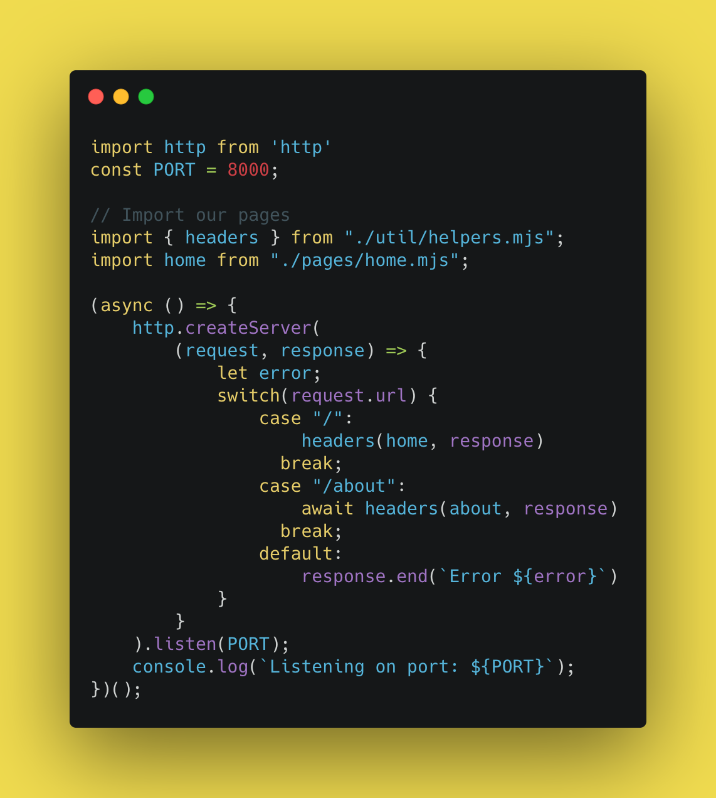

# Lesson 2.3: Express.js & Modular SSR
**AZ CTE Standards `8.3`, `11.4`–`11.7`, `15.6`**

---

### `[L1 Remember]` Why Modularize SSR? (`Std 11.6–11.7`)

Monolithic `if/else` HTML strings inside one file break down fast! Split SSR cleanly:
1. **`routes.mjs`** — Route manifest (`name`, `url`)
2. **`components/*.mjs`** — Pure UI partials (`renderNav`)
3. **`layout/template.mjs`** — HTML5 shell (`<head>`, `<main>`, `<footer>`)
4. **`pages/*.mjs`** — Data + component + layout composition



---

### `[L2 Understand]` Component Flow & `package.json` (`Std 11.7`)


- Add `"type": "module"` to `package.json` for native ES `import`/`export`!
- Use `"scripts"` (`npm start`, `npm test`) so every teammate runs identical commands.

---

### `[L3 Apply]` Express.js Static Middleware & Routing (`Std 8.3, 11.6`)

```javascript
import express from 'express';
import path from 'node:path';

const app = express();
app.use('/public', express.static(path.join(import.meta.dirname, 'public')));
app.use(express.json());

app.get('/', (req, res) => res.send(renderHomePage()));
```

- `app.use('/public', express.static(...))` maps MIME types, caches headers, and blocks `../` path traversal automatically!

---

### `[L4 Analyze]` Predict the Two Security Defects!

```javascript
const card = `<h2>${item.name}</h2>`; // Defect 1!
const filePath = path.join(publicDir, req.url); // Defect 2!
```

1. **Defect 1 (XSS):** Unescaped `${item.name}` executes `<script>` tags in visitors' browsers → wrap with `escapeHtml()`!
2. **Defect 2 (Path Traversal):** `path.join` allows `../../etc/passwd` unless checked with `path.resolve()` + prefix guard!

---

### `[L5 Evaluate -> L6 Create]` Tradeoff Decision & Lab

- **Choose bare `node:http` SSR:** Zero npm CVEs, fastest FaaS cold starts, tiny edge services.
- **Choose Express.js:** Rich middleware ecosystem, `express.static()`, `req.params`, rapid multi-route APIs.

> **Lab:** Run `node --test 02-HTTP/03-Express-and-SSR/code/expressVsNodeSsrDemo.mjs` and complete `0-student_files/03-http-server/expressLab.js`!
