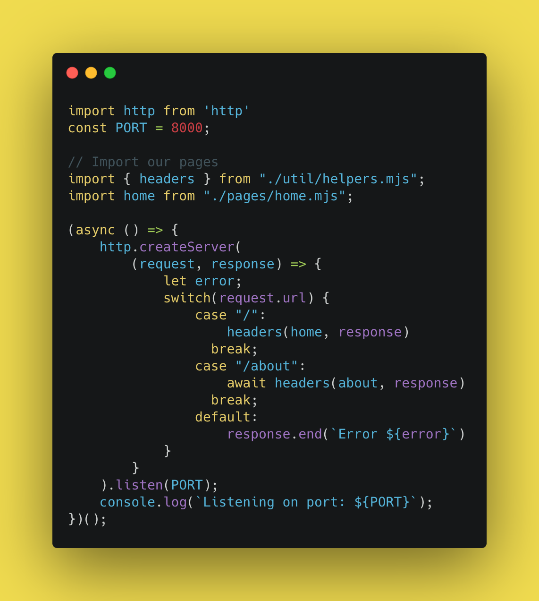

# Chapter 2: Internet Protocols, Cloud Models, Node.js HTTP, Express SSR & Network Engineering

*By Hans McMurdy (`@HansOnCoding`) · West-MEC / Arizona CTE Software & App Design (`Stds 8.0, 11.3–11.7, 1.5, 15.6`) + IT Security (`ITS 102 / CCNA 200-301 | ADE 3.0, 6.0, 7.0, 8.1–8.5, 10.1–10.6`)*

> **Chapter Navigation:** [Unit 2 Guide](./unit-guide.md) · [Setup & Standards Guide](./setup-guide.md) · [50-Question Mastery Exam](./quizzes/unit-test-50.md) · [Unit 2 Project](./projects/unit-project.md) · Run `npm run grade -- --unit 02`

Let's dispel two expensive myths before your first `curl` command even hits port 80.

**Myth #1: "Node.js is a web server like Apache or Nginx."**  
Nope. Node.js is a **JavaScript runtime environment**, not a web server. It happens to ship with a rock-solid built-in `node:http` module that lets you *build* an HTTP server in 12 lines of code—and in real production stacks, that Node server almost always sits behind a reverse proxy like Nginx handling TLS termination and static caching.

**Myth #2: "Subnetting, fiber optics, and TCP/UDP ports are 'IT helpdesk trivia' that software engineers can ignore."**  
Tell that to the developer whose app passes every unit test on `localhost:7000` and collapses on launch day because a `/26` CIDR subnet mask dropped half the database pool, an emoji caused `string.length` to lie to `Content-Length` and slice a JSON response in half, or a forgotten `path.resolve()` prefix check exposed `/etc/passwd` over a URL query!

In this chapter, we bridge **the physical wire and IP packet** (`Std 8.0`, `ITS 102`, `CCNA`) all the way up to **production Node.js HTTP servers and modular ES-module SSR** (`Stds 11.3–11.7`).

<p align="center">
  
</p>

---

## 1. Internet Protocols, Cloud Tiers, Performance & IoT (`Std 8.0`)

Every time you press Enter on a URL in Chrome, your browser isn't executing magic—it is orchestrating an exact stack of transport and application protocols over public or private IP networks.

<p align="center">
  
</p>

### Benefits of Cloud Computing & Web Server Roles (`Std 8.1, 8.3`)
Why do modern teams rent cloud infrastructure instead of racking bare-metal servers in a hallway closet?
- **Elasticity & Auto-Scaling:** Spin up 40 instances for Friday night registration spikes, then shrink back to 2 instances at 3:00 AM.
- **CapEx → OpEx Economics:** Pay per compute second instead of dropping tens of thousands upfront on hardware that sits 80% idle.
- **Global Regions & Server Roles (`8.3`):** Deploy close to users using specialized roles: **Static File Servers**, **JSON REST APIs**, **Reverse Proxies / Load Balancers** (Nginx/Cloudflare terminating TLS and routing traffic), **Media Streamers**, and **Serverless Edge Workers**.

### Essential Network & Application Protocols (`Std 8.2`)

| Protocol | Default Port(s) | Transport | Encrypted? | Primary Engineering Role |
|---|---|---|---|---|
| **HTTP** | `80` | TCP | No (Plaintext) | Unencrypted hypertext requests/responses (local dev or behind TLS) |
| **HTTPS** | `443` | TCP | **Yes (TLS 1.3)** | Encrypted web pages, REST APIs, and webhook payloads |
| **SSH / SFTP** | `22` | TCP | **Yes (SSH)** | Encrypted Linux terminal access & authenticated file transfer |
| **FTPS** | `990` / `21` | TCP | **Yes (TLS)** | Legacy FTP wrapped in TLS certificates (distinct from SSH-based SFTP) |
| **IMAP / IMAPS** | `143` / `993` | TCP | `993` **Yes (TLS)** | Syncing email folders/read state across laptops and phones |
| **DNS** | `53` | UDP (queries) / TCP (zone xfer) | Optional (`DoH`/`DoT`) | Translating domain names (`api.school.edu`) to IPv4/IPv6 addresses |
| **MQTT / MQTTS** | `1883` / `8883` | TCP | `8883` **Yes (TLS)** | Lightweight pub/sub broker telemetry for IoT sensors |
| **IPv4 vs. IPv6** | Layer 3 | IP | Add-on (`IPsec`) | `32`-bit (~4.3B addresses, exhaustible) vs. `128`-bit ($3.4 \times 10^{38}$ addresses) |

### Cloud Models (`8.5`), Performance Math (`8.4`) & IoT Radios (`8.6`)

Choose the right abstraction level for the job:
- **SaaS** *(Gmail, Figma)* — Finished software accessed in a browser; zero infrastructure code managed by you.
- **PaaS** *(Render, Railway, Heroku)* — Push Git commits; provider handles OS patches, Node runtimes, and TLS.
- **IaaS** *(AWS EC2, Google Compute Engine)* — Rent virtual machines, block disks, and VPC firewall rules (needed when custom kernels or low-level networking matter).
- **FaaS / Serverless** *(AWS Lambda, Cloudflare Workers)* — Run stateless functions billed per millisecond; ideal for bursty webhooks idle 16+ hours a day!

> **Try this in Node right now:** Run [`protocolInspectorDemo.js`](./01-Internet-Protocols-and-Cloud/code/protocolInspectorDemo.js) to see how gzip compression cuts wire time:
> ```bash
> node 02-HTTP/01-Internet-Protocols-and-Cloud/code/protocolInspectorDemo.js
> ```
> A `1000 KB` JS bundle compressed `75%` with **Gzip/Brotli** drops to **`250 KB`** on the wire (`wireKb = rawKb * (1 - ratio)`). Over a `4,000 kbps` link (`250 * 8 / 4000 = 0.5 s` + `0.02 s` RTT = **`0.520 s`**), caching that compressed asset on a **CDN** edge node shrinks round-trip latency even further!

And when your app connects physical hardware (`Std 8.6`), match the wireless radio to range and battery constraints:

| Radio Standard | Typical Range | Power Draw | Real-World Fit |
|---|---|---|---|
| **NFC** | `< 4 cm` | Passive / Ultra-low | Contactless transit tap, badge unlock, payment terminals |
| **BLE (`802.15`)** | `10–100 m` | Very Low | Smart watches, glucose monitors, BLE door locks |
| **Wi-Fi (`802.11` / WPA3)** | `30–100 m` | Moderate–High | Security cameras, laptops, smart speakers on local LAN |
| **LTE / 5G CBRS** | Miles (Tower) | High (Sleep-cycled) | Fleet GPS trackers, remote weather/farm soil sensors |

👉 Lesson 2.1 Deep Dive: [`01-Internet-Protocols-and-Cloud/readme.md`](./01-Internet-Protocols-and-Cloud/readme.md) · [Slides](./01-Internet-Protocols-and-Cloud/slides/slides.md) · [Student Lab](./01-Internet-Protocols-and-Cloud/student-lesson.md)

---

## 2. HTTP Verbs, Status Families & Bare-Metal `node:http` (`Std 11.3–11.7`)

Every HTTP exchange has two halves: a **Client Request** (method + URL + headers + optional body) and a **Server Response** (status code + response headers + byte payload).

<p align="center">
  
  
</p>

### HTTP Verbs & Status Families You Must Know by Heart
- **CRUD Verbs:** `GET` (read, no request body), `POST` (create resource → often returns `201 Created`), `PUT` (full replace), `PATCH` (partial update), `DELETE` (remove).
- **Status Code Families (`http.cat`):**
  - **`1xx` Informational** (`100 Continue`, `101 Switching Protocols`)
  - **`2xx` Success** (`200 OK`, `201 Created`, `204 No Content`)
  - **`3xx` Redirection** (`301 Moved Permanently`, `304 Not Modified`)
  - **`4xx` Client Errors** (`400 Bad Request`, `401 Unauthorized`, `403 Forbidden`, `404 Not Found`, **`405 Method Not Allowed`**)
  - **`5xx` Server Errors** (`500 Internal Server Error`, `502 Bad Gateway`, `503 Service Unavailable`)

### The `Buffer.byteLength` UTF-8 Trap That Clips Production Payloads
Here is a bug that catches almost everyone once: in JavaScript, `'Hi 🚀'.length` is **`5`**, because JavaScript strings use UTF-16 code units where `'🚀'` takes 2 units. Over UTF-8 on the wire, `'Hi 🚀'` is actually **`7` bytes** (`'H'`, `'i'`, `' '`, plus 4 bytes for the rocket)! If you pass `'Content-Length': body.length`, the client closes the socket 2 bytes early and chops your closing `}` or `</html>`!

Always measure headers with **`Buffer.byteLength(body, 'utf8')`**, and always separate **`createAppServer()`** from **`server.listen()`** behind `if (require.main === module)` so automated `node --test` suites can bind ephemeral port `0` cleanly without port collisions:

```javascript
const http = require('node:http');

function send(res, statusCode, contentType, body) {
  res.writeHead(statusCode, {
    'Content-Type': contentType,
    'Content-Length': Buffer.byteLength(body, 'utf8'),
  });
  res.end(body);
}

function createAppServer() {
  return http.createServer((req, res) => {
    if (req.url === '/' && req.method === 'GET') {
      return send(res, 200, 'text/html; charset=utf-8', '<h1>Node HTTP Live 🚀</h1>');
    }
    if (req.url === '/api/health') {
      if (req.method !== 'GET') return send(res, 405, 'application/json', '{"error":"Method Not Allowed"}');
      return send(res, 200, 'application/json', JSON.stringify({ ok: true }));
    }
    return send(res, 404, 'application/json', JSON.stringify({ error: 'Not Found' }));
  });
}

if (require.main === module) {
  createAppServer().listen(7000, '127.0.0.1');
}
```

> **Try this in Node right now:** Run our self-testing ephemeral port router demo (`listen(0)`):
> ```bash
> node 02-HTTP/02-Node-HTTP-Server/code/httpRouterDemo.js
> ```

👉 Lesson 2.2 Deep Dive: [`02-Node-HTTP-Server/readme.md`](./02-Node-HTTP-Server/readme.md) · [Interactive Reveal Deck](./03-http.md) · [Simple HTTP Reference](./code/simpleHTTP.js) · [Student Lab](./02-Node-HTTP-Server/student-lesson.md)

---

## 3. Express.js, Modular `.mjs` SSR & Server Security (`Std 8.3, 11.4–11.7, 1.5, 15.6`)

Shoving 200 lines of inline HTML inside one `http.createServer` callback works for Day 1, and turns into unmaintainable spaghetti by Day 3. Notice how clean architecture breaks the monolith into four pure ES-module layers (`"type": "module"` in `package.json`):

| SSR Layer | Purpose | Example File |
|---|---|---|
| **Route Manifest** | Single source of truth for nav links & URLs | `routes.mjs` (`SITE_ROUTES`) |
| **Pure Components** | Reusable HTML fragments receiving plain data | `components/nav.mjs` (`renderNav`) |
| **Layout Shell** | Shared `<!DOCTYPE html>`, `<head>`, `<header>`, `<main>`, `<footer>` | `layout/template.mjs` (`renderLayout`) |
| **Page Builders** | Compose route data + components + layout | `pages/catalog.mjs` (`renderCatalogPage`) |

<p align="center">
  
  
</p>

### Bare `node:http` vs. Express.js (`app.use`, `express.static`, `express.json`)
Express gives you a clean middleware chain `(req, res, next)`, parameterized routing (`/users/:id`), `express.json()`, and built-in `express.static()` with MIME headers and `..` blocking. Zero-dependency `node:http` SSR wins on cold-start speed, zero transitive npm CVEs, and total control—exactly why we test **both** in [`expressVsNodeSsrDemo.mjs`](./03-Express-and-SSR/code/expressVsNodeSsrDemo.mjs)!

### Two Non-Negotiable SSR Security Rules
1. **Prevent Template XSS (`Std 15.6`):** JavaScript backticks do **not** auto-escape HTML! Always run untrusted fields through `escapeHtml()` (converting `&`, `<`, `>`, `"`, `'`) before inserting them into `<h1>${escapeHtml(title)}</h1>`.
2. **Block Static Path Traversal (`Std 1.5`):** Never join `req.url` straight onto `fs.readFile()`. An attacker requesting `/public/%2e%2e/secret.env` escapes `./public` unless you decode safely and enforce:
   ```js
   const resolved = path.resolve(rootDir, relativeSubpath);
   if (!resolved.startsWith(rootDir + path.sep)) {
     res.writeHead(403, { 'Content-Type': 'application/json' });
     return res.end(JSON.stringify({ error: 'Forbidden path traversal' }));
   }
   ```

> **Try this in Node right now:** Watch `expressVsNodeSsrDemo.mjs` verify XSS escaping, MIME types, `405`, `404`, and `403` path traversal prevention automatically:
> ```bash
> node --test 02-HTTP/03-Express-and-SSR/code/expressVsNodeSsrDemo.mjs
> ```

👉 Lesson 2.3 Deep Dive: [`03-Express-and-SSR/readme.md`](./03-Express-and-SSR/readme.md) · [Slides](./03-Express-and-SSR/slides/slides.md) · [Express Reference](./03-Express-and-SSR/code/expressStarterReference.mjs) · [Student Lab](./03-Express-and-SSR/student-lesson.md)

---

## 4. Subnetting, OSI vs. TCP/IP, Media & 7-Step Troubleshooting (`West-MEC ITS 102 / CCNA 200-301`)

Now zoom down the stack to the routers, switches, cables, and binary masks carrying every HTTP packet (`ADE 3.0, 6.0, 7.0, 8.1–8.5, 10.1–10.6`).

### Binary, Hex, OSI 7 Layers vs. TCP/IP 4 Layers
Computers forward raw bits, while engineers configure dotted-decimal IPv4 (`32` bits: `192.168.10.25` = `11000000.10101000.00001010.00011001` = `C0:A8:0A:19`) and hex MAC (`48`-bit NIC OUI + serial) / IPv6 (`128`-bit). During encapsulation, data moves down the stack:

| OSI Layer | TCP/IP Model | PDU Unit | Core Protocols & Devices |
|---|---|---|---|
| **7. Application** / **6. Presentation** / **5. Session** | **Application** | Data | `HTTP/HTTPS`, `DNS`, `SSH`, `DHCP`, TLS, UTF-8/JSON |
| **4. Transport** | **Transport** | **Segment** (`TCP`) / **Datagram** (`UDP`) | TCP (`SYN/SYN-ACK/ACK` reliability) vs. UDP (low-latency DNS/NTP/DHCP), IANA ports |
| **3. Network** | **Internet** | **Packet** | `IPv4`, `IPv6`, `ICMP`, **Routers**, Longest-prefix forwarding |
| **2. Data Link** | **Network Access** | **Frame** | `Ethernet 802.3`, MAC addresses, VLANs, **Switches**, **`STP`/`RSTP`** loop blocking |
| **1. Physical** | **Network Access** | **Bits** | `Cat6a UTP` (`100 m` copper), `MMF` (`<550 m`), `SMF` (`10+ km`, zero EMI), `802.11 WPA3` (`SAE`), `5G/CBRS` (`3.5 GHz`) |

### Topologies, CIDR Bitwise Math & Largest-First VLSM
- **Topologies:** **Star** (central switch, single fault domain per link), **Mesh** ($n(n-1)/2$ redundant links), and **Spine-Leaf** (modern two-tier data-center Clos fabric giving equal hop latency between every leaf rack).
- **CIDR Block Anatomy (`192.168.10.99/26`):** `32 - 26 = 6` host bits → block size $2^6 = 64$, usable hosts $64 - 2 = 62$, mask `255.255.255.192`, wildcard `0.0.0.63`, network `192.168.10.64` (`ip & mask`), usable `192.168.10.65–192.168.10.126`, broadcast `192.168.10.127` (`network | wildcard`). *(Note: RFC 3021 `/31` point-to-point router links allow `2` hosts directly without wasting a `/30`!)*
- **VLSM Allocation Algorithm:** Always **sort subnet demands largest-first**, round `hosts + 2` up to the smallest power of `2` ($2^h$, prefix `/32 - h`), align to block multiples, and advance sequentially without overlapping!
- **RFC 1918 vs. APIPA vs. IPv6:** Private NAT ranges (`10.0.0.0/8`, `172.16.0.0/12`, `192.168.0.0/16`), Loopback (`127.0.0.0/8` / `::1`), **APIPA (`169.254.0.0/16` — self-assigned when DHCP fails!)**, IPv6 link-local `fe80::/10`, ULA `fc00::/7`, Global Unicast `2000::/3`.

### IANA Ports, Longest-Prefix Routing & 7-Step Troubleshooting
- **IANA Port Tiers (`0–65535`):** **Well-Known (`0–1023`)** (`22`, `53`, `67/68`, `80`, `123`, `161`, `443`), **Registered (`1024–49151`)** (`1433`, `3306`, `3389`, `5432`, `8080`), **Dynamic/Ephemeral (`49152–65535`)** outbound client source ports.
- **Longest-Prefix Match:** Routers ALWAYS prefer the **most specific matching prefix** (highest `/prefix` wins even over lower metric; `0.0.0.0/0` only catches misses), while **STP / `802.1w RSTP`** prevents Layer-2 broadcast storms on redundant links by keeping backup uplinks in Blocking/Discarding mode until failover.
- **7-Step Network Troubleshooting Methodology:** **(1) Identify** the problem → **(2) Establish a theory** → **(3) Test the theory** → **(4) Plan of action** → **(5) Implement or escalate** → **(6) Verify full functionality & prevent** → **(7) Document findings**. Use **`ping`** (L3 ICMP), **`traceroute`** (L3 TTL hops), **`nslookup`/`dig`** (L7 DNS), **`ss -tulnp`/`netstat`** (L4 listening sockets), and **`tcpdump`/Wireshark** (L2–L7 wire capture).

### Worked VLSM Example: Splitting `10.60.0.0/24` Without Overlap
Suppose your Unit 2 router deployment needs three subnets inside `10.60.0.0/24`: **App-Servers (`50` hosts)**, **Public-DMZ (`25` hosts)**, and **Database (`12` hosts)**. Always sort **largest-first** so every subnet sits cleanly on an aligned power-of-2 boundary:

| Priority | Department | Demand + 2 | Block Size / Prefix | Network Address | Usable Host Range | Broadcast |
|---|---|---|---|---|---|---|
| **1st** | `App-Servers` (`50`) | `52 → 64` | `/26` (`255.255.255.192`) | `10.60.0.0` | `10.60.0.1 – 10.60.0.62` | `10.60.0.63` |
| **2nd** | `Public-DMZ` (`25`) | `27 → 32` | `/27` (`255.255.255.224`) | `10.60.0.64` | `10.60.0.65 – 10.60.0.94` | `10.60.0.95` |
| **3rd** | `Database` (`12`) | `14 → 16` | `/28` (`255.255.255.240`) | `10.60.0.96` | `10.60.0.97 – 10.60.0.110` | `10.60.0.111` |

> **Try this in Node right now:** Run our reference CIDR/VLSM/routing engine and test suite:
> ```bash
> node 02-HTTP/04-Subnetting-OSI-Topologies-and-Routing/code/subnetAndRoutingDemo.mjs
> ```

👉 Lesson 2.4 Deep Dive: [`04-Subnetting-OSI-Topologies-and-Routing/readme.md`](./04-Subnetting-OSI-Topologies-and-Routing/readme.md) · [Slides](./04-Subnetting-OSI-Topologies-and-Routing/slides/slides.md) · [Reference Engine](./04-Subnetting-OSI-Topologies-and-Routing/code/subnetAndRoutingDemo.mjs) · [Student Lab](./04-Subnetting-OSI-Topologies-and-Routing/student-lesson.md) (`../0-student_files/02-subnetting-routing/subnetCalculatorLab.mjs`)

---

## 5. Quick Unit 2 Error Triage Cheatsheet

| Symptom in Terminal / Browser | Likely Root Cause | Exact Fix |
|---|---|---|
| `Error: listen EADDRINUSE :::7000` | Background server already occupies port `7000` | Check `ss -tulnp \| grep 7000` or bind ephemeral port `0` in tests |
| JSON ending with emoji truncates mid-response | `Content-Length` used `.length` instead of `Buffer.byteLength` | Use `Buffer.byteLength(body, 'utf8')` for header sizing |
| `node --test` passes then hangs forever | `.listen()` ran at top level instead of inside `if (require.main === module)` | Guard `.listen()` and close servers in `finally` |
| Attacker fetches `/public/%2e%2e/.env` | Static router checked raw `'..'` instead of canonical paths | Decode safely and enforce `resolved.startsWith(rootDir + path.sep)` |
| Client receives `169.254.x.x` IPv4 | DHCP unreachable (`APIPA` link-local fallback) | Check cable/VLAN + renew DHCP (`Step 1–3` of 7-step triage) |

---

## Chapter 2 Verification, Labs & Assessments

1. Verify ports, `curl`, `ss`, and Express ESM workflow via [`setup-guide.md`](./setup-guide.md).
2. Complete all Unit 2 starter labs in [`../0-student_files/03-http-server/`](../0-student_files/03-http-server/), [`../0-student_files/02-subnetting-routing/`](../0-student_files/02-subnetting-routing/), and your [Unit 2 Project](./projects/unit-project.md) in [`../0-student_files/projects/unit-02-http-router/`](../0-student_files/projects/unit-02-http-router/).
3. Turn all 3 `node:test` suites **RED → GREEN**:
   ```bash
   npm run grade -- --unit 02
   ```
4. Complete [`evaluations/pre-unit-eval.md`](./evaluations/pre-unit-eval.md), [`evaluations/post-unit-eval.md`](./evaluations/post-unit-eval.md), [`quizzes/quiz-1-concepts.md`](./quizzes/quiz-1-concepts.md), [`quizzes/quiz-2-application.md`](./quizzes/quiz-2-application.md), and the 50-item [`quizzes/unit-test-50.md`](./quizzes/unit-test-50.md).
