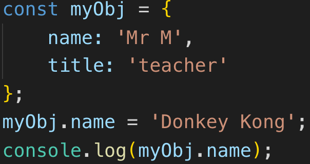
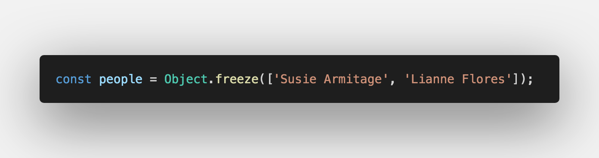

# Chapter 4: What Do You Really Know About Variables, Scope, Data Types & Immutability?

*By Hans McMurdy (`@HansOnCoding`) · High School CTE (Grades 11–12) & Community College CIS — Software & App Design (`AZ CTE CIP 11.0202.00 | Stds 3.3, 3.4, 3.6, 18.2, 18.3`)*

> **Chapter Navigation:** [Unit 4 Guide](./unit-guide.md) · [Setup & Standards Guide](./setup-guide.md) · [50-Question Mastery Exam](./quizzes/unit-test-50.md) · [Unit 4 Project](./projects/unit-project.md) · Run `npm run grade -- --unit 04`

Let's dispel two massive JavaScript myths before you declare another variable.

**Myth #1: "`const` means the value cannot change."**  
Tell that to the engineer who writes `const player = { score: 10 }; player.score = 99;` and stares at the screen wondering why JavaScript didn't throw an error—or writes `const copy = { ...state }; copy.inventory.push('potion');` and accidentally mutates their live Redux/game history!

**Myth #2: "`var` and `let` basically behave the same, and `==` is fine as long as I know what I passed."**  
Right until a `for (var i = 0; ...)` callback prints `3, 3, 3` instead of `0, 1, 2`, an uninitialized variable silently leaks `undefined` across an `if` block, or `"0" == false` quietly unlocks an admin check.

In this chapter, we look straight inside JavaScript's memory model and compiler phases: variable lifecycles, function vs. block scope, hoisting and the **Temporal Dead Zone (TDZ)**, why `==` lies, what `const` actually freezes on the **Stack** vs. **Heap**, and how shallow copies differ from `Object.freeze()`, `Object.seal()`, and `structuredClone()`.

---

## 1. Variable Lifecycle: `var` Function Scope vs. `let` & `const` Block Scope (`Std 3.3`)

Every JavaScript variable passes through three distinct phases inside its enclosing scope: **Declaration** (registering the name), **Initialization** (allocating its slot and initial binding), and **Assignment / Usage**.

| Keyword | Scope Boundary | Hoisting Initialization | Can Reassign? | Can Redeclare in Same Scope? |
|---|---|---|---|---|
| **`var`** | Function / Module / Global (ignores `{ }` blocks!) | Hoisted & initialized as **`undefined`** | Yes | Yes (bug magnet!) |
| **`let`** | **Block (`if`, `for`, `{ ... }`)** | Hoisted into **TDZ** (uninitialized!) | Yes | **No** (`SyntaxError`) |
| **`const`** | **Block (`if`, `for`, `{ ... }`)** | Hoisted into **TDZ** (must initialize immediately) | **No** (`TypeError`) | **No** (`SyntaxError`) |

### The Classic `var` Block-Leak & Loop Closure Trap
Watch how `var` ignores curly braces (`{ ... }`) and shares a single variable slot across loop iterations:

```javascript
function loopBugDemo() {
  const callbacks = [];
  for (var i = 0; i < 3; i++) {
    callbacks.push(() => i);
  }
  return callbacks.map((fn) => fn()); // Returns [3, 3, 3] — NOT [0, 1, 2]!
}
```
Why? Because `var i` exists **once** for the entire `loopBugDemo` function! By the time any callback executes, `i` finished incrementing to `3`. Switching `var i` to **`let i`** creates a fresh block-scoped binding on **every single iteration**, returning `[0, 1, 2]` cleanly!

---

## 2. Hoisting, Temporal Dead Zone (TDZ), Shadowing & `'use strict'` (`Std 18.2`)

During compilation (before line 1 executes), the V8 engine scans every scope and registers declarations—this is called **Hoisting**, and it behaves radically differently for `var`, functions, and `let`/`const`:

```javascript
console.log(legacy); // undefined (`var` hoisted and pre-initialized!)
var legacy = 10;

console.log(greet('AZ')); // 'Hello, AZ!' (Function declarations hoist full body!)
function greet(name) { return `Hello, ${name}!`; }

console.log(modern); // ReferenceError: Cannot access 'modern' before initialization
let modern = 10;
```

### Why the Temporal Dead Zone (TDZ) Exists
Between entering a `{ ... }` block and reaching `let modern = 10;`, `modern` sits inside the **Temporal Dead Zone**. Reading or writing it throws an immediate, loud **`ReferenceError`** instead of silently hiding bugs behind `undefined` (`Std 18.2`). Notice also the difference with **Function Expressions**: calling `sayHi()` above `const sayHi = () => 'hi'` throws `ReferenceError` (TDZ), whereas calling above `var sayHi = () => 'hi'` throws `TypeError: sayHi is not a function` (`undefined()`!).

### Lexical Scope, Variable Shadowing & Strict Mode
- **Lexical Scope:** Inner functions read variables from enclosing outer scopes (`code/immutability.js`).
- **Shadowing:** Declaring `const score = 99` inside an inner `{ ... }` block temporarily hides an outer `const score = 10` without modifying it—helpful in isolation, confusing if overused.
- **Accidental Implicit Globals (`'use strict'`):** In legacy sloppy scripts, forgetting `let`/`const` (`number = 100`) silently attaches `globalThis.number = 100`! Enabling `'use strict'` (automatic inside all ES Modules and class bodies, see [`code/hoisting.js`](./code/hoisting.js)) forces an immediate **`ReferenceError`** instead.

> **Try this in Node right now:** Run [`code/hoisting.js`](./code/hoisting.js) to watch strict implicit-global protection, `var` hoisting, TDZ `ReferenceError`, and function hoisting verify live:
> ```bash
> node 04-Variables-Scope-Immutability/code/hoisting.js
> ```

---

## 3. Operators & Why Loose `==` Lies While Strict `===` Tells the Truth (`Std 3.3`)

In JavaScript, arithmetic (`+`, `-`, `*`, `/`, `%`, `**`) and compound assignments (`=`, `+=`, `-=`) are straightforward—until someone writes **`==` (loose equality)** instead of **`===` (strict equality)**.

Loose equality forces automatic **abstract type coercion** (`ToNumber` / `ToPrimitive`) before comparing:
- `"5" == 5` → **`true`** (converts `"5"` to `5`)
- `0 == ""` → **`true`** (both coerce to `0`!)
- `false == "0"` → **`true`** (both coerce to `0`!)
- `null == undefined` → **`true`** (`null === undefined` is `false`)
- `[] == ![]` → **`true`** (`![]` is `false`, `[]` coerces to `""` → `0 == 0`!)

Always enforce **`===` / `!==`** (and use **`Object.is(a, b)`** when distinguishing `NaN === NaN` as `true` or `+0` from `-0`). Notice also unary `+` traps (`"5" + 2 === "52"` string concatenation vs `"5" - 2 === 3` numeric subtraction!).

```javascript
// Real-world HTTP router bug caused by loose == on valid ephemeral port 0!
function validatePortBuggy(port) {
  if (port == false) throw new Error('Rejected port!'); // 0 == false is TRUE!
  return port;
}

// Strict check preserves valid numeric 0 while catching NaN cleanly:
function validatePortSafe(port) {
  if (typeof port !== 'number' || Number.isNaN(port) || port < 0) {
    throw new TypeError('Invalid numeric port');
  }
  return port;
}

console.log(Object.is(NaN, NaN), NaN === NaN); // true false
console.log(validatePortSafe(0));             // 0
```

> **Try this in Node right now:** Verify coercion & strict checks directly in one terminal command:
> ```bash
> node -e "console.log('5'==5, '5'===5, 0=='', 0==='', Object.is(NaN, NaN))"
> ```

---

## 4. The `const` Myth: Stack Binding vs. Heap Mutation (`Std 3.6`)

Let's lock down the single most tested JavaScript memory distinction:
- **Primitives** (`string`, `number`, `boolean`, `undefined`, `null`, `symbol`, `bigint`) are immutable values held conceptually on the **Stack**. Writing `const port = 7000` locks the binding—`port = 8080` immediately throws **`TypeError: Assignment to constant variable`**.
- **Non-Primitives** (`Object`, `Array`, `Map`, `Set`, `Function`) live dynamically on the **Heap**, while the Stack variable stores only the **memory address reference**. **`const` locks the pointer on the Stack—NOT the properties inside the Heap!**

```javascript
const user = { name: 'Alex', role: 'student' };
user.role = 'developer'; // Allowed! Mutates Heap object via unchanged Stack reference.
// user = {};            // TypeError: Assignment to constant variable (reassigning Stack binding!)

const frozenUser = Object.freeze({ name: 'Alex', role: 'student' });
frozenUser.role = 'admin'; // Ignored silently in sloppy mode; throws TypeError in 'use strict'!
```

<p align="center">
  
  
</p>

> **Try this in Node right now:** Run the strict-mode `Object.freeze()` check in one terminal command:
> ```bash
> node --use-strict -e "const cfg = Object.freeze({ port: 7000 }); cfg.port = 8080;"
> ```
> Notice how `'use strict'` upgrades that silent no-op mutation into a loud **`TypeError: Cannot assign to read only property 'port'`**!

---

## 5. Shallow vs. Deep Immutability: Spread, `Object.seal`, `Object.freeze` & `structuredClone` (`Std 3.4–3.6`)

Why do shallow copies still burn senior engineers? Because `{ ...state }` and `Object.assign({}, state)` only clone **one level deep**—every nested array or sub-object still shares the exact same Heap pointer!

```javascript
const original = { player: 'Sam', inventory: ['sword'] };
const shallow = { ...original };
shallow.inventory.push('shield'); // BUG! Mutates original.inventory too!

const deep = structuredClone(original);
deep.inventory.push('potion');    // Safe! Independent nested array on the Heap.
```

Compare every immutability tool side by side before picking one for a project:

| Tool / Pattern | Blocks Reassignment? | Blocks New/Deleted Keys? | Blocks Editing Existing Values? | Protects Nested Objects? | Special Runtime Gotchas |
|---|---|---|---|---|---|
| **`const obj = {...}`** | Yes (`TypeError`) | No | No | No | Only locks variable binding, not Heap object |
| **`Object.seal(obj)`** | No (unless `const`) | **Yes** | **No** (existing values mutable!) | **No** (shallow) | Often confused with `freeze` |
| **`Object.freeze(obj)`** | No (unless `const`) | **Yes** | **Yes** (top level) | **No** (shallow!) | Silent failure unless `'use strict'` is active |
| **Spread `{ ...obj }`** | N/A (returns new obj) | No | No | **No** (nested aliasing!) | Nested `arr.push()` mutates source object |
| **JSON clone (`JSON.parse(JSON.stringify(x))`)** | N/A | N/A | N/A | Yes (JSON types only) | **Drops `Date`, `Map`, `Set`, `undefined`; crashes on `BigInt` & circular refs!** |
| **`structuredClone(obj)`** | N/A (returns deep copy) | N/A | N/A | **Yes (Deep!)** | Preserves circular refs/`Map`/`Set`/`Date`; **throws `DataCloneError` on Functions, DOM nodes & Symbols!** |

### `Object.seal()` vs. `Object.freeze()` vs. Recursive `deepFreeze()`
Understanding the difference between sealing and freezing saves hours of debugging in strict mode:

```javascript
'use strict';
const sealed = Object.seal({ port: 7000, tags: ['http'] });
sealed.port = 8080;     // Allowed! Existing values remain writable under Object.seal.
// sealed.env = 'prod'; // TypeError: Cannot add property env, object is not extensible.

function deepFreeze(value) {
  if (value === null || typeof value !== 'object') return value;
  Object.freeze(value);
  for (const key of Reflect.ownKeys(value)) {
    const child = value[key];
    if (child !== null && (typeof child === 'object' || typeof child === 'function') && !Object.isFrozen(child)) {
      deepFreeze(child);
    }
  }
  return value;
}

const snapshot = deepFreeze({ player: { hp: 100 }, inventory: ['sword'] });
// snapshot.inventory.push('shield'); // Throws TypeError in strict mode!
```

### Circular Graphs, `DataCloneError` & Big-O Performance Tradeoffs (`Std 3.5`)
Unlike legacy `JSON.parse(JSON.stringify(obj))` (which throws `TypeError: Converting circular structure to JSON`, strips `undefined`, coerces `Date` to string, and explodes on `BigInt`), **`structuredClone()` handles cyclic graphs cleanly**:

```javascript
const node = { name: 'Root', created: new Date('2025-01-01') };
node.self = node;

const cloned = structuredClone(node);
console.log(cloned !== node, cloned.self === cloned, cloned.created instanceof Date); // true true true

// Watch out: Functions, DOM nodes, and Symbols cannot cross structuredClone()!
try {
  structuredClone({ label: 'Play', onClick: () => {} });
} catch (err) {
  console.log(err.name); // 'DataCloneError'
}
```

When engineering a shared state store ([`projects/unit-project.md`](./projects/unit-project.md)), weigh read vs. write **Big-O cost**:
- **Deep-cloning on every `getState()` read (`structuredClone`)** guarantees callers cannot mutate internal state, **but costs $O(n)$ CPU and heap allocation** on every single frame or subscriber read!
- **Freezing once at write time (`deepFreeze` inside `dispatch()`)** lets every consumer read `getState()` in **$O(1)$ zero-copy time** while `'use strict'` throws immediately if any rogue caller attempts a mutation!

---

## 6. Quick Unit 4 Error Triage & Chapter Next Steps

| Symptom / Exception | Root Cause | Exact Fix |
|---|---|---|
| `ReferenceError: Cannot access 'x' before initialization` | Accessed `let`/`const` inside its **TDZ** above declaration | Move read below declaration line (never rely on hoisting) |
| `TypeError: Assignment to constant variable` | Reassigned a `const` variable binding | Use `let` if rebinding is intentional, or clone/update properties |
| `TypeError: Cannot assign to read only property` | Mutated an `Object.freeze()` object under `'use strict'` | Clone (`{ ...obj }` or `structuredClone(obj)`) before creating updated snapshot |
| Mutating `copy.scores.push(99)` alters `original.scores` | Used shallow spread `{ ...original }` on nested array | Replace shallow spread with `structuredClone(original)` |
| `DOMException [DataCloneError]: () => {} could not be cloned` | Passed a function, Symbol, or DOM node into `structuredClone()` | Clone plain serializable state separately from callback methods |

### Verification & Practice Links
- **Setup & Linting Guide:** [`setup-guide.md`](./setup-guide.md) (Node `--use-strict`, ESLint `prefer-const`/`no-var`/`eqeqeq`, debugging TDZ & `DataCloneError`)
- **Slides & Reference Demos:** [`slides/slides.md`](./slides/slides.md) · [`code/immutability.js`](./code/immutability.js) · [`code/hoisting.js`](./code/hoisting.js)
- **Student Worksheet & Starter Labs:** [`student-lesson.md`](./student-lesson.md) · [`../0-student_files/05-variables-scope/`](../0-student_files/05-variables-scope/) · [Unit 4 Project](./projects/unit-project.md) ([`../0-student_files/projects/unit-04-immutable-state-store/`](../0-student_files/projects/unit-04-immutable-state-store/))
- **Automated Grading & Assessments:** Run `npm run grade -- --unit 04`, then complete [`evaluations/pre-unit-eval.md`](./evaluations/pre-unit-eval.md), [`evaluations/post-unit-eval.md`](./evaluations/post-unit-eval.md), [`quizzes/quiz-1-concepts.md`](./quizzes/quiz-1-concepts.md), [`quizzes/quiz-2-application.md`](./quizzes/quiz-2-application.md), and [`quizzes/unit-test-50.md`](./quizzes/unit-test-50.md).
- **Teacher & Student Pacing Map:** Review [`unit-guide.md`](./unit-guide.md) for SMART goals, standards mapping, and Red→Green submission checkpoints before advancing to Unit 5.
