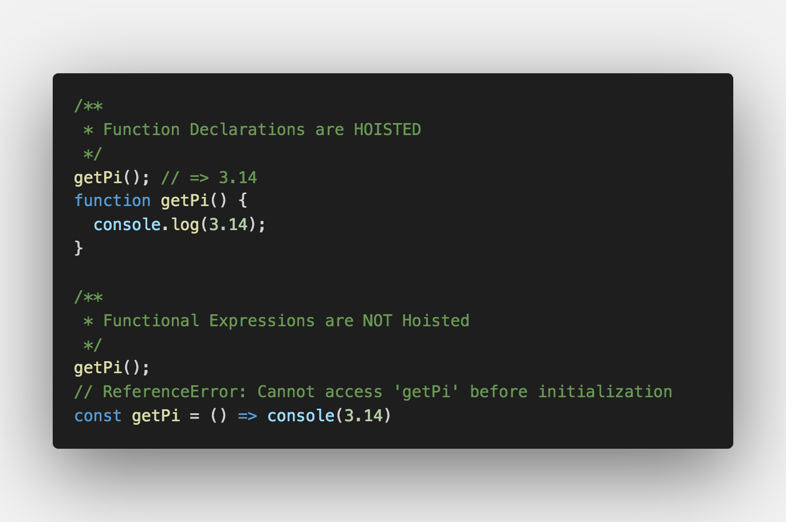
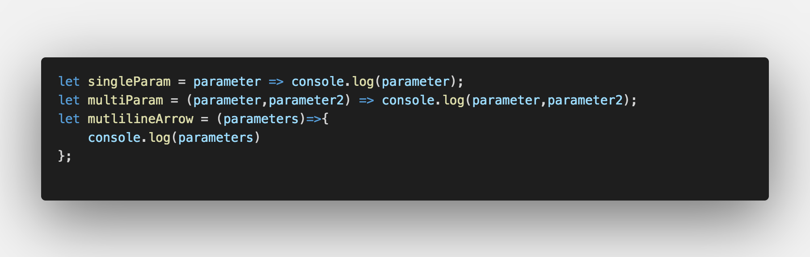
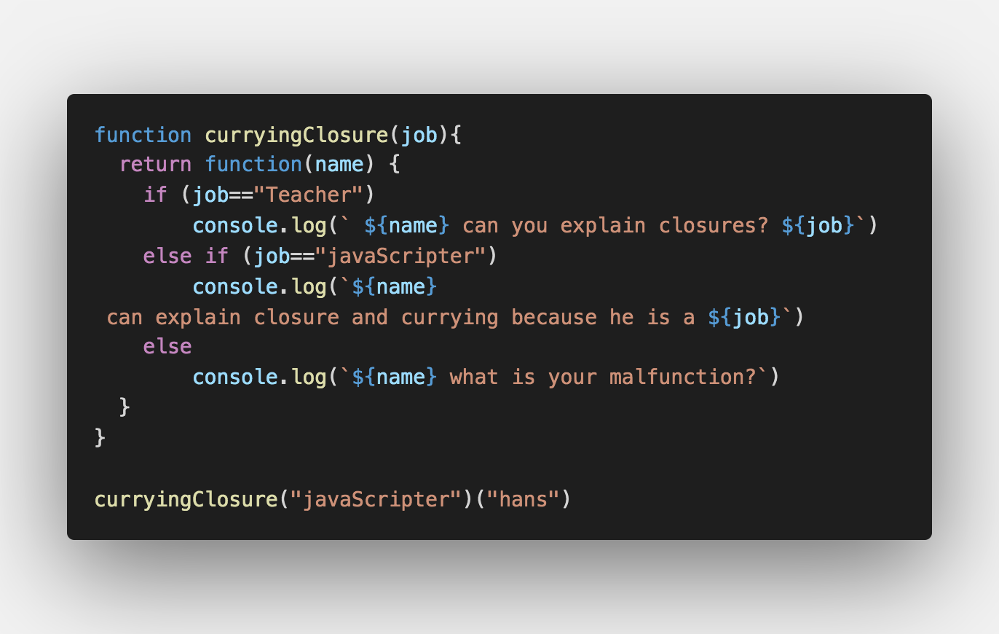
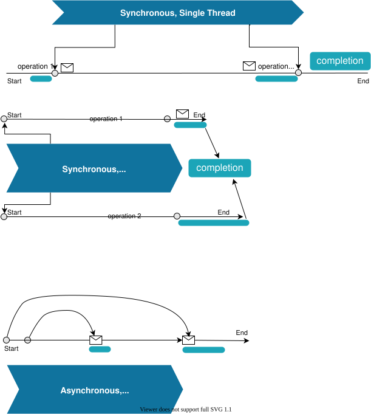

# Lesson 6.2: Functions, Closures, Currying & Seeded RNG (`Std 5.5, 11.11–11.12`)

## Student Learning Objectives (Bloom's Taxonomy)
- **`[L1 Remember]`** Recall function declarations, expressions, arrow functions, IIFEs, parameters vs. arguments, and `return` (`5.5`, `11.11`).
- **`[L2 Understand]`** Explain how **closures** retain outer lexical variables and why pure functions avoid side effects (`5.5`).
- **`[L3 Apply]`** Implement closure factories, higher-order functions (HOFs), currying, and a seeded PRNG (`11.12`).
- **`[L4 Analyze]`** Diagnose loop closure leaks (`var` vs `let`) and flaky unseeded `Math.random()` bugs.
- **`[L5 Evaluate]`** Choose between closure encapsulation vs. global state and deterministic PRNG vs. CSPRNG (`crypto.randomInt`).

---

## 1. Forms, Hoisting, Arrow Functions & Purity (`Std 5.5, 11.11`)
- **Declaration:** `function add(a, b = 0) { return a + b; }` (hoisted to top of scope).
- **Expression / Arrow:** `const add = (a, b = 0) => a + b;` (lexical `this`, concise return, not hoisted before initialization).
- **IIFE:** `(() => { /* isolated scope */ })();`.
- **Pure Functions:** Identical outputs for identical inputs with zero external mutation—making testing trivial.

<p align="center">
  
  
</p>

## 2. Closures, Callbacks, Async Functions & Currying (`Std 5.5`)
A **closure** captures outer scope variables when a nested function is returned, enabling private state without globals:
```javascript
const createCounter = (start = 0) => () => ++start;
const multiplyBy = (factor) => (n) => factor * n; // Currying
```

<p align="center">
  
  
</p>

<p align="center">
  
</p>

## 3. Random Number Generation & Seeding (`Std 11.12`)
- **`Math.random()`:** Returns unseeded `[0, 1)` pseudo-random float (non-reproducible across test runs, **not cryptographically secure**).
- **Seeded LCG PRNG:** Computes a deterministic sequence from a starting integer `seed`—essential for repeatable game maps, procedural worlds, and unit tests.
- **Security Note:** For tokens/passwords use Node's `node:crypto` (`crypto.randomBytes()` / `randomInt()`), NEVER `Math.random()`.

## Lesson Resources
- **Slides:** [`slides/slides.md`](./slides/slides.md)
- **Teacher Demo:** [`code/functionsDemo.js`](./code/functionsDemo.js) & [`../code/functions.js`](../code/functions.js)
- **Student Starter:** [`../../0-student_files/07-functions/functions.js`](../../0-student_files/07-functions/functions.js)
