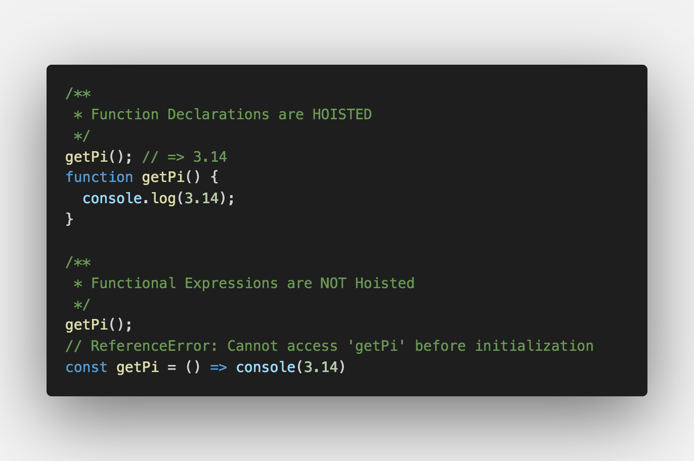
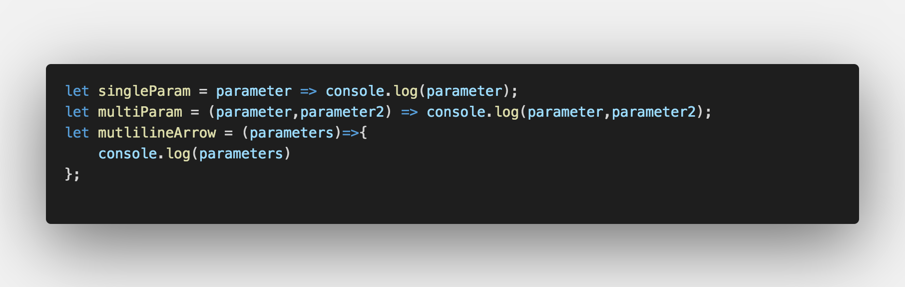
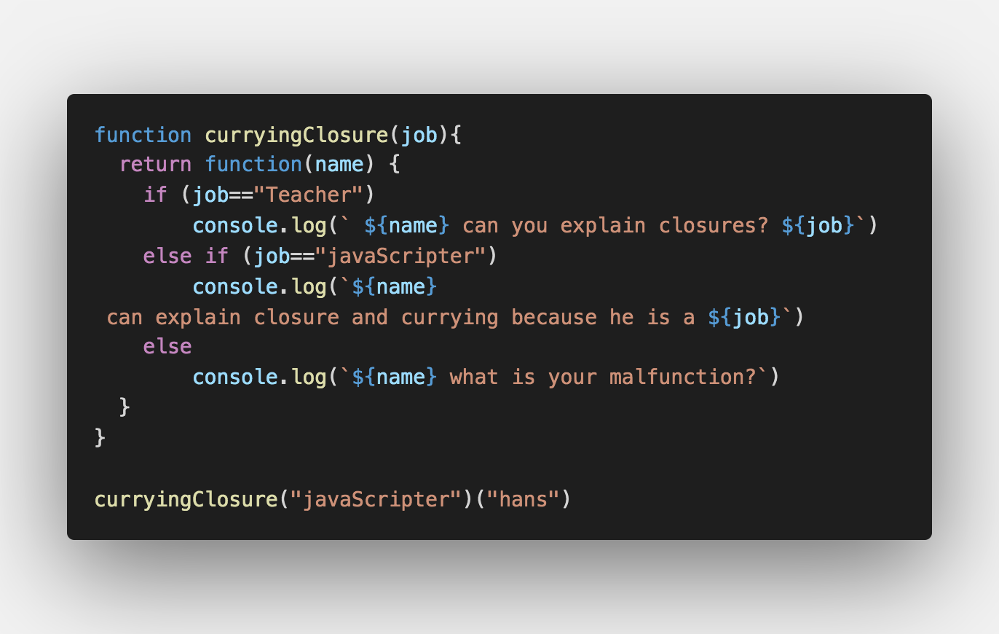
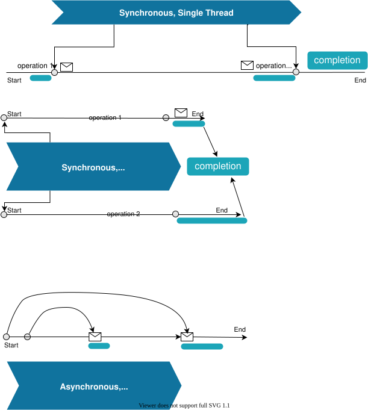

# Lesson 6.2: Functions, Closures & RNG
**AZ CTE Standards `5.5`, `11.10`–`11.12`**

---

### `[L1 Remember]` Declarations, Expressions, Arrows & IIFEs

```javascript
function add(a, b) { return a + b; }          // Declaration (hoisted)
const sub = (a, b) => a - b;                  // Arrow expression
(() => console.log("Isolated IIFE ran!"))();  // IIFE
```




---

### `[L2 Understand -> L3 Apply]` Closures & Private State

```javascript
function createCounter(start = 0) {
  let count = start;      // Encapsulated inside closure!
  return () => ++count;
}
const clicks = createCounter(10);
console.log(clicks(), clicks()); // 11, 12
```



---

### `[L3 Apply]` Higher-Order Functions, Callbacks & Async Preview (`Std 5.5, 11.11`)

```javascript
const discount = (pct) => (cents) => Math.round(cents * (1 - pct));
const student20 = discount(0.20);
console.log(student20(5000)); // 4000
```




---

### `[L4 Analyze -> L5 Evaluate]` Deterministic Seeded RNG (`Std 11.12`)

- `Math.random()` → Great for quick math toys, bad for **security tokens** AND hard to debug flaky game tests!
- **Seeded PRNG (`createRng(seed)`):** Replays exact random sequences identically!
- **CSPRNG (`crypto.randomUUID()` / `randomInt()`):** Required for passwords & tokens!

> **Lab:** Complete `0-student_files/07-functions/functions.js` & run in Node!
