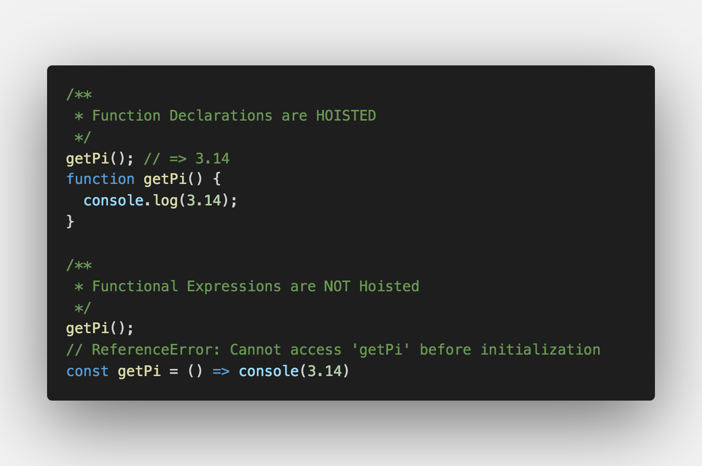
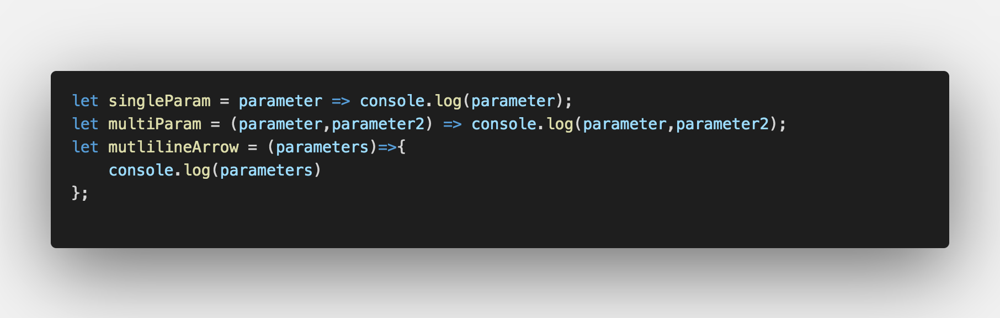
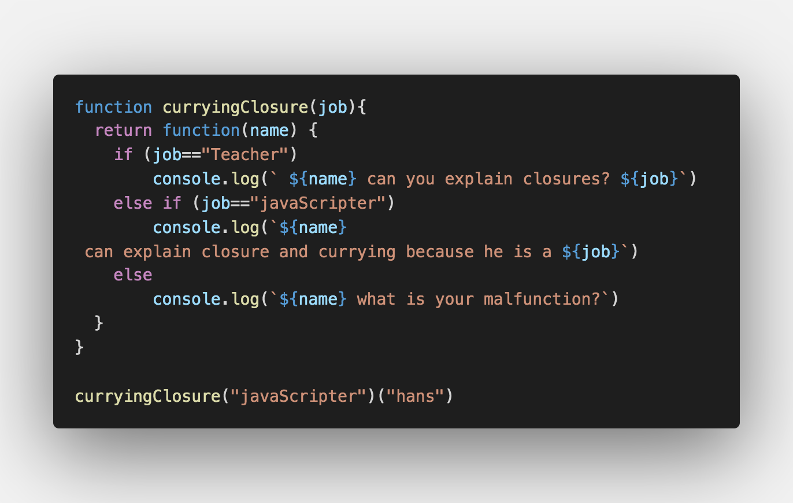
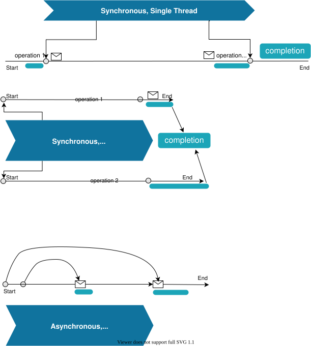

# Chapter 6: Conditionals, Boolean Logic, Closures & Clean Functions (`AZ CTE Stds 5.0, 11.10–11.12`)

> **Before we write a single `if` statement:** The average production bug doesn't come from advanced calculus or distributed consensus. It comes from a developer assuming `"false"` is falsy, forgetting one `break` inside a `switch` statement, burying business logic six tabs deep inside an `if/else` pyramid, or generating password-reset tokens with `Math.random()`.

Imagine working the front desk at a secure lab building where the badge reader checks four rules: you have a badge, your account is verified, you aren't suspended, and you aren't trying to swipe two conflicting temporary passes simultaneously. In sloppy code, that check turns into a sideways staircase of nested `if` blocks nobody dares edit six months later. In clean JavaScript, it becomes flat **guard clauses**, explicit **De Morgan logic**, pure **curried functions**, and **closure-encapsulated state** you can verify in 5 milliseconds with `node --test`.

---

## Chapter Map & Unit Hub

- **Setup & CLI Guide:** [`setup-guide.md`](./setup-guide.md) | **Unit Plan & SMART Goals:** [`unit-guide.md`](./unit-guide.md)
- **Lesson 6.1 — Conditionals, Boolean Logic, Truth Tables & Switch (`Std 5.1–5.4`):**
  [`01-Conditionals-and-Boolean-Logic/readme.md`](./01-Conditionals-and-Boolean-Logic/readme.md) |
  [Slides](./01-Conditionals-and-Boolean-Logic/slides/slides.md) |
  [Student Lab](./01-Conditionals-and-Boolean-Logic/student-lesson.md)
- **Lesson 6.2 — Functions, Closures, Currying & Seeded RNG (`Std 5.5, 11.10–11.12`):**
  [`02-Functions-and-Closures/readme.md`](./02-Functions-and-Closures/readme.md) |
  [Slides](./02-Functions-and-Closures/slides/slides.md) |
  [Student Lab](./02-Functions-and-Closures/student-lesson.md)
- **Unit Assessments & Project:**
  [`evaluations/pre-unit-eval.md`](./evaluations/pre-unit-eval.md) |
  [`evaluations/post-unit-eval.md`](./evaluations/post-unit-eval.md) |
  [`quizzes/quiz-1-concepts.md`](./quizzes/quiz-1-concepts.md) |
  [`quizzes/quiz-2-application.md`](./quizzes/quiz-2-application.md) |
  [`quizzes/unit-test-50.md`](./quizzes/unit-test-50.md) |
  [`projects/unit-project.md`](./projects/unit-project.md)
- **Student TDD Workspaces:**
  [`0-student_files/07-functions/`](../0-student_files/07-functions/functionsAndLogic.test.js) |
  [`0-student_files/projects/unit-06-rules-engine/`](../0-student_files/projects/unit-06-rules-engine/index.test.js)

---

## 1. Myth-Busting Truthiness, Short-Circuiting & Relational Traps (`Std 5.1`)

Let's clear out the four JavaScript logic myths that ambush beginners and senior devs alike:

1. **Myth #1: "`0 || 70` is safe for defaulting a missing test score."**  
   JavaScript has **exactly 8 falsy values** (`false`, `0`, `-0`, `0n`, `""`, `null`, `undefined`, `NaN`) and *everything else is truthy*—including `"0"`, `"false"`, `[]`, and `{}`. When a student earns a legitimate score of `0`, `score || 70` evaluates to `70` and erases their zero! Always reach for the **Nullish Coalescing operator (`??`)**, which only falls back on `null` or `undefined`.
2. **Myth #2: "`1 < x < 5` checks whether `x` sits between 1 and 5."**  
   In Python, yes. In JavaScript, comparison operators evaluate strictly left-to-right! For `x = 99`, `(1 < 99)` evaluates to `true`, and `true < 5` coerces `true` to `1`, checking `1 < 5` → **`true`**! Always write explicit compound bounds: `x > 1 && x < 5`.
3. **Myth #3: "`if (role = 'admin')` compares equality."**  
   Single `=` is **assignment**, not comparison. Not only does it silently overwrite `role` to `'admin'`, the assignment expression itself evaluates to `'admin'` (truthy), handing admin rights to every anonymous visitor! Use strict `===` and `!==` always.
4. **Myth #4: "`&&` and `||` always return booleans."**  
   They don't! Logical `&&` returns the **first falsy operand** (or the last operand if all are truthy); `||` returns the **first truthy operand**. That powers **short-circuit evaluation**: `user && user.save()` skips calling `user.save()` entirely if `user` is falsy.

### Try this right now

Run a 10-second Node experiment exposing chained comparisons and truthiness traps live in your terminal:

```bash
node -e "
console.log('Chained 1 < 99 < 5 bug:', 1 < 99 < 5);
console.log('Proper range check:', 99 > 1 && 99 < 5);
console.log('Truthy strings/arrays:', Boolean('false'), Boolean([]), Boolean({}));
console.log('Falsy zero vs nullish:', 0 || 70, 0 ?? 70);
"
```

---

## 2. Complete Boolean Gates & De Morgan's Laws (`Std 5.2`)

Every digital circuit, firewall rule, and access check builds from core gates. Note how JavaScript models **NOR** and **XOR** explicitly (unlike bitwise `^` on numbers, logical XOR uses `Boolean(a) !== Boolean(b)` so `"admin" ^ "guest"` doesn't evaluate to `0`!):

| `a` | `b` | `AND (a && b)` | `OR (a \|\| b)` | `NOR (!(a \|\| b))` | `XOR (Boolean(a) !== Boolean(b))` |
|---|---|---|---|---|---|
| `false` | `false` | `false` | `false` | **`true`** | `false` |
| `false` | `true` | `false` | `true` | `false` | **`true`** |
| `true` | `false` | `false` | `true` | `false` | **`true`** |
| `true` | `true` | **`true`** | `true` | `false` | `false` |

### De Morgan's Laws (The Cure for Negated-If Headaches)

Whenever you stare at a tangled `!` outside parentheses, apply **De Morgan's Laws**—flip the operator between `&&` and `||` while pushing `!` onto each inner operand:

1. `!(A && B)` ≡ **`!A || !B`**  *(Not both A and B → at least one is false)*
2. `!(A || B)` ≡ **`!A && !B`**  *(Neither A nor B → A is false AND B is false)*

```javascript
// Hard to read negation:
if (!(user.isActive && user.emailVerified)) return 'BLOCKED';

// Clear De Morgan equivalent:
if (!user.isActive || !user.emailVerified) return 'BLOCKED';
```

---

## 3. Clean Guard Clauses vs. Pyramids & Dispatch Maps (`Std 5.3–5.4, 11.10`)

Developers call deeply nested `if { if { if { ... } } }` blocks **"Arrow Code"** or the **Pyramid of Doom**. Every branch pushes validation preconditions downward while hiding the happy path inside four levels of braces. Refactoring with **Early-Return Guard Clauses** (`AZ CTE 11.10`) handles invalid preconditions up front and leaves the core logic unindented at the bottom:

```javascript
// BEFORE: Pyramid of Doom (hard to trace error paths)
function approveBadgeNested(user) {
  if (user !== null) {
    if (user.verified) {
      if (!user.suspended) {
        return 'ACCESS_GRANTED';
      } else {
        return 'DENIED_SUSPENDED';
      }
    } else {
      return 'DENIED_UNVERIFIED';
    }
  } else {
    return 'DENIED_NULL_USER';
  }
}

// AFTER: Flat Guard Clauses (reads top-to-bottom like a security checklist)
function approveBadgeClean(user) {
  if (!user) return 'DENIED_NULL_USER';
  if (!user.verified) return 'DENIED_UNVERIFIED';
  if (user.suspended) return 'DENIED_SUSPENDED';
  return 'ACCESS_GRANTED';
}
```

### `switch` Fall-Through Traps vs. Dispatch Maps

A classic `switch` bug happens when someone omits `break` (or `return`) at the end of a `case`: execution silently **falls through** into the next branch! When mapping simple static keys (`'free'`, `'pro'`, `'team'`), an immutable **Dispatch Map (`Object` or `Map`)** eliminates `break` bugs completely:

```javascript
const PLAN_DISPATCH = new Map([
  ['free', { priceCents: 0, seats: 1 }],
  ['pro', { priceCents: 1900, seats: 5 }],
  ['team', { priceCents: 4900, seats: 25 }],
]);

const resolvePlan = (tier) => PLAN_DISPATCH.get(tier) ?? { priceCents: 0, seats: 0 };
```

| Pattern | Best When | Classic Bug / Watch-Out |
|---|---|---|
| **Guard Clauses** | Rejecting invalid states/nulls at top of function | Forgetting `return` inside the guard branch lets invalid execution continue |
| **`switch (val)`** | Multi-case branching, shared fall-through intent, complex cases | Missing `break` falls into next case; uses strict `===` comparison |
| **Dispatch `Map` / Object** | Mapping string commands/tiers directly to values or handlers | Never forget `?? defaultHandler`; safer with `Map` to avoid `__proto__` key collisions |

---

## 4. Functions, Hoisting, Closures, HOFs & Currying (`Std 5.5, 11.11`)

In JavaScript, **functions are first-class values**—you can store them in variables, pass them into other functions (**Callbacks / Higher-Order Functions**), and return newly minted functions (**Factories / Closures**).

<p align="center">
  
  
</p>

### Declarations vs. Expressions vs. Arrows vs. IIFEs

- **Function Declaration (`function square(n) { return n * n; }`):** Fully hoisted (callable above its line in scope) and owns dynamic `this`.
- **Function Expression / Arrow (`const square = (n) => n * n;`):** Stored in `const`/`let`, subject to the **Temporal Dead Zone (`ReferenceError` if called before declaration)**, and inherits **`this` lexically** from surrounding scope.
  - **Parentheses Gotcha:** Returning an object literal concisely requires parentheses `const makeUser = (id) => ({ id });`—otherwise JS parses `{ id }` as a function block returning `undefined`!
- **IIFE (`(() => { ... })()`):** Immediately Invoked Function Expression used to run one-shot setup code inside an isolated scope without polluting globals.

### Pure Functions, Closures & Currying

A **Pure Function** relies *only* on its arguments, mutates *nothing* outside itself, and always returns the same output for identical inputs. Compare that with a dirty global variable: anyone anywhere can overwrite `let count = 0`, breaking tests unpredictably.

A **Closure** solves shared state safely: when an inner function is returned from an outer function, it carries a live reference backpack (**lexical environment**) to the outer function's local variables—even after the outer function has returned!

<p align="center">
  
  
</p>

<p align="center">
  
</p>

```javascript
// Closure Factory: each counter owns strictly private lexical state
function createCounter(start = 0) {
  let current = start;
  return {
    increment: () => ++current,
    value: () => current,
  };
}

// Higher-Order Function (HOF) + Currying: configure once, reuse anywhere
const applyTaxRate = (rate) => (cents) => Math.round(cents * (1 + rate));
const withAzTax = applyTaxRate(0.086);
console.log(withAzTax(1000)); // 1086
```

#### Try this right now

Spot the infamous **`var` vs. `let` loop closure bug** directly in Node:

```bash
node -e "
const bad = [], good = [];
for (var i = 0; i < 3; i++) bad.push(() => i);
for (let j = 0; j < 3; j++) good.push(() => j);
console.log('var closures (shared!):', bad.map((fn) => fn()));
console.log('let closures (per-iteration!):', good.map((fn) => fn()));
"
```

---

## 5. Seeded PRNG vs. `Math.random()` vs. CSPRNG (`Std 11.12`)

Why would an engineer write their own random generator when `Math.random()` is right there? Because **`Math.random()` serves two completely opposite masters badly:**

| Generator Type | Deterministic Replay (`seed`)? | Cryptographically Secure? | Best Engineering Use Case |
|---|---|---|---|
| `Math.random()` | **No** (hidden engine state) | **No** (predictable PRNG state) | Quick non-critical UI confetti or tossaway prototypes |
| **Seeded LCG PRNG** (Closure) | **Yes** (same seed → identical sequence) | **No** | Repeatable unit tests, procedural game maps, Monte Carlo simulations |
| **`node:crypto` CSPRNG** (`randomInt`, `randomBytes`, `randomUUID`) | **No** (OS hardware entropy) | **Yes** | API keys, password-reset tokens, session IDs, cryptographic salts |

```javascript
// Deterministic 32-bit Linear Congruential Generator (LCG) inside a closure
function createSeededRng(seed = 1234) {
  let state = seed >>> 0;
  return () => {
    state = (1664525 * state + 1013904223) >>> 0;
    return state / 2 ** 32; // Float in [0, 1)
  };
}
```

---

## 6. Essential Terminal Commands & TDD Workflow

Run instructor demonstrations, your student lab suites, and the Unit 06 automated grader from the repository root:

```bash
# 1. Run instructor demos
node 06-Functions/01-Conditionals-and-Boolean-Logic/code/booleanLogicDemo.js
node 06-Functions/02-Functions-and-Closures/code/functionsDemo.js

# 2. Check syntax and run your active RED -> GREEN node:test suites
node --check 0-student_files/07-functions/*.js
node --check 0-student_files/projects/unit-06-rules-engine/*.js
node --test 0-student_files/07-functions/functionsAndLogic.test.js
node --test 0-student_files/projects/unit-06-rules-engine/index.test.js

# 3. Grade Unit 06 progress
npm run grade -- --unit 06
```

---

## 7. Unit 6 Terminology Reference & Error Triage Table

| Key Term | Plain-English Definition |
|---|---|
| **Short-Circuiting** | Stopping boolean evaluation (`a && b` or `a \|\| b`) the instant the first operand settles the result |
| **De Morgan's Laws** | `!(A && B) === !A \|\| !B` and `!(A \|\| B) === !A && !B` |
| **Guard Clause** | Early `return`/`throw` validating preconditions at the top of a function to avoid deep nesting |
| **Closure** | Function bundling its code together with lexical access to its enclosing scope variables |
| **Currying** | Transforming `fn(a, b)` into `fn(a)(b)` so configuration parameters lock in early via closure |
| **Pure Function** | Function whose output depends strictly on inputs with zero observable side effects |
| **Seeded PRNG** | Stateful closure (`LCG`) reproducing exact `[0, 1)` sequences whenever initialized with the same `seed` |

| Symptom / Bug | Root Cause | Concrete Fix |
|---|---|---|
| `0` grade silently becomes `70` | Used `score \|\| 70` (treats numeric `0` as falsy) | Switch to nullish coalescing: `score ?? 70` |
| `1 < x < 5` returns `true` when `x = 99` | Left-to-right comparison coerces `(1 < 99)` → `true` (`1`) `< 5` | Write explicit compound bounds: `x > 1 && x < 5` |
| `switch` runs two branches unexpectedly | Missing `break` or `return` triggered fall-through | Add `break;` at each case end or switch to a `Map` dispatch table |
| Arrow function `(id) => { id }` returns `undefined` | Curly braces create a function block, not an object literal | Wrap object literal in parentheses: `(id) => ({ id })` |
| Every loop callback prints `3` instead of `0, 1, 2` | Loop variable declared with function-scoped `var` | Replace `var i` with block-scoped `let i` |
| `node --test` fails seeded RNG repeatability | Used `Math.random()` instead of closure `state` LCG | Initialize `let state = seed >>> 0` inside `createSeededRng(seed)` |

---

## Next Steps

1. Configure your debug and complexity lint checks using [`setup-guide.md`](./setup-guide.md).
2. Turn [`0-student_files/07-functions/functionsAndLogic.test.js`](../0-student_files/07-functions/functionsAndLogic.test.js) and [`0-student_files/projects/unit-06-rules-engine/index.test.js`](../0-student_files/projects/unit-06-rules-engine/index.test.js) from **RED** to **GREEN** (`npm run grade -- --unit 06`).
3. Test your mastery on the 50-question Unit 6 exam at [`quizzes/unit-test-50.md`](./quizzes/unit-test-50.md).
