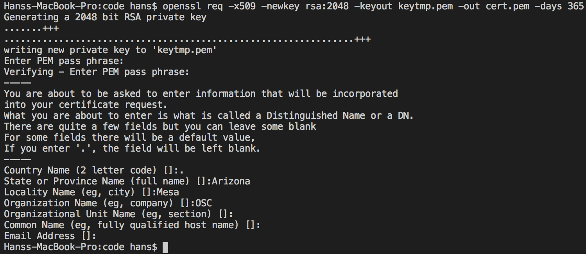

# Chapter 11: Cybersecurity, Cryptography, Zero Trust, SIEM & STRIDE (`Std 1.0 | ITS 201–202 / Sec+`)

> **Before you wire another Express or `node:http` endpoint onto the open internet:** Grep any old student repo for `"SELECT * FROM users WHERE name = '" +`, `Access-Control-Allow-Origin: *`, or a quick `crypto.createHash('md5')` helper copied from a 2012 blog post. If any single one of those lines shows up, an automated scanner finds and exploits your server faster than you can close your laptop.

Let's be honest about something security checklists hide: **nobody hacks an app because you forgot a semicolon—they breach it because you trusted user input, skipped one access boundary, or assumed nobody would look inside your LAN.**

Every semester I watch smart developers spend three weekends crafting sleek frontends, then lose the whole database in five minutes because a file-download route concatenates `req.query.file` directly to `/uploads/`, a login table stores unsalted fast hashes, or Firewall Rule #1 says `ALLOW ANY -> 443` right above `DENY ATTACKER_IP -> 443` (where first-match ordering silently lets the attacker walk right past!).

**Security isn't a plugin you install on Friday afternoon. It is how every byte is encrypted, verified, segmented, logged, and governed from day one.**

Chapter 11 integrates **AZ CTE Standard 1.0 (`1.1–1.7`)** with enterprise defense, Zero Trust architecture, SIEM correlation, quantitative risk math, DRP, and regulatory compliance from **West-MEC `ITS 201–202` (`CompTIA Security+` / `ADE Network Security 1.0, 4.5–5.10, 9.1–11.6`)**.

---

## Chapter Map, Environment Setup & Assessments

Bookmark these unit hubs before diving into the deep read:

1. **[Lesson 11.1 — Cybersecurity, OWASP Top 10, Cryptography & Server Hardening (`Std 1.0`)](./student-lesson.md)**
   - Lesson Plan & Slides: [`lesson-plan.md`](./lesson-plan.md) | [`slides/slides.md`](./slides/slides.md)
   - Demos: [`cryptoSanitizationDemo.js`](./code/cryptoSanitizationDemo.js), [`aesTlsDemo.test.js`](./code/aesTlsDemo.test.js) & [`secureServer.js`](./code/secureServer.js)
   - Student Starters: [`cryptoSanitizeLab.js`](../0-student_files/12-security-server/cryptoSanitizeLab.js) & [`secureServer.js`](../0-student_files/12-security-server/secureServer.js)
2. **[Lesson 11.2 — Zero Trust, Firewalls, SIEM Correlation & STRIDE (`ITS 201–202`)](./02-Zero-Trust-Firewalls-SIEM-and-STRIDE/readme.md)**
   - Slides & Student Lab: [`02-Zero-Trust-Firewalls-SIEM-and-STRIDE/slides/slides.md`](./02-Zero-Trust-Firewalls-SIEM-and-STRIDE/slides/slides.md) | [`02-Zero-Trust-Firewalls-SIEM-and-STRIDE/student-lesson.md`](./02-Zero-Trust-Firewalls-SIEM-and-STRIDE/student-lesson.md)
   - Demo & Starter: [`zeroTrustSiemDemo.mjs`](./02-Zero-Trust-Firewalls-SIEM-and-STRIDE/code/zeroTrustSiemDemo.mjs), [`zeroTrustSiemDemo.test.mjs`](./02-Zero-Trust-Firewalls-SIEM-and-STRIDE/code/zeroTrustSiemDemo.test.mjs) & [`firewallSiemLab.mjs`](../0-student_files/11-zero-trust-siem/firewallSiemLab.mjs)

- **Environment & OpenSSL Setup Guide:** [`setup-guide.md`](./setup-guide.md)
- **Pre/Post Unit Evals:** [`evaluations/pre-unit-eval.md`](./evaluations/pre-unit-eval.md) | [`evaluations/post-unit-eval.md`](./evaluations/post-unit-eval.md)
- **Quizzes & 50-Q Mastery Exam:** [`quizzes/quiz-1-concepts.md`](./quizzes/quiz-1-concepts.md) | [`quizzes/quiz-2-application.md`](./quizzes/quiz-2-application.md) | [`quizzes/unit-test-50.md`](./quizzes/unit-test-50.md)
- **Unit Project:** [`projects/unit-project.md`](./projects/unit-project.md) ([`unit-11-security-hardening-audit/index.js`](../0-student_files/projects/unit-11-security-hardening-audit/index.js) & [`11-zero-trust-siem/firewallSiemLab.mjs`](../0-student_files/11-zero-trust-siem/firewallSiemLab.mjs))
- **Automated TDD Check:** Run `npm run grade -- --unit 11`

---

## 1. CIA Triad, Human/AI Threats & Access Hygiene (`Std 1.1–1.3, 1.6`)

Every defect you find maps cleanly onto one or more pillars of the **CIA Triad (`1.6`)**:
- **Confidentiality:** Only authorized subjects read private secrets (`TLS 1.3`, `AES-256-GCM`, **Principle of Least Privilege**, `VLAN`/`DMZ` isolation).
- **Integrity:** Unauthorized modifications cannot slip past unnoticed (`SHA-256`, `GCM` auth tags, RSA digital signatures, immutable SIEM logs).
- **Availability:** Systems keep serving legitimate traffic despite traffic floods or hardware outages (`429` rate limiting, Hot/Warm failover, DDoS scrubbing).

### Phishing, AI Voice Cloning, AAA, MFA & SSO (`1.1, 1.3`)

Modern social engineering doesn't stop at misspelled emails—attackers pair caller-ID **spoofing** with **AI voice deepfakes** impersonating executives requesting wire transfers or MFA reset codes. Defend with **AAA**:
1. **Authentication:** Who are you? Enforce **hardware/app MFA (`FIDO2` WebAuthn)** + **SSO (`SAML 2.0` XML assertions / `OIDC` JSON JWTs)** backed by a single hardened Identity Provider (`IdP`).
2. **Authorization:** What can you touch? Apply **RBAC + Least Privilege**—zero wildcard admin roles by default.
3. **Accounting:** What did you do? Record tamper-evident logs into a **SIEM** and track **CVEs** continuously (`npm audit`).

---

## 2. Cryptography & OpenSSL TLS vs. Salted Hashing (`Std 1.4, 8.2`)

> **Myth:** *"We encrypt our users' passwords with AES so if someone asks support for their password, or if we switch auth providers, we can decrypt them safely."*
> **Reality:** If your server can decrypt passwords, **any attacker who compromises your encryption key or database server steals every user's plaintext password immediately**. Passwords MUST NEVER be reversible!

Know all four cryptographic tools cold (`Std 1.4`):

| Tool | Reversible? | Exact Security Job | Node.js Implementation |
|---|---|---|---|
| **Authenticated Encryption (`AES-256-GCM`)** | **Yes** (with key + IV + AAD) | Protects secret tokens/files + catches tampering via Auth Tag | `crypto.createCipheriv('aes-256-gcm', key, iv12)` |
| **Salted Slow Hashing (`scrypt` / `Argon2`)** | **No** (one-way!) | Stores passwords safely; unique random 16-byte **salt** kills Rainbow Tables | `crypto.scryptSync(pw, salt, 32)` + **`crypto.timingSafeEqual()`** |
| **Digital Signature (`RSA` / `ECDSA`)** | Public verify only | Proves publisher identity + integrity (`X.509` TLS certs, npm releases) | `crypto.sign('sha256', ...)` / `crypto.verify(...)` |
| **Sandboxes & VMs / Containers** | Execution isolation | Traps untrusted code away from host disks/OS kernels | Browser sandboxes, Linux containers, VMs |

Why `crypto.timingSafeEqual()` instead of `===`? Because standard string `===` stops comparing at the **very first mismatched byte**, leaking byte-by-byte timing side-channels over microsecond statistics!

### Local HTTPS / TLS with OpenSSL (`Std 1.4, 8.2`)

Never ship login credentials or cookies over unencrypted HTTP (`port 80`). Generate local development certificates with OpenSSL and pass them into `node:https`:

```bash
openssl req -x509 -newkey rsa:2048 -keyout key.pem -out cert.pem -days 365 -nodes
```

<p align="center">
  
</p>

> **Try this right now:** Run Node's `AES-256-GCM` tamper-detection and RSA digital-signature verification suite plus the `scrypt`/sanitization demo:
> ```bash
> node --test 11-Internet-Server-Security/code/aesTlsDemo.test.js
> node 11-Internet-Server-Security/code/cryptoSanitizationDemo.js
> ```

```javascript
// Runnable per-user random salt + scrypt + timingSafeEqual check
const crypto = require('node:crypto');

function hashPassword(password) {
  const salt = crypto.randomBytes(16).toString('hex');
  const key = crypto.scryptSync(password, salt, 32).toString('hex');
  return `${salt}:${key}`;
}

function verifyPassword(password, stored) {
  const [salt, expectedHex] = stored.split(':');
  const actualBuf = crypto.scryptSync(password, salt, 32);
  return crypto.timingSafeEqual(actualBuf, Buffer.from(expectedHex, 'hex'));
}

const digest = hashPassword('CorrectHorseBatteryStaple!');
console.log('Valid login?', verifyPassword('CorrectHorseBatteryStaple!', digest)); // true
console.log('Wrong guess?', verifyPassword('password123', digest));                  // false
```

---

## 3. OWASP Top 10 Defenses in Node.js (`Std 1.2, 1.5, 1.7`)

Three coding bugs account for a massive fraction of real web compromises—and every single one takes five lines of disciplined code to kill permanently:

1. **Reflected / Stored XSS:** Never reflect raw strings into HTML responses or `innerHTML`. Escape all five hazardous characters (`&`, `<`, `>`, `"`, `'`) with `escapeHtml()`, pair with `X-Content-Type-Options: nosniff`, lock down CORS origins (never `*` with credentials), and enforce `Content-Security-Policy`.
2. **SQL Injection (`SQLi`):** Never interpolate user strings (`\`SELECT ... '${q}'\``). Always send **Parameterized Queries** (`SELECT id, name FROM items WHERE name = $1`, `[q]`) so database drivers treat input strictly as literal data, never SQL syntax!
3. **Path Traversal (`../`):** Never concatenate paths (`baseDir + '/' + req.query.file`). Canonicalize via `path.resolve()` and enforce a strict directory jail check:

```javascript
// Runnable path traversal jail + XSS escaping reference (Node 24)
const path = require('node:path');

function safeFilePath(baseDir, requestedName) {
  const root = path.resolve(baseDir);
  const resolved = path.resolve(root, String(requestedName || ''));
  if (!resolved.startsWith(root + path.sep)) {
    throw new Error('Blocked path traversal attempt outside base directory');
  }
  return resolved;
}

console.log('Safe:', safeFilePath('/srv/public', 'reports/q1.pdf'));
try {
  safeFilePath('/srv/public', '../../.env');
} catch (err) {
  console.log('Blocked traversal:', err.message);
}
```

---

## 4. Zero Trust, Firewalls, SIEM, STRIDE & Risk/DRP (`ITS 201–202`)

Perimeter security fails the second an attacker clicks one phishing link inside the building. **Zero Trust ("Never Trust, Always Verify")** assumes the corporate LAN itself is hostile—requiring identity, device posture, MFA, and **micro-segmentation** at every step.

### Three Data States, Segmentation (`VLAN`/`DMZ`) & Firewall ACLs

| Data State | Where It Lives | Core Security Control |
|---|---|---|
| **At Rest** | SSDs, backups, USBs | AES-256 full-disk encryption (**BitLocker + TPM**, **LUKS**), locked racks, **Faraday bags/cages** blocking RF commands |
| **In Motion** | Wi-Fi, LAN, WAN links | **TLS 1.3**, SSH, IPsec / WireGuard VPN |
| **In Use** | CPU registers & RAM | Process sandboxes, secure enclaves, Least Privilege, zeroing buffers |

Isolate networks using **802.1Q `VLANs`** (separating `Guest`, `Corp`, and `Prod-DB`) and place public reverse proxies inside a dual-firewall **`DMZ`** so even a breached web server cannot touch internal databases directly. Inside ordered firewall ACLs, **first-match wins -> implicit deny all**:

| Priority Order | Action | Source -> Destination | Why Ordering Matters |
|---|---|---|---|
| **Rule 1** | `DENY` | `198.51.100.44 -> DMZ:443` | Specific block placed **first** catches known attackers |
| **Rule 2** | `ALLOW` | `ANY -> DMZ:443 (HTTPS)` | General inbound web permit sits *below* explicit blocks |
| **Rule 3 (Implicit)** | `DENY ALL` | `ANY -> Prod-DB:5432` | Zero Trust default blocks direct external LAN/DB probes |

- **Packet-Filtering (Stateless L3/L4):** Evaluates each packet in isolation (breaks unless return ephemeral ports are opened explicitly).
- **Stateful Inspection:** Tracks `SYN -> ESTABLISHED` flows automatically.
- **Next-Gen Firewall (`NGFW` L7) + `IDS/IPS`:** Deep-inspects HTTP/TLS App-ID payloads; passive **IDS** alerts whereas inline **IPS** drops exploits immediately.

### SIEM Correlation, STRIDE & Quantitative Risk (`SLE/ALE` & Matrix)

Isolated server logs miss multi-stage attacks. **SIEM** correlates events across firewalls, `sshd`, and `SAML/OIDC` IdPs to catch:
- **Brute-force fail burst + `AUTH_SUCCESS`** from the same external IP
- **Impossible-travel SSO** (`Phoenix -> Frankfurt` inside 5 minutes)
- **AI statistical Z-score anomalies** (e.g., `1.2 MB` off-hours dump vs. `400 B` baseline)

Model threats systematically across **STRIDE** (**S**poofing, **T**ampering, **R**epudiation, **I**nformation Disclosure, **D**enial of Service, **E**levation of Privilege) and prioritize controls with quantitative **Risk Math**:
- **Quantitative Annualized Risk (`Security+`):**
  $$\text{SLE} = \text{Asset Value (AV)} \times \text{Exposure Factor (EF)}, \qquad \text{ALE} = \text{SLE} \times \text{Annualized Rate of Occurrence (ARO)}$$
  *Worked example:* A customer database has `AV = $250,000`. A SQLi breach exposes `EF = 40%` (`0.40`), so **`SLE = $100,000`**. At `ARO = 0.5` incidents/yr (once every 2 years), **`ALE = $50,000/yr`**. Adding an `$8,000/yr` NGFW + parameterized query gate drops `ARO` to `0.02` (`ALE_after = $2,000/yr`), justifying the safeguard by saving **`$40,000/yr` net**!
- **Qualitative Risk Matrix:** $\text{Risk Score} = \text{Asset} \times \text{Likelihood} \times \text{Impact}$ -> **Mitigate**, **Transfer** (insurance), **Avoid**, or **Accept**.

```javascript
// Runnable AI Z-score log anomaly & brute-force detector probe (Node 24)
function zScoreEgressAnomaly(currentBytes, baselineMean = 420, baselineStdDev = 90) {
  const z = (currentBytes - baselineMean) / baselineStdDev;
  return { currentBytes, zScore: Number(z.toFixed(2)), exfiltrationAlert: z >= 3.0 };
}
console.log('Normal healthcheck:', zScoreEgressAnomaly(480));       // false
console.log('Off-hours DB dump :', zScoreEgressAnomaly(1_200_000)); // true (massive Z-score spike!)
```

### Incident Remediation Playbook (`Std 1.7`) & DRP/Compliance Governance

When a token leaks into Git history or SIEM triggers an impossible-travel alert, never settle for deleting the file—run the 4-step playbook: **(1) Revoke & rotate keys immediately**, **(2) Query SIEM blast radius**, **(3) Enforce hardware MFA + Ed25519 SSH keys**, and **(4) Lock CI secret scanning**.

Match disaster recovery backups to **Recovery Point Objective (`RPO` max data loss)** and **Recovery Time Objective (`RTO` max downtime)**: **Hot Site** (`< 15m` synced failover), **Warm Site** (hours), or **Cold Site** (empty powered shell, days/weeks). Always engineer within law—and never store central biometric templates carelessly, because fingerprints/faces are **biologically non-revocable**, triggering severe **Illinois BIPA / GDPR Art. 9** statutory penalties:

| Framework / Policy | Domain Protected | Concrete Engineering Control |
|---|---|---|
| **GDPR / Illinois BIPA** | EU PII & non-revocable biometric data | 72h breach notice, explicit consent, local hardware TPM/WebAuthn enclaves |
| **HIPAA / FERPA** | US medical `PHI` & student records | `AES-256` at rest, `TLS 1.3`, strict RBAC + audit trails |
| **PCI-DSS / SOX** | Payment cards & public financial audits | Isolated `CDE` `VLAN`, tamper-evident logs, never store raw CVV |
| **FCC / DRM / EFF / AUP** | RF spectrum, copyright, civil rights & org rules | Licensed wireless telemetry, lawful encryption, documented acceptable use |

> **Try this right now:** Execute Lesson 11.2's Zero Trust ACL, SIEM + AI Z-score anomaly, STRIDE, DRP, and compliance suite:
> ```bash
> node 11-Internet-Server-Security/02-Zero-Trust-Firewalls-SIEM-and-STRIDE/code/zeroTrustSiemDemo.mjs
> node --test 11-Internet-Server-Security/02-Zero-Trust-Firewalls-SIEM-and-STRIDE/code/zeroTrustSiemDemo.test.mjs
> ```

---

## 5. Chapter 11 Terminology & Error Triage Reference

| Term | Crisp Engineering Meaning |
|---|---|
| **`scrypt` + Random Salt** | Memory-hard one-way password hash with unique per-user random bytes blocking Rainbow Tables |
| **`timingSafeEqual`** | Constant-time Buffer check preventing byte-mismatch latency side-channels |
| **Zero Trust (`VLAN`/`DMZ`)** | Never trusting internal LANs; segmenting subnets and authorizing every identity/session request |
| **`SLE` / `ALE` Risk Math** | Single Loss Expectancy ($AV \times EF$) $\times$ Annual Rate ($ARO$) = Annualized Loss Expectancy |
| **`RPO` / `RTO`** | Maximum tolerable data age lost (`RPO`) vs. maximum tolerable recovery downtime (`RTO`) |

| Symptom / Failure | Root Cause | Exact Diagnostic Fix |
|---|---|---|
| `GET /files?name=../../.env` returns host secrets | String concatenation trusts `..` traversal segments | Resolve `base` + `target` via `path.resolve()` and enforce `startsWith(base + path.sep)` |
| Rule 2 `DENY badIP` never triggers in firewall | Rule 1 `ALLOW ANY` sits higher (first-match shadows Rule 2) | Place specific `DENY` rules **strictly above** broader `ALLOW` rules; end with implicit deny |
| `node --test` hangs when importing `secureServer.js` | `server.listen(7001)` ran unconditionally at top level | Wrap `.listen()` inside `if (require.main === module) { ... }` |
| `decryptAes256Gcm` throws `Unsupported state` | Ciphertext, `authTag`, key, or AAD modified in transit | Reject payload immediately—integrity verification caught tampering cleanly |
| Central biometric DB triggers legal audit stop | Faces/prints cannot be revoked/rotated after a breach | Keep biometrics inside local hardware TPM/WebAuthn enclaves with explicit consent |

---

## Ready to Test Your Mastery?

1. Set up OpenSSL keys and security inspection CLI tools via [`setup-guide.md`](./setup-guide.md).
2. Turn every RED test GREEN in [`cryptoSanitizeLab.js`](../0-student_files/12-security-server/cryptoSanitizeLab.js), [`secureServer.js`](../0-student_files/12-security-server/secureServer.js), [`firewallSiemLab.mjs`](../0-student_files/11-zero-trust-siem/firewallSiemLab.mjs), and [`unit-11-security-hardening-audit/index.js`](../0-student_files/projects/unit-11-security-hardening-audit/index.js) until `npm run grade -- --unit 11` passes **GREEN**.
3. Challenge yourself on the 50-question mastery exam in [`quizzes/unit-test-50.md`](./quizzes/unit-test-50.md).
