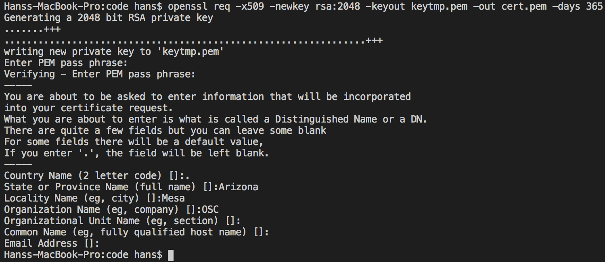

# Chapter 11: Cybersecurity & Hardening
**AZ CTE Standard 1.0 (`1.1`–`1.7`)**

---

### `[L1 Remember]` CIA Triad & Threats (`Std 1.1, 1.6`)

- **Confidentiality:** Keep secrets private (HTTPS/TLS, Least Privilege)
- **Integrity:** Detect tampering (SHA-256, Digital Signatures)
- **Availability:** Stay online under load (Rate limiting, redundancy)
- **Threats (`1.1–1.3`):** Phishing, spoofing, AI impersonation → enforce **MFA** + **Least Privilege** + **SIEM / CVE patching**!

---

### `[L2 Understand -> L3 Apply]` Encryption (`AES-256-GCM`) vs. Hashing (`Std 1.4`)

- **Authenticated Encryption (`AES-256-GCM`):** Two-way reversible with secret key + unique 96-bit IV + integrity `authTag` (rejects tampering!).
- **Password Hashing (`scrypt` + Salt):** One-way slow mathematical digest — use **`crypto.timingSafeEqual`** on verify!

---

### `[L3 Apply]` HTTPS / TLS Certificates in Node.js (`Std 1.4, 8.2`)

```bash
openssl req -x509 -newkey rsa:2048 -keyout key.pem -out cert.pem -days 365 -nodes
```

```javascript
const server = https.createServer({ key: fs.readFileSync('key.pem'), cert: fs.readFileSync('cert.pem') }, app);
```



---

### `[L3 Apply -> L4 Analyze]` Injection & Traversal Defenses (`Std 1.5`)

- **XSS:** Escape `& < > " '` cleanly and use `textContent` + `nosniff`.
- **SQL Injection:** NEVER write ``SELECT * FROM users WHERE name='${input}'`` — bind parameters (`$1`)!
- **Path Traversal:** Block `../../etc/passwd` with `path.resolve(baseDir, userFile)` boundary checks!

> **Labs:** Run `node 11-Internet-Server-Security/code/cryptoSanitizationDemo.js`, `node --test 11-Internet-Server-Security/code/aesTlsDemo.test.js`, and finish `0-student_files/12-security-server/`!
