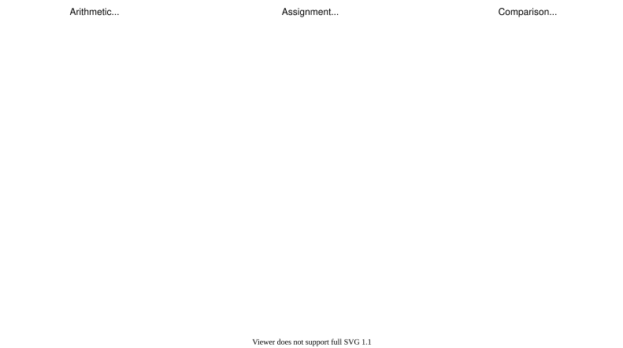

# Chapter 12: Computer Mathematics, Binary & Bitwise Logic (`AZ CTE Std 4.0`)

## Student Learning Objectives (Bloom's Taxonomy)
By the end of this chapter, you should be able to:
- **`[L1 Remember]`** Recall binary prefixes (bit, byte, KB–PB), clock frequency units (kHz–GHz), and base-2 / base-16 digit weights (`4.1`, `4.2`).
- **`[L2 Understand]`** Explain IEEE-754 floating-point precision loss (`0.1 + 0.2 !== 0.3`) and contrast integer, floating-point, and fixed-point arithmetic (`4.5`, `4.6`).
- **`[L3 Apply]`** Convert between Binary, Decimal, and Hexadecimal in Node.js; translate algebraic formulas (Pythagorean Theorem, Ohm's Law) and **GEMA** expressions into JavaScript (`4.2`–`4.4`).
- **`[L4 Analyze]`** Debug floating-point rounding bugs in financial totals and trace bitwise mask/shift permissions (`&`, `|`, `^`, `<<`, `>>`) (`4.6`, `4.7`).
- **`[L5 Evaluate]`** Select appropriate numeric types (`number` vs. integer cents vs. `BigInt`) based on overflow and precision risk (`4.5`, `4.6`).

---

## 1. Storage & Frequency Units (`Std 4.1`)

| Storage Unit | Value | Clock Frequency Unit | Cycles per Second |
|---|---|---|---|
| **Bit (`b`)** | Single `0` or `1` | **Hertz (`Hz`)** | 1 cycle / sec |
| **Byte (`B`)** | `8 bits` (values `0`–`255`) | **Kilohertz (`kHz`)** | $10^3$ cycles / sec |
| **Kilobyte (`KB` / `KiB`)** | $10^3$ B (or $2^{10} = 1024$ KiB) | **Megahertz (`MHz`)** | $10^6$ cycles / sec |
| **MB / GB / TB / PB** | $\times 1000$ (or $\times 1024$ binary) per step | **Gigahertz (`GHz`)** | $10^9$ cycles / sec |

---

## 2. Number Bases: Binary, Decimal & Hexadecimal (`Std 4.2`)

Computers store data in **base-2 (binary)** because transistors represent two stable voltage states (`0` = OFF, `1` = ON). **Hexadecimal (base-16)** compresses 4 binary bits per digit (`0–9, A–F`), making memory addresses and RGB CSS colors (`#FF5733`) concise.

```javascript
const dec = 42;
console.log(dec.toString(2));   // "101010" (binary)
console.log(dec.toString(16));  // "2a"     (hex)
console.log(parseInt('101010', 2)); // 42
console.log(0b101010, 0x2A);        // 42 42
```

---

## 3. GEMA & Scientific Formulas (`Std 4.3, 4.4`)

JavaScript follows **GEMA** (**G**rouping `( )`, **E**xponents `**`, **M**ultiplication/Division/Modulo `* / %`, **A**ddition/Subtraction `+ -`). Always use explicit parentheses around numerator/denominator expressions:

```javascript
const hypotenuse = (a, b) => Math.hypot(a, b); // sqrt(a**2 + b**2)
const voltage = (amps, ohms) => amps * ohms;   // V = I * R (Ohm's Law)
```

<p align="center">
  
</p>

---

## 4. Floating-Point Precision vs. Integer Cents (`Std 4.5, 4.6`)

JavaScript `number` uses IEEE-754 **64-bit binary floating point**, meaning tenths like `0.1` and `0.2` have infinite repeating binary expansions:

```javascript
console.log(0.1 + 0.2);               // 0.30000000000000004 (precision drift!)
console.log(0.1 + 0.2 === 0.3);       // false

// Fixed-point solution: store currency in integer cents!
const totalCents = 10 + 20;           // 30 cents -> "$0.30"
```

---

## 5. Bitwise Operators & Shifts (`Std 4.7`)

Bitwise operators manipulate raw 32-bit patterns—ideal for compact Unix/RBAC feature flags:

```javascript
const READ = 1 << 0;    // 0b001 (1)
const WRITE = 1 << 1;   // 0b010 (2)
const EXEC = 1 << 2;    // 0b100 (4)

let perms = READ | WRITE;          // 0b011 (grant READ + WRITE)
const canWrite = (perms & WRITE) !== 0; // true
perms ^= WRITE;                    // toggle WRITE off -> 0b001
```

## Chapter Resources
- **Slides:** [`slides/slides.md`](./slides/slides.md)
- **Teacher Demos:** [`code/computerMathDemo.js`](./code/computerMathDemo.js) & [`code/pythagoreanDemo.js`](./code/pythagoreanDemo.js)
- **Student Starter:** [`../0-student_files/12-computer-math/computerMathLab.js`](../0-student_files/12-computer-math/computerMathLab.js)
