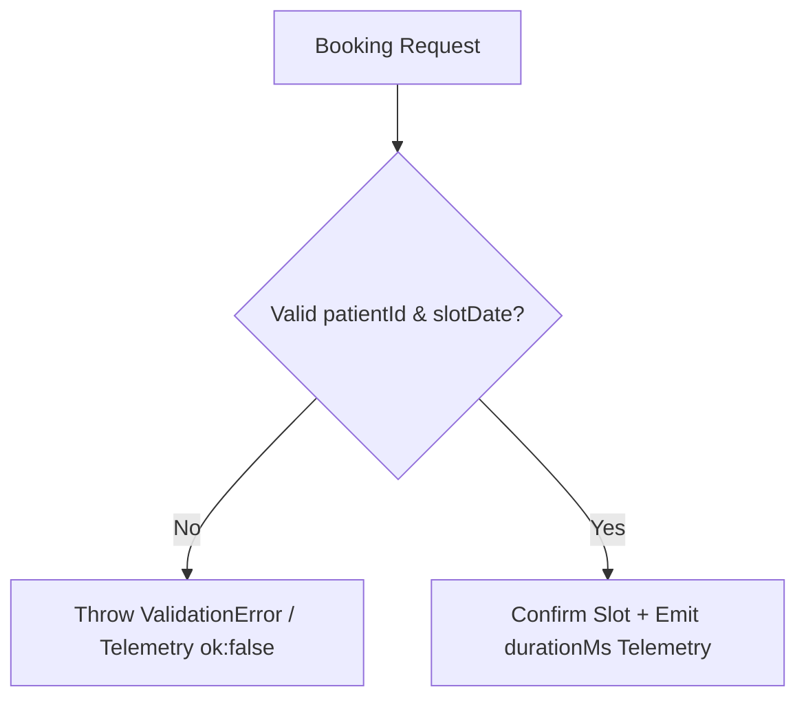

# Unit 14 Setup & Standards Guide: Diagramming, JSDoc Validation & Telemetry Logging

**Unit:** 14 — Program Analysis, SDLC & Software Design (`AZ CTE Std 10.0`)  
**Navigation:** [Chapter 14 Reading](./readme.md) · [Unit 14 Guide](./unit-guide.md) · [50-Question Exam](./quizzes/unit-test-50.md)

This guide establishes the design-before-code workstation standards for **Unit 14**: architecture diagrams, JSDoc/JSON Schema validation contracts, PII-safe structured telemetry logging, and automated testing for [`../0-student_files/14-program-design/`](../0-student_files/14-program-design/systemDesignLab.js).

---

## 1. Architecture & Diagramming Baseline (`Std 10.8`)

| Artifact Type | Recommended Format / Tool | Purpose in Unit 14 |
|---|---|---|
| **Control-Flow & Decision Trees** | Mermaid `flowchart TD` or `.drawio.svg` (VS Code Draw.io Extension) | Map validation, auth, and HTTP status branches before coding |
| **Entity-Relationship Diagrams (ERD)** | Mermaid `erDiagram` or editable `.drawio.svg` | Lock Primary Keys (`PK`), Foreign Keys (`FK`), and unique composite indexes |
| **User Story Specs** | Markdown (`As a... I want... So that...` + `Given/When/Then`) | Convert client needs directly into testable `node:test` specs |
| **Runtime & Telemetry Lab** | **Node.js v24 LTS** (zero external deps) | `performance.now()` timing and structured JSON stdout logging |

### Installing VS Code Diagramming Support (Recommended)
1. Install **Draw.io Integration** (`hediet.vscode-drawio`) so `.drawio.svg` files render cleanly inside Markdown while staying editable in VS Code.
2. Enable **Markdown Preview Mermaid Support** (`bierner.markdown-mermaid`) to preview ERDs and flowcharts side-by-side inside documentation:

```markdown

```

Save system diagrams inside your project's `docs/` folder (or project README) so teammates inspect boundaries directly inside Git PRs.

---

## 2. JSDoc Contracts & JSON Schema Validation Baseline (`Std 10.2, 10.7`)

Strong system specs define strict input/output shapes **before** implementation. Even in plain CommonJS `.js` files, TypeScript's language server (`VS Code` + optional `tsc`) checks **JSDoc** contracts natively:

```javascript
/**
 * @typedef {Object} BookingRequest
 * @property {string} patientId - Opaque clinic identifier (never log full name/SSN)
 * @property {string} clinicianId - Provider ID
 * @property {string} slotDate - ISO date YYYY-MM-DD
 */

/**
 * Validates incoming booking payload before database reservation.
 * @param {BookingRequest} req
 * @returns {boolean}
 */
```

For runtime boundary validation (API requests, config files), define an explicit **JSON Schema Draft-2020-12** contract (or explicit pure JS validator helper) verifying `required` fields, types, and ranges **before** business logic runs:

```json
{
  "$schema": "https://json-schema.org/draft/2020-12/schema",
  "title": "AppointmentRequest",
  "type": "object",
  "required": ["patientId", "slotDate"],
  "properties": {
    "patientId": { "type": "string", "minLength": 3 },
    "slotDate": { "type": "string", "pattern": "^\\d{4}-\\d{2}-\\d{2}$" }
  },
  "additionalProperties": false
}
```

> **Architecture Rule:** Never mix validation, business calculation, and persistence inside one monolithic handler. Separate pure validation (`validateAppointmentRequest`) cleanly from transaction orchestration (`bookAppointment`).

---

## 3. Structured JSON Logger & Compliance Hygiene (`Std 10.5, 10.10`)

Production telemetry must answer *what happened*, *how long it took*, and *whether it succeeded* **without** leaking HIPAA PHI (`patientName`, `diagnosis`), PCI card data (`PAN`, `CVV`), or GLBA account secrets into log aggregators.

Verify structured NDJSON logging directly in Node.js:

```bash
node -e "
const start = performance.now();
const entry = {
  timestamp: new Date().toISOString(),
  action: 'appointment.book',
  durationMs: Number((performance.now() - start).toFixed(3)),
  succeeded: true
};
console.log(JSON.stringify(entry));
"
```

Notice the strict field allowlist: `timestamp`, `action`, `durationMs`, and `succeeded`. Never pass raw `req.body` or error objects containing user payloads into `console.log`.

---

## 4. Instructor Demo Verification & Student TDD Workflow

Verify the Unit 14 reference implementation and `git bisect` debugging utilities first:

```bash
node -v                                         # Expect Node v24.x LTS (performance.now built-in)
node 14-Program-Analysis-and-Design/code/sdlcDesignDemo.js
```

Validate syntax and execute Unit 14 active `node:test` suites:

```bash
node --check 0-student_files/14-program-design/systemDesignLab.js
node --check 0-student_files/projects/unit-14-system-spec/index.js

# Run individual lab & blueprint test suites
node --test 0-student_files/14-program-design/systemDesignLab.test.js
node --test 0-student_files/projects/unit-14-system-spec/index.test.js

# Run automated Unit 14 grade check
npm run grade -- --unit 14
```

Review the full architecture prompt in [`projects/unit-project.md`](./projects/unit-project.md) before modifying [`unit-14-system-spec/index.js`](../0-student_files/projects/unit-14-system-spec/index.js).

---

## 5. Common Setup Error Triage Table

| Error Message / Symptom | Likely Cause | Exact Fix |
|---|---|---|
| Mermaid diagram shows raw text in VS Code Markdown Preview | Mermaid preview extension missing or fenced tag typo | Install `bierner.markdown-mermaid` and ensure opening fence reads ```` ```mermaid ```` |
| Telemetry logs show `undefined` or `NaN` for `durationMs` | Measured with integer `Date.now()` (`0ms`) or skipped `performance.now()` | Use `const start = performance.now();` and subtract `performance.now() - start` |
| Patient email or card field flagged during compliance review | Logged raw input object instead of allowlisted telemetry keys | Allowlist strictly `{ timestamp, action, durationMs, succeeded }` before logging |
| `validateAppointmentRequest` returns `false` instead of failing invalid input | Missing `throw new Error(...)` guard on invalid payload | Throw explicit descriptive `Error` when required fields are empty or malformed |
| `git bisect` session stuck on detached HEAD | Forgot to end bisect after finding bad commit | Run `git bisect reset` to return safely to your branch HEAD |
| `npm run grade -- --unit 14` reports `Cannot find module` | Missing `module.exports` or executed outside repo root | Verify `module.exports` exists untouched and run from repo root containing `package.json` |
