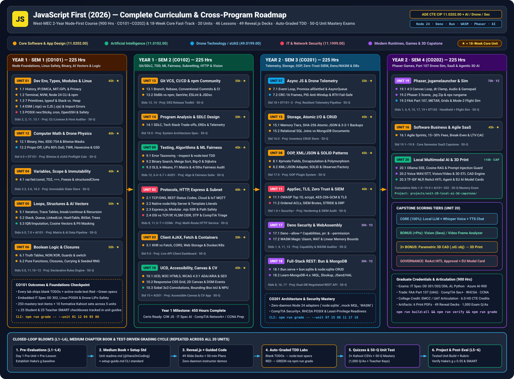

   

<h1 align="center">JavaScript First</h1>

  <strong>An open-source coding book and full-semester interactive CTE course</strong> teaching modern JavaScript from the ground up using the <strong>Node.js</strong> runtime environment—culminating in building full-stack, secure, database-backed web applications.

  

---

## How to Use This Repository

**JavaScript First** is engineered both as a **self-paced coding textbook** and a complete **18-week (90-day) Bloom's-Taxonomy classroom course** aligned **1:1+** to **Arizona CTE Software & App Design Technical Standards (`CIP 11.0202.00` — Standards `1.0`–`19.0`)**:

- **As a Student Book:** Read each unit/lesson `readme.md` in sequential order or compile a single solution-free PDF textbook (`npm run build:student`).
- **Pre/Post Learning Verification (Bloom's Taxonomy L1–L6):**
  - Every lesson and every unit opens with a baseline diagnostic (**`pre-lesson-eval.md`** / **`evaluations/pre-unit-eval.md`**) and closes with a paired summative check (**`post-lesson-eval.md`** / **`evaluations/post-unit-eval.md`**) to compute measurable learning growth (**Hake's $g$**, see [`0-documentation/blooms-taxonomy-framework.md`](./0-documentation/blooms-taxonomy-framework.md)).
  - Student worksheets (**`student-lesson.md`**) and blank lab starters ([`0-student_files/`](./0-student_files/)) NEVER spoil answers.
- **As an Instructor Course Package:**
  - Every unit provides a **`unit-guide.md`**, lesson **`lesson-plan.md`** files, **`evaluations/eval-answer-key.md`**, two **Kahoot-ready quizzes** (`quizzes/quiz-1-concepts.*` + `quiz-2-application.*` with validated `.csv` spreadsheets), and an L5–L6 **Unit Project** with grading rubric (`projects/project-rubric.md`).
  - Compile the entire instructor handbook in one command: `npm run build:teacher`.
- **Reveal.js Classroom Slides (`vscode-reveal`):** Configured out of the box via [`.vscode/extensions.json`](./.vscode/extensions.json), [`.vscode/settings.json`](./.vscode/settings.json), and [`.gitpod.yml`](./.gitpod.yml) for [evilz.vscode-reveal](https://marketplace.visualstudio.com/items?itemName=evilz.vscode-reveal). Export all **29 slide decks** to HTML/PDF with `npm run build:slides` (or `npm run build:all`).
- **Zero-Config Cloud Classroom:** Launch directly in [GitPod](https://gitpod.io/) from Windows, macOS, Linux, or Chromebook with Node.js, `vscode-reveal`, and Markdown tools preinstalled.

---

## Curriculum & Roadmap

The visual progression is outlined in [`JavaScriptRoadmap.drawio.svg`](./JavaScriptRoadmap.drawio.svg), and the full 90-day AZ CTE alignment lives in [`roadmap.md`](./roadmap.md).

  

---

## Table of Contents (18-Week Semester Order — Units 01–16)

### Front Matter & Program Documentation
- [18-Week Pacing Guide & AZ CTE Standards 1.0–19.0 Crosswalk](./roadmap.md)
- [Bloom's Taxonomy Curriculum & Pre/Post Evaluation Framework](./0-documentation/blooms-taxonomy-framework.md)
- [Repository Standards & File Blueprint](./STANDARDS.md)
- [Student Blank Exercise & Project Workspace](./0-student_files/)
- [Authoring Footer Reference](./0-documentation/section-footer.md)

### Quarter 1: Engineering Foundations, Math & Core JavaScript (Weeks 1–5)
1. **Unit 1: Developer Environment, Legal/Ethical IT & Data Types** (`Stds 2.0, 11.0, 3.0`) — [Unit Guide](./01-Reteaching-JavaScript/unit-guide.md) | [Evals](./01-Reteaching-JavaScript/evaluations/) | [Quizzes](./01-Reteaching-JavaScript/quizzes/) | [Project](./01-Reteaching-JavaScript/projects/unit-project.md)
   - [1.1 History of JS, Licensing & Ethics](./01-Reteaching-JavaScript/01-History-of-JS/readme.md) ([Slides](./01-Reteaching-JavaScript/01-History-of-JS/slides/slides.md) | [Student Lab](./01-Reteaching-JavaScript/01-History-of-JS/student-lesson.md) | [Plan](./01-Reteaching-JavaScript/01-History-of-JS/lesson-plan.md))
   - [1.2 Terminal Basics, NVM & Node Programs](./01-Reteaching-JavaScript/02-Terminal-NVM/01-node-overview.md) ([CLI Setup](./01-Reteaching-JavaScript/02-Terminal-NVM/00-terminal-basics-and-installing-nvm-node-js.md) | [Slides](./01-Reteaching-JavaScript/02-Terminal-NVM/slides/slides.md) | [Intro Deck](./01-Reteaching-JavaScript/readme.md) | [Student Lab](./01-Reteaching-JavaScript/02-Terminal-NVM/student-lesson.md) | [Plan](./01-Reteaching-JavaScript/02-Terminal-NVM/lesson-plan.md))
   - [1.3 Primitive Data Types, Strings & Memory](./01-Reteaching-JavaScript/03-logging-datatypes/readme.md) ([Slides](./01-Reteaching-JavaScript/03-logging-datatypes/slides/01-primitiveTypes.md) | [Student Lab](./01-Reteaching-JavaScript/03-logging-datatypes/student-lesson.md) | [Plan](./01-Reteaching-JavaScript/03-logging-datatypes/lesson-plan.md))
2. **Unit 12: Computer Mathematics, Binary & Bitwise Logic** (`Std 4.0`) — [Book](./12-Computer-Math-and-Binary/readme.md) | [Unit Guide](./12-Computer-Math-and-Binary/unit-guide.md) | [Slides](./12-Computer-Math-and-Binary/slides/slides.md) | [Student Lab](./12-Computer-Math-and-Binary/student-lesson.md) | [Plan](./12-Computer-Math-and-Binary/lesson-plan.md) | [Quizzes](./12-Computer-Math-and-Binary/quizzes/) | [Project](./12-Computer-Math-and-Binary/projects/unit-project.md)
3. **Unit 4: Variables, Scope, Hoisting & Immutability** (`Stds 3.3, 3.6, 18.2`) — [Book](./04-Variables-Scope-Immutability/readme.md) | [Unit Guide](./04-Variables-Scope-Immutability/unit-guide.md) | [Slides](./04-Variables-Scope-Immutability/slides/slides.md) | [Student Lab](./04-Variables-Scope-Immutability/student-lesson.md) | [Plan](./04-Variables-Scope-Immutability/lesson-plan.md) | [Quizzes](./04-Variables-Scope-Immutability/quizzes/) | [Project](./04-Variables-Scope-Immutability/projects/unit-project.md)
4. **Unit 5: Loops, Arrays, Matrices, Trees & Graphs** (`Stds 7.0, 6.0`) — [Book Hub](./05-DataStructures-and-Loops/readme.md) | [Unit Guide](./05-DataStructures-and-Loops/unit-guide.md) | [Quizzes](./05-DataStructures-and-Loops/quizzes/) | [Project](./05-DataStructures-and-Loops/projects/unit-project.md)
   - [5.1 Iterative Structures, Trace Tables & Recursion](./05-DataStructures-and-Loops/01-Iteration-and-Loops/readme.md) ([Slides](./05-DataStructures-and-Loops/01-Iteration-and-Loops/slides/slides.md) | [Student Lab](./05-DataStructures-and-Loops/01-Iteration-and-Loops/student-lesson.md) | [Plan](./05-DataStructures-and-Loops/01-Iteration-and-Loops/lesson-plan.md))
   - [5.2 Arrays, `Map`, 2D Matrices, Trees & Graphs](./05-DataStructures-and-Loops/02-Arrays-Objects-Matrices/readme.md) ([Slides](./05-DataStructures-and-Loops/02-Arrays-Objects-Matrices/slides/slides.md) | [Student Lab](./05-DataStructures-and-Loops/02-Arrays-Objects-Matrices/student-lesson.md) | [Plan](./05-DataStructures-and-Loops/02-Arrays-Objects-Matrices/lesson-plan.md))

### Quarter 2: Logic, Team Workflows, System Architecture & QA (Weeks 6–9)
5. **Unit 6: Conditionals, Boolean Logic & Functions** (`Stds 5.0, 11.10–11.12`) — [Book Hub](./06-Functions/readme.md) | [Unit Guide](./06-Functions/unit-guide.md) | [Quizzes](./06-Functions/quizzes/) | [Project](./06-Functions/projects/unit-project.md)
   - [6.1 Boolean Logic, Truth Tables & Flowcharts](./06-Functions/01-Conditionals-and-Boolean-Logic/readme.md) ([Slides](./06-Functions/01-Conditionals-and-Boolean-Logic/slides/slides.md) | [Student Lab](./06-Functions/01-Conditionals-and-Boolean-Logic/student-lesson.md) | [Plan](./06-Functions/01-Conditionals-and-Boolean-Logic/lesson-plan.md))
   - [6.2 Closures, Pure Functions, Currying & PRNG](./06-Functions/02-Functions-and-Closures/readme.md) ([Slides](./06-Functions/02-Functions-and-Closures/slides/slides.md) | [Student Lab](./06-Functions/02-Functions-and-Closures/student-lesson.md) | [Plan](./06-Functions/02-Functions-and-Closures/lesson-plan.md))
6. **Unit 13: Version Control & Community Ecosystem** (`Stds 14.0, 13.0`) — [Book Hub](./13-Version-Control-and-Community/readme.md) | [Unit Guide](./13-Version-Control-and-Community/unit-guide.md) | [Quizzes](./13-Version-Control-and-Community/quizzes/) | [Project](./13-Version-Control-and-Community/projects/unit-project.md)
   - [13.1 Version Control Systems, Git & CI/CD](./13-Version-Control-and-Community/01-Version-Control-Git-CICD/readme.md) ([Slides](./13-Version-Control-and-Community/01-Version-Control-Git-CICD/slides/slides.md) | [Student Lab](./13-Version-Control-and-Community/01-Version-Control-Git-CICD/student-lesson.md) | [Plan](./13-Version-Control-and-Community/01-Version-Control-Git-CICD/lesson-plan.md))
   - [13.2 Stdlib, `npm` Packages & Technical Docs](./13-Version-Control-and-Community/02-Community-Resources-NPM-Docs/readme.md) ([Slides](./13-Version-Control-and-Community/02-Community-Resources-NPM-Docs/slides/slides.md) | [Student Lab](./13-Version-Control-and-Community/02-Community-Resources-NPM-Docs/student-lesson.md) | [Plan](./13-Version-Control-and-Community/02-Community-Resources-NPM-Docs/lesson-plan.md))
7. **Unit 14: Program Analysis, SDLC & System Design** (`Std 10.0`) — [Book](./14-Program-Analysis-and-Design/readme.md) | [Unit Guide](./14-Program-Analysis-and-Design/unit-guide.md) | [Slides](./14-Program-Analysis-and-Design/slides/slides.md) | [Student Lab](./14-Program-Analysis-and-Design/student-lesson.md) | [Plan](./14-Program-Analysis-and-Design/lesson-plan.md) | [Quizzes](./14-Program-Analysis-and-Design/quizzes/) | [Project](./14-Program-Analysis-and-Design/projects/unit-project.md)
8. **Unit 9: Testing, Debugging & Searching/Sorting Algorithms** (`Stds 12.0, 6.4–6.7`) — [Book Hub](./09-Debugging-TDD-Algorithms/readme.md) | [Unit Guide](./09-Debugging-TDD-Algorithms/unit-guide.md) | [Quizzes](./09-Debugging-TDD-Algorithms/quizzes/) | [Project](./09-Debugging-TDD-Algorithms/projects/unit-project.md)
   - [9.1 Error Taxonomy, VS Code Debugger & TDD](./09-Debugging-TDD-Algorithms/01-Testing-and-Debugging/readme.md) ([Slides](./09-Debugging-TDD-Algorithms/01-Testing-and-Debugging/slides/slides.md) | [Student Lab](./09-Debugging-TDD-Algorithms/01-Testing-and-Debugging/student-lesson.md) | [Plan](./09-Debugging-TDD-Algorithms/01-Testing-and-Debugging/lesson-plan.md))
   - [9.2 Binary Search & Sorting Big-O Comparison](./09-Debugging-TDD-Algorithms/02-Search-and-Sort-Algorithms/readme.md) ([Slides](./09-Debugging-TDD-Algorithms/02-Search-and-Sort-Algorithms/slides/slides.md) | [Student Lab](./09-Debugging-TDD-Algorithms/02-Search-and-Sort-Algorithms/student-lesson.md) | [Plan](./09-Debugging-TDD-Algorithms/02-Search-and-Sort-Algorithms/lesson-plan.md))

### Quarter 3: Web Protocols, Client APIs, Concurrency & Storage (Weeks 10–13)
9. **Unit 2: Internet Protocols, Cloud Models & Node HTTP Servers** (`Stds 8.0, 11.3–11.7`) — [Book Hub](./02-HTTP/readme.md) | [Unit Guide](./02-HTTP/unit-guide.md) | [Quizzes](./02-HTTP/quizzes/) | [Project](./02-HTTP/projects/unit-project.md)
   - [2.1 Internet Protocols, Cloud & IoT](./02-HTTP/01-Internet-Protocols-and-Cloud/readme.md) ([Slides](./02-HTTP/01-Internet-Protocols-and-Cloud/slides/slides.md) | [Student Lab](./02-HTTP/01-Internet-Protocols-and-Cloud/student-lesson.md) | [Plan](./02-HTTP/01-Internet-Protocols-and-Cloud/lesson-plan.md))
   - [2.2 Node.js HTTP Server & HTML Templates](./02-HTTP/02-Node-HTTP-Server/readme.md) ([Slides](./02-HTTP/03-http.md) | [Student Lab](./02-HTTP/02-Node-HTTP-Server/student-lesson.md) | [Plan](./02-HTTP/02-Node-HTTP-Server/lesson-plan.md))
10. **Unit 3: Client-Side Web, AJAX, Fetch & Containers** (`Std 9.0`) — [Book](./03-AJAX/readme.md) | [Unit Guide](./03-AJAX/unit-guide.md) | [Slides](./03-AJAX/slides/slides.md) | [Student Lab](./03-AJAX/student-lesson.md) | [Plan](./03-AJAX/lesson-plan.md) | [Quizzes](./03-AJAX/quizzes/) | [Project](./03-AJAX/projects/unit-project.md)
11. **Unit 7: Asynchronous JavaScript, Event Loop & Error Handling** (`Std 18.0`) — [Book](./07-Async-JS/readme.md) | [Unit Guide](./07-Async-JS/unit-guide.md) | [Slides](./07-Async-JS/slides/slides.md) | [Student Lab](./07-Async-JS/student-lesson.md) | [Plan](./07-Async-JS/lesson-plan.md) | [Quizzes](./07-Async-JS/quizzes/) | [Project](./07-Async-JS/projects/unit-project.md)
12. **Unit 15: Storage Architecture, File I/O & Databases (SQL / MongoDB CRUD)** (`Std 16.0`) — [Book Hub](./15-Storage-Databases-and-CRUD/readme.md) | [Unit Guide](./15-Storage-Databases-and-CRUD/unit-guide.md) | [Quizzes](./15-Storage-Databases-and-CRUD/quizzes/) | [Project](./15-Storage-Databases-and-CRUD/projects/unit-project.md)
    - [15.1 Storage Hardware, Atomic File I/O & Backups](./15-Storage-Databases-and-CRUD/01-Storage-Architecture-File-IO/readme.md) ([Slides](./15-Storage-Databases-and-CRUD/01-Storage-Architecture-File-IO/slides/slides.md) | [Student Lab](./15-Storage-Databases-and-CRUD/01-Storage-Architecture-File-IO/student-lesson.md) | [Plan](./15-Storage-Databases-and-CRUD/01-Storage-Architecture-File-IO/lesson-plan.md))
    - [15.2 Relational SQL vs. MongoDB & CRUD Operations](./15-Storage-Databases-and-CRUD/02-Databases-SQL-Mongo-CRUD/readme.md) ([Slides](./15-Storage-Databases-and-CRUD/02-Databases-SQL-Mongo-CRUD/slides/slides.md) | [Student Lab](./15-Storage-Databases-and-CRUD/02-Databases-SQL-Mongo-CRUD/student-lesson.md) | [Plan](./15-Storage-Databases-and-CRUD/02-Databases-SQL-Mongo-CRUD/lesson-plan.md))

### Quarter 4: Accessible UI, OOP Architecture, Security & Capstone (Weeks 14–18)
13. **Unit 10: UCD, Accessibility, Responsive CSS, 2D Canvas & DOM** (`Std 15.0`) — [Book Hub](./10-HTML-CSS-DOM/readme.md) | [Unit Guide](./10-HTML-CSS-DOM/unit-guide.md) | [Quizzes](./10-HTML-CSS-DOM/quizzes/) | [Project](./10-HTML-CSS-DOM/projects/unit-project.md)
    - [10.1 UCD, Wireframes, W3C HTML5, ADA/ARIA & SEO](./10-HTML-CSS-DOM/01-UCD-W3C-Accessibility-SEO/readme.md) ([Slides](./10-HTML-CSS-DOM/01-UCD-W3C-Accessibility-SEO/slides/slides.md) | [Student Lab](./10-HTML-CSS-DOM/01-UCD-W3C-Accessibility-SEO/student-lesson.md) | [Plan](./10-HTML-CSS-DOM/01-UCD-W3C-Accessibility-SEO/lesson-plan.md))
    - [10.2 Responsive CSS Grid, 2D Canvas & DOM Events](./10-HTML-CSS-DOM/02-Responsive-CSS-Canvas-DOM/readme.md) ([Slides](./10-HTML-CSS-DOM/02-Responsive-CSS-Canvas-DOM/slides/slides.md) | [Student Lab](./10-HTML-CSS-DOM/02-Responsive-CSS-Canvas-DOM/student-lesson.md) | [Plan](./10-HTML-CSS-DOM/02-Responsive-CSS-Canvas-DOM/lesson-plan.md))
14. **Unit 8: Object-Oriented JavaScript, XML/JSON & SOLID Patterns** (`Std 17.0`) — [Book Hub](./08-OOP-and-Design-Patterns/readme.md) | [Unit Guide](./08-OOP-and-Design-Patterns/unit-guide.md) | [Quizzes](./08-OOP-and-Design-Patterns/quizzes/) | [Project](./08-OOP-and-Design-Patterns/projects/unit-project.md)
    - [8.1 Classes, `#private` Encapsulation & Polymorphism](./08-OOP-and-Design-Patterns/01-OOP-Classes-and-Polymorphism/readme.md) ([Slides](./08-OOP-and-Design-Patterns/01-OOP-Classes-and-Polymorphism/slides/slides.md) | [Student Lab](./08-OOP-and-Design-Patterns/01-OOP-Classes-and-Polymorphism/student-lesson.md) | [Plan](./08-OOP-and-Design-Patterns/01-OOP-Classes-and-Polymorphism/lesson-plan.md))
    - [8.2 XML vs. JSON, SOLID Principles & Patterns](./08-OOP-and-Design-Patterns/02-DataFormats-SOLID-Patterns/readme.md) ([Slides](./08-OOP-and-Design-Patterns/02-DataFormats-SOLID-Patterns/slides/slides.md) | [Student Lab](./08-OOP-and-Design-Patterns/02-DataFormats-SOLID-Patterns/student-lesson.md) | [Plan](./08-OOP-and-Design-Patterns/02-DataFormats-SOLID-Patterns/lesson-plan.md))
15. **Unit 11: Web Security, OWASP Defense & Cryptography** (`Std 1.0`) — [Book](./11-Internet-Server-Security/readme.md) | [Unit Guide](./11-Internet-Server-Security/unit-guide.md) | [Slides](./11-Internet-Server-Security/slides/slides.md) | [Student Lab](./11-Internet-Server-Security/student-lesson.md) | [Plan](./11-Internet-Server-Security/lesson-plan.md) | [Quizzes](./11-Internet-Server-Security/quizzes/) | [Project](./11-Internet-Server-Security/projects/unit-project.md)
16. **Unit 16: Software Business, Agile Delivery & Semester Capstone** (`Std 19.0 + 1.0–19.0`) — [Book](./16-Software-Business-and-Capstone/readme.md) | [Unit Guide](./16-Software-Business-and-Capstone/unit-guide.md) | [Slides](./16-Software-Business-and-Capstone/slides/slides.md) | [Student Lab](./16-Software-Business-and-Capstone/student-lesson.md) | [Plan](./16-Software-Business-and-Capstone/lesson-plan.md) | [Quizzes](./16-Software-Business-and-Capstone/quizzes/) | [Capstone](./16-Software-Business-and-Capstone/projects/unit-project.md)

### Legacy Draft Notes
Original scratch notes and earlier Medium article drafts are preserved in [`00-Drafts/`](./00-Drafts/readme.md) for reference.

---

## Community & Support

This book is an open-source, living educational resource (originally developed from classroom instruction and notes in [OSS Books](https://github.com/HansUXdev/OSS-Books)). You can read it online for free.

  
  
  
  

If you'd like to support the author:
- Star the repository on GitHub
- Follow and share articles on [Medium](https://medium.com/@HansOnConsult)
- Become a [GitHub Sponsor](https://github.com/users/HansUXdev/sponsorship) or [Patreon](https://www.patreon.com/hansOnDevelopment) supporter

## License

See [LICENSE](./LICENSE) for details.